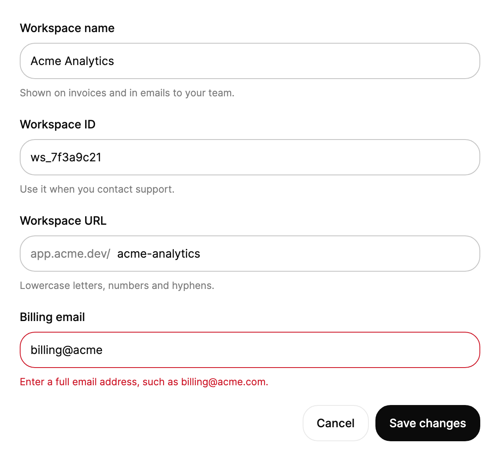

<Demo name="Basic" />

## When to use

`Input` is the default control for a short, free-form value that a person types. It carries the whole field (a
visible label, the frame, helper copy and an error row), so a form is a column of inputs with no extra layout around
them.

- **Identity and contact data** in sign-up, checkout and profile forms: a full name, a work email, a job title, a
  company name. These values have no fixed shape, so a plain text field with good validation is the right tool.
- **Short identifiers in admin and developer consoles**: a project slug, a webhook URL, an API key name, a DNS record
  value. Use `Prefix` and `Suffix` for the fixed part (`https://`, `.acme.dev`) so people type only what varies.
- **Values with live feedback**: a username with length and character rules, or a workspace URL whose availability is
  checked as it is typed. The helper row rewrites only the words that change and rolls the counts, so constant
  feedback stays calm instead of flickering.
- **Read-only values people need to copy**: a workspace ID or an account number shown in a settings form, next to the
  fields that can change, with `IsReadOnly` keeping the same frame and alignment.

## When not to use

- **Several lines of text**, such as a description, a note, a support message, a postal address typed as one block: use
  `Textarea`, which wraps and can be resized.
- **Secrets**: use `PasswordField` (masked, with a reveal toggle) or `PasswordStrength` when people choose a new
  password and need its rules.
- **Values with a fixed shape**: numbers that people step or scrub (`NumberField`, `ScrubInput`), amounts of money
  (`MoneyInput`), phone numbers (`PhoneInput`), short tokens such as tags or recipients (`TagInput`) and @mentions
  (`MentionInput`). These parse and format the value; `Input` only holds a string.
- **A value from a known list**: use `Select` or `Combobox`; for dates and times use `DatePicker` and `TimePicker`.
- **Search and filtering**: use `SearchField` (clear button, Escape to clear, `SearchSubmitted`) or `ExpandingSearch`
  in a header.
- **Renaming a title in place on a page**: use `InlineEdit`, which looks like text until it is edited.

## Usage

```xml
<UserControl xmlns="https://github.com/avaloniaui"
             xmlns:arc="https://github.com/AtomUICommunity/TKCode.Arc">
    <arc:Input Label="Email"
               Placeholder="you@example.com"
               Description="We never share it." />
</UserControl>
```

`Input` derives from Avalonia's `TextBox`, so everything a text box does is still there: a two-way `Text`, `MaxLength`,
`IsReadOnly`, `TextAlignment`, `CaretIndex`, `SelectAll()`, undo, IME composition and the clipboard shortcuts. The
field adds the label, the message rows and the Arc frame on top of it.

### Anatomy

1. **Label** (`Label`): 14 px, medium weight, 8 px above the frame. It is also the field's accessible name. Hide it
   with `IsLabelVisible="False"` only when another visible element already names the field.
2. **Frame**: a 1 px border with the control radius on the surface color. Hover and focus only darken the border;
   an error turns it to the danger color; nothing changes size.
3. **Prefix** (`Prefix`): optional content before the text: a scheme, a currency symbol, an icon.
4. **Text and placeholder**: the editable text; `Placeholder` shows in a muted color while the text is empty.
5. **Suffix** (`Suffix`): optional content after the text: a unit or a small action.
6. **Description row** (`Description`): 12 px helper copy in a muted color under the frame.
7. **Error row** (`ErrorMessage`): 12 px copy in the danger color. While it has text, the field is invalid.

### Helper and error copy

Derive the copy from state and change the string. Only the words that change move, and numbers roll digit by
digit, so do not swap between separate messages.

<Demo name="HelperAndError" />

```xml
<arc:Input Label="Username"
           Text="{Binding UserName}"
           Description="{Binding UserNameHint}"
           ErrorMessage="{Binding UserNameError}" />
```

A non-empty `ErrorMessage` makes the field invalid. While it is empty, a validation error from the `Text`
binding shows instead.

The error that is actually on screen is `EffectiveErrorMessage`: `ErrorMessage` when it has text, otherwise the
message of the binding's validation error. `IsInvalid` is forced to `True` while either one exists; set it yourself
only to show the danger border without a message, for example on every field of a group that failed together.

### Binding to a view model

In an MVVM app the view model owns the value and its rules, and the input only shows them. With
CommunityToolkit.Mvvm, an `ObservableValidator` validates each property when it is set and reports the errors through
`INotifyDataErrorInfo`; Avalonia passes them to the `Text` binding, and the input shows the first one.

```csharp
public partial class ProfileViewModel : ObservableValidator
{
    [ObservableProperty]
    [NotifyDataErrorInfo]
    [Required(ErrorMessage = "Enter your full name.")]
    [StringLength(80, ErrorMessage = "Use 80 characters or fewer.")]
    private string _fullName = string.Empty;

    [ObservableProperty]
    [NotifyDataErrorInfo]
    [Required(ErrorMessage = "Enter a work email.")]
    [EmailAddress(ErrorMessage = "Enter an email address such as name@company.com.")]
    private string _email = string.Empty;

    [RelayCommand]
    private async Task SaveAsync()
    {
        ValidateAllProperties();
        if (HasErrors)
        {
            return;
        }
        await _profiles.SaveAsync(FullName, Email);
    }
}
```

```xml
<StackPanel Spacing="16">
    <arc:Input Label="Full name" Text="{Binding FullName}" />
    <arc:Input Label="Work email"
               Text="{Binding Email, UpdateSourceTrigger=LostFocus}"
               Placeholder="name@company.com" />
    <arc:Button Content="Save profile" Command="{Binding SaveCommand}" IsDefault="True" />
</StackPanel>
```

- `UpdateSourceTrigger=LostFocus` writes the email to the view model when the person leaves the field, so a format
  error appears after they finish typing, not at the first keystroke. Keep the default (`PropertyChanged`) for values
  whose helper copy reacts while typing, such as a character count.
- Use one source of validation. When the view model validates its DataAnnotations attributes and Avalonia's own
  DataAnnotations plugin checks them too, each rule runs twice; the Avalonia MVVM app template removes the plugin for
  this reason.
- Compiled bindings need `x:DataType` on the view (the examples here leave it out for brevity).

### Validation timing

Good forms check each rule at the moment the person can act on it. A rule that fires too early reads as blame; one
that fires too late wastes a submit.

| Rule | When to check | Where it shows |
|---|---|---|
| Length limits and allowed characters | While typing | `Description` counts down ("12 left"); `ErrorMessage` only once the limit is broken |
| Format (email, URL, slug) | When the field loses focus | `ErrorMessage` (binding validation with `LostFocus`) |
| Required | On submit, then while the value is still empty | `ErrorMessage`; move focus to the first invalid field |
| Availability or uniqueness (server) | After a pause in typing, or on blur | `Description` while checking ("Checking…"), then `ErrorMessage` if taken |
| Errors the server returns on save | After the request | `ErrorMessage` on the field the error is about; clear it when the value changes |

```csharp
// The server is the last word: show its message on the field it is about, and clear it once the value changes.
var result = await api.CreateWebhookAsync(endpoint.Text);
endpoint.ErrorMessage = result.IsSuccess ? null : result.Error;

endpoint.TextChanged += (_, _) => endpoint.ErrorMessage = null;
```

### Sizes

`Size` sets the frame height: `Small` is 36, `Medium` is 44 (the Arc look) and `Large` is 50.

<Demo name="Sizes" />

Keep one size per form. `Small` suits dense admin tables and toolbars, `Medium` is the default for forms and
settings, and `Large` fits a single prominent field such as the email on a sign-in page. Pickers, selects and the
special inputs take the same `Size` values, so a mixed form lines up when they all use the same one.

### Prefix and suffix

<Demo name="PrefixAndSuffix" />

Use `Prefix` and `Suffix` for text that is part of the value's context but not of the value: `https://` before a
domain, `$` before a price, `USD` or `GB` after a number, `.acme.dev` after a subdomain. Show them in the muted text
color so the typed text stays the strongest element. They are not part of `Text`, so the view model receives only
what the person typed. For a value that must be parsed as a number or an amount, use `NumberField` or `MoneyInput`
instead of a prefix on a plain input.

### States

A field can be disabled, read-only or invalid.

<Demo name="States" />

- **Read-only** keeps the value focusable, selectable and copyable, and assistive technology still reads it. Use it
  for values people need to see and copy but cannot change here, such as an ID.
- **Disabled** fades the field to 50% and removes it from the tab order. Use it only while a value cannot apply,
  and say why nearby, for example in the description of a switch that turns the feature on.
- **Invalid** shows the danger border and the error row. Keep the error until the value is fixed; do not clear it
  on focus.

### Field foundation

`Field` adds a label and message rows around a `FieldFrame`. Pickers and special inputs reuse both.

<Demo name="FieldFoundation" />

Use `Field` and `FieldFrame` when you build your own trigger or composite editor and want it to look and behave
like the other fields: the same label, frame states, message rows and size. `Field.MessageSwap` chooses how the rows
change: `Words` (the default) moves only the words that changed; `Whole` replaces the entire line.

### Example: workspace settings form

A settings form in a SaaS admin console. The labels are short nouns, the helper copy explains consequences
("Shown on invoices"), the workspace ID is read-only so it can be copied, and the URL field shows the fixed part of
the address as a prefix so the person types only the workspace's own part. The email field shows the kind of error
the form should produce: what is wrong and how to fix it.



```xml
<StackPanel Width="560" Spacing="20">
    <arc:Input Label="Workspace name"
               Text="Acme Analytics"
               Description="Shown on invoices and in emails to your team." />
    <arc:Input Label="Workspace ID"
               Text="ws_7f3a9c21"
               IsReadOnly="True"
               Description="Use it when you contact support." />
    <arc:Input Label="Workspace URL"
               Text="acme-analytics"
               Description="Lowercase letters, numbers and hyphens.">
        <arc:Input.Prefix>
            <TextBlock Text="app.acme.dev/"
                       Foreground="{arc:ArcDesignTokenResource TextMuted}"
                       VerticalAlignment="Center" />
        </arc:Input.Prefix>
    </arc:Input>
    <arc:Input Label="Billing email"
               Text="billing@acme"
               ErrorMessage="Enter a full email address, such as billing@acme.com." />
    <StackPanel Orientation="Horizontal" Spacing="8" HorizontalAlignment="Right">
        <arc:Button Content="Cancel" Variant="Secondary" />
        <arc:Button Content="Save changes" />
    </StackPanel>
</StackPanel>
```

### Content guidelines

- **Label**: a short noun phrase in sentence case, without a colon: "Work email", not "Please enter your work email:".
  The label stays visible while typing, so it carries the meaning; a placeholder does not.
- **Placeholder**: an example of the expected format ("name@company.com", "acme-analytics"), never the only
  instruction and never a repeat of the label. It disappears as soon as typing starts.
- **Description**: one sentence about a constraint or a consequence: "3 to 20 characters", "Shown on invoices".
  Write numbers as digits so counts roll smoothly.
- **Error**: say what is wrong and how to fix it, in the same terms as the description. Avoid blame and jargon.

| Instead of | Write |
|---|---|
| Invalid input. | Enter an email address such as name@company.com. |
| Error: field required | Enter your full name. |
| Username too short!! | Use at least 3 characters. |
| Regex mismatch | Use only lowercase letters, numbers and hyphens. |

### Best practices

**Do**

- Give every input a visible label, even in compact layouts; use `IsLabelVisible="False"` only when a visible
  heading or a column header already names it.
- Keep one long-lived string per message row and update it, so the motion explains what changed.
- Put the field the error is about in focus when a submit fails, and keep the entered value.
- Match the field width to the expected value: a postal code field should not span the page.

**Avoid**

- Placeholder text as the label, or instructions that disappear when typing starts.
- Errors that appear on the first keystroke for format rules; wait for blur or submit.
- Disabling the submit button until the form is valid; people cannot discover what is missing. Validate on submit
  instead and point to the first problem.
- Swapping between several different message strings on a timer; the row then never settles.

### Common questions

**My binding has a validation error, but the field shows another message.** `ErrorMessage` wins over the binding's
error. Clear `ErrorMessage` (set it to `null` or an empty string) and the validation message shows.

**How do I submit the form with Enter?** `Input` does not handle Enter itself. Set `IsDefault="True"` on the form's
primary `Button`; Enter in any field then presses it.

**How do I ask for the email keyboard or autofill hints?** Use Avalonia's attached
`TextInputOptions.ContentType`, for example `TextInputOptions.ContentType="Email"`. On-screen keyboards and input
methods use it.

**Why is there no right-click menu?** The Arc input has no context menu; cut, copy, paste, undo and select all work
from the keyboard.

**Does the word-by-word rewrite work for Chinese or Japanese copy?** The row splits text at spaces. Copy without
spaces changes as one piece, which still animates but rewrites the whole line.

## API reference

<!-- api: Input -->

## Accessibility

- `Label` names the field. With `IsLabelVisible="False"` the label is hidden but still names it.
- The description and the error are the field's help text, read after the name and the value.
- The error row is an assertive live region: a new error is announced at once, without moving focus.
- Animated words are hidden from assistive technology, which reads a plain copy instead.
- Caret, selection, IME, undo and clipboard shortcuts are the native `TextBox` behavior.
- Hover and focus change only the border color; the focused field is the one with the darker border and the caret.
  When focus is hard to see in a dense form, use `Large` or add space between the fields rather than removing the
  label.

### Keyboard

| Keys | Action |
|---|---|
| `Tab` / `Shift+Tab` | Move to the next or previous field; a read-only field is still a stop, a disabled one is not |
| `Left` / `Right`, `Home` / `End` | Move the caret by character or to the start or end |
| `Ctrl+Left` / `Ctrl+Right` (`Option` on macOS) | Move the caret by word |
| `Shift` + any of the above | Extend the selection |
| `Ctrl+A`, `Ctrl+C`, `Ctrl+X`, `Ctrl+V` (`Cmd` on macOS) | Select all, copy, cut, paste |
| `Ctrl+Z` / `Ctrl+Y` (`Cmd+Z` / `Cmd+Shift+Z` on macOS) | Undo, redo |
| `Enter` | Not handled by the input; presses the window's default button when there is one |

## Motion

- Helper and error rows open their height on a smooth spring. Changed words rise in and unblur, and numbers roll
  digit by digit.
- Reduced motion shows the rows at full height and swaps words with an instant fade. Off jumps to the end state.
- Hover and focus only darken the border; nothing changes size.

| Change | Full | Reduced | Off |
|---|---|---|---|
| A message row appears or goes | Height opens on a smooth spring and the text fades in | Shown at full height | Immediate |
| A message changes | Only the changed words rise in from below with a soft blur | Instant fade | Immediate |
| A number in the copy changes | Only the changed digits roll, up when it grows, down when it shrinks | Instant fade | Immediate |
| Hover, focus, invalid | The border color crossfades | The border color crossfades | Immediate |

## Related

- `Textarea` for several lines, `PasswordField` for secrets and `SearchField` for search.
- `Field` and `FieldFrame` give any editor or trigger the same label, frame and message rows.

| Component | Choose it when |
|---|---|
| `Textarea` | The text runs over several lines or people paste paragraphs |
| `PasswordField` / `PasswordStrength` | The value is a secret, or a new password with rules |
| `SearchField` / `ExpandingSearch` | The text filters or searches instead of being saved |
| `NumberField` / `MoneyInput` / `PhoneInput` | The value is a number, an amount or a phone number that needs parsing |
| `TagInput` / `MentionInput` | The value is a list of tokens or text with @mentions |
| `InlineEdit` | A title or a name is renamed where it is shown |
| `Field` + `FieldFrame` | You build your own editor or trigger and want it to match the other fields |
