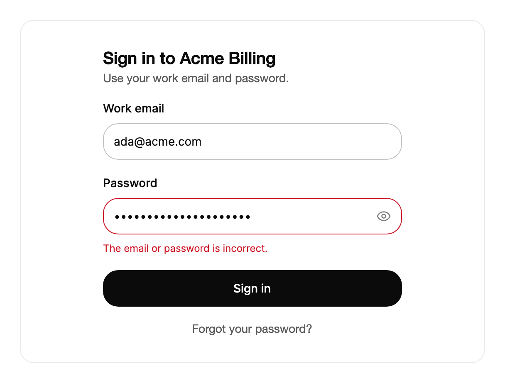

<Demo name="SignIn" />

## When to use

`PasswordField` holds a secret that already exists and that the person types or pastes: a password at sign-in, a
current password that confirms a sensitive change, or a secret an operator enters into an admin screen. It is an
`Input` with the value masked by default and a reveal toggle inside the frame, so the label, the helper row, the error
row and the sizes behave exactly as they do on every other field of the form.

- **Sign-in to a SaaS or billing portal**: an email field and a password field stacked in a card, with one "Sign in"
  button. The toggle lets the person check a long passphrase they typed on a phone keyboard before they submit.
- **Re-authentication for a sensitive change**: "Current password" on an Acme Billing screen that changes the payout
  account or the card on file. The field asks for the secret before the change is applied, and the toggle helps the person
  avoid a typo that would lock them out of the change.
- **Operator credentials in an admin console**: a database or SMTP password entered on a settings page. The value is
  masked on screen, but the operator can reveal it to confirm a paste went in correctly.
- **Confirming an existing secret in a multi-step flow**: a second field that repeats a password the person already
  chose, such as "Confirm password" when a settings page saves a change to it.
- **Secrets entered on a shared or recorded screen**: a masked default keeps the value off the display until the person
  reveals it, which matters for kiosks, demos and support sessions.

## When not to use

- **Choosing a new password with rules**: use `PasswordStrength`, which shows how strong the value is and which rules it
  meets. A plain `PasswordField` gives no feedback about the value's quality.
- **Text that is not secret**: use `Input`. A masked field for a username or an account number makes people type blind.
- **A secret that must be copied out**: a generated API key, a recovery code or a token that the person copies to another
  system. Use `Input` with `IsReadOnly` and a `CopyButton`, because a masked value cannot be read back for copying.
- **A search query**: use `SearchField`. It has a clear control and submits on Enter; a masked search field hides what the
  person is looking for.
- **A one-time code from an authenticator app**: use `Input`. Codes are short, shown as typed and often pasted, so the
  dots and the reveal toggle only slow the person down.

## Usage

The eye toggle inside the field shows or hides the text. Its name is read by assistive technology.

```xml
<UserControl xmlns="https://github.com/avaloniaui"
             xmlns:arc="https://github.com/AtomUICommunity/TKCode.Arc">
    <arc:PasswordField Label="Password"
                       Placeholder="Your password"
                       Description="Use the reveal toggle to check what you typed."
                       Width="360"
                       HorizontalAlignment="Left" />
</UserControl>
```

`PasswordField` derives from the same shared field base as `Input`, and that base derives from Avalonia's `TextBox`. The
text box provides the value, caret, selection, IME composition, undo and the clipboard shortcuts. The shared base provides
the label, the frame, the helper and error rows, the sizes and the invalid state. `PasswordField` adds the mask (a `•`
password character by default, from the text box's `PasswordChar`), the reveal toggle, and the eye glyph inside the toggle.
Read the `Input` page for the parts that both fields share, such as validation timing and the message rows.

### Anatomy

1. **Label** (`Label`): 14 px, medium weight, above the frame. It is also the field's accessible name. `IsLabelVisible`
   hides it visually while the name stays.
2. **Frame**: a 1 px border with the control radius on the surface color. Hover and focus only darken the border;
   an error turns it to the danger color.
3. **Prefix** (`Prefix`): optional content before the text. The reveal toggle takes the suffix position of the frame,
   so the inherited `Suffix` property does not show on a password field.
4. **Masked text**: the typed value shown with the `PasswordChar` (`•`). When `IsRevealed` is `True`, the same text shows
   as characters. `Placeholder` shows in the muted text color while the value is empty.
5. **Reveal toggle**: a 30 px round button in the Medium and Large sizes and 26 px in Small, with a 7 px inset from the
   top, bottom and trailing edge in Medium. It holds an 18 px eye glyph with a slash. The toggle has a hover fill in the
   muted surface color and a 2 px focus ring for keyboard focus.
6. **Description row** (`Description`): 12 px helper copy under the frame.
7. **Error row** (`ErrorMessage`): 12 px copy in the danger color. While it has text, the field is invalid.

The frame padding changes with the size: 12 px before the text and 6 px after the toggle in Medium, 10 and 4 px in Small,
and 14 and 9 px in Large. The text runs at the body size (14 px) in Medium and Small, and at the base type size in Large.

### Bind the value

`Text` is a two-way property, so bind it to a view model. Use `IsRevealed` to read or set the visible state.

```xml
<arc:PasswordField Label="Password"
                   Text="{Binding Password}"
                   ErrorMessage="{Binding PasswordError}" />
```

```csharp
signIn.PropertyChanged += (_, e) =>
{
    if (e.Property == PasswordField.IsRevealedProperty)
    {
        state.Text = signIn.IsRevealed ? "Shown" : "Hidden";
    }
};
```

`IsRevealed` is two-way too. Setting it from code reveals or masks the value, and the toggle follows. The field also keeps
the text box's own `RevealPassword` in step with `IsRevealed`, so code that reads `RevealPassword` sees the same state.

### Binding to a view model

A sign-in form keeps the password in a view model with the other fields, and submits through a command. Keep the
password out of logs, analytics events and any persisted state; the view model holds it only for the request.

```csharp
public partial class SignInViewModel : ObservableObject
{
    private readonly IAuthService _auth;

    public SignInViewModel(IAuthService auth)
    {
        _auth = auth;
    }

    [ObservableProperty]
    private string _email = string.Empty;

    [ObservableProperty]
    private string _password = string.Empty;

    [ObservableProperty]
    private string? _passwordError;

    [RelayCommand]
    private async Task SignInAsync()
    {
        PasswordError = null;
        if (string.IsNullOrEmpty(Password))
        {
            PasswordError = "Enter your password.";
            return;
        }

        var result = await _auth.SignInAsync(Email, Password);
        Password = string.Empty;
        if (!result.IsSuccess)
        {
            PasswordError = "The email or password is incorrect.";
        }
    }
}
```

```xml
<StackPanel Width="360" Spacing="16">
    <arc:Input Label="Work email" Text="{Binding Email}" />
    <arc:PasswordField Label="Password"
                       Text="{Binding Password}"
                       ErrorMessage="{Binding PasswordError}" />
    <arc:Button Content="Sign in" Command="{Binding SignInCommand}" IsDefault="True" />
</StackPanel>
```

- `Text` and `IsRevealed` are two-way. `ErrorMessage` is one-way: the view model owns the message and clears it when the
  person edits the field, or when the next submit starts.
- `IsDefault="True"` on the sign-in button lets Enter in either field submit the form. The field does not handle Enter
  itself.
- The view model clears `Password` after the request, whether or not it succeeded, so the secret is not kept in memory
  longer than the request needs.

### Validation

Sign-in validates for presence and for the outcome of the request, not for the shape of the password. A password that
was valid when it was created can be shorter than today's rules, and a format rule at sign-in would lock out people who
have an older password.

| Rule | When to check | Where it shows |
|---|---|---|
| Required | On submit | `ErrorMessage`: "Enter your password." Move focus into the field |
| Wrong email or password | After the server rejects the request | `ErrorMessage` with one generic sentence for both cases |
| Account locked or rate limited | After the server answers | `ErrorMessage` with the next step ("Try again in 15 minutes.") |
| Length or character rules | Only on sign-up or a password change (use `PasswordStrength`) | Not on sign-in |
| Match with a confirmation field | When the confirmation field loses focus, or on submit | `ErrorMessage` on the confirmation field |

Clear `ErrorMessage` when the person edits the field, so the message does not outlive the value it describes. Do not
say which of the two (email or password) was wrong: a generic message avoids telling an attacker which accounts exist.

### Confirmation

Set `ErrorMessage` from the second field while the two values differ. Clear it by setting it to `null`.

<Demo name="Confirm" />

The demo checks the match on every keystroke, so the error appears while the person is still typing the second value. In
an application, check the match when the confirmation field loses focus or when the form is submitted, and clear the
message as soon as the two values are equal. The message then appears once the person has finished a value, not
character by character.

### Toggle names

The toggle names come from `ShowPasswordText` and `HidePasswordText`. Set them to translate the copy.

```xml
<arc:PasswordField Label="Mot de passe"
                   ShowPasswordText="Afficher"
                   HidePasswordText="Masquer" />
```

The toggle reports its name as "Show password" or "Hide password" by default, and changes it with `IsRevealed`. Translate
both names together with the label, so a screen reader user hears one language throughout the form.

### Sizes and states

`Size` sets the frame height: `Small` is 36 and `Medium` (the default) is 44. `Large` (50) suits a single prominent field.

<Demo name="SizesAndStates" />

Use one size per form, as with `Input`. `Small` suits a dense admin screen, where the toggle also gets smaller (26 px) to
keep the row in proportion. Disabled and invalid states work as they do on `Input`: a disabled field fades and leaves the
tab order, and an invalid field shows the danger border with its error row.

### Example: sign-in card

A sign-in card for a billing portal. The card names the product, the email field is a plain `Input`, and the password
field shows the error that a failed sign-in produces: one generic sentence that does not say which part was wrong. The
value is masked, which is the default state, so the picture shows what a person sees before they reveal anything. The
button is the form's default, so Enter in the password field submits the form.



```xml
<Border Width="560"
        Padding="32"
        CornerRadius="16"
        BorderThickness="1"
        BorderBrush="{arc:ArcDesignTokenResource Border}"
        Background="{arc:ArcDesignTokenResource Surface}">
    <StackPanel Width="360"
                Spacing="18"
                HorizontalAlignment="Center">
        <StackPanel Spacing="4">
            <TextBlock Text="Sign in to Acme Billing"
                       FontSize="20"
                       FontWeight="SemiBold"
                       Foreground="{arc:ArcDesignTokenResource Foreground}" />
            <TextBlock Text="Use your work email and password."
                       FontSize="14"
                       TextWrapping="Wrap"
                       Foreground="{arc:ArcDesignTokenResource TextSecondary}" />
        </StackPanel>
        <arc:Input Label="Work email"
                   Text="ada@acme.com" />
        <arc:PasswordField Label="Password"
                           Text="correct-horse-battery"
                           ErrorMessage="The email or password is incorrect." />
        <arc:Button Content="Sign in"
                    IsDefault="True"
                    HorizontalAlignment="Stretch" />
        <TextBlock Text="Forgot your password?"
                   FontSize="14"
                   HorizontalAlignment="Center"
                   Foreground="{arc:ArcDesignTokenResource TextSecondary}" />
    </StackPanel>
</Border>
```

### Content guidelines

- **Label**: the noun for the secret, in sentence case: "Password", "Current password", "Confirm password". Do not write
  "Enter your password" as the label; that is an instruction for the placeholder or the error.
- **Placeholder**: optional. Use it for a short format hint only when the field has one ("At least 12 characters" belongs
  on `PasswordStrength`, not here). Do not repeat the label.
- **Description**: one sentence that explains a consequence or helps the person check the value ("Use the reveal toggle to
  check what you typed.").
- **Error**: one sentence, in the same terms as the label. For sign-in, one generic sentence covers a wrong email or a wrong
  password.
- **Toggle names**: the default "Show password" and "Hide password" are clear. Translate them with the rest of the form.

| Instead of | Write |
|---|---|
| Enter your password please!!! | Enter your password. |
| Invalid credentials | The email or password is incorrect. |
| Password wrong | The email or password is incorrect. |
| Re-enter password | Confirm password |
| Your password must not be weak | Use at least 12 characters, with a number and a symbol. |

### Best practices

**Do**

- Keep the value masked by default, and let the person reveal it with the toggle. A masked default protects the value on
  shared screens and in screen recordings.
- Use `PasswordStrength` for any screen that sets a new password, and `PasswordField` for any screen that uses an
  existing one, so the rules appear only where a person is choosing a value.
- Show one generic message for a failed sign-in, so the form does not reveal which accounts exist.
- Clear the password from the view model after the request, and keep it out of logs and analytics.
- Keep the label, the description and the error copy in the same language, and set `ShowPasswordText` and
  `HidePasswordText` to match.

**Avoid**

- Using `PasswordField` for a value that must be copied out, such as a generated key. A masked value cannot be read back
  reliably for copying; use `Input` with `IsReadOnly` instead.
- Validating the length or the character classes of a password at sign-in. Older passwords can break newer rules, and the
  person is locked out for a rule that did not apply when they set the password.
- Turning off the mask as a default because a person found the dots hard to read. Offer the toggle, and leave the default
  alone.
- Using a placeholder that looks like a value, such as "••••••••". A person can mistake it for a saved password.
- Placing the field in a dense toolbar or header. A password is a form value; search or filter fields belong there.

### Common questions

**How do I change the mask character?** `PasswordChar` (inherited from the text box) sets the character. It defaults to
`•`. Change it only when the platform or the brand needs a different symbol; the eye toggle works the same either way.

**How do I know whether the value is revealed?** Read `IsRevealed`, or listen for `PasswordField.IsRevealedProperty`
changes, as the demo does. Setting `IsRevealed` from code reveals or hides the value and moves the toggle.

**Can I translate the toggle names without changing the label?** Yes. Set `ShowPasswordText` and `HidePasswordText` on
each field. The label and the messages are separate properties, so translating them is independent.

**Where do the length rules for a new password belong?** On the screen that sets the password, with `PasswordStrength`,
which shows how strong the value is while the person types. Keep `PasswordField` for the screens that use a password that
already exists.

## API reference

<!-- api: PasswordField -->

## Accessibility

- `Label` names the field. `Description` and `ErrorMessage` are merged into its help text, so a screen reader reads the name,
  the value and then the help.
- The reveal toggle is a toggle button with a pressed state. Its name changes between "Show password" and
  "Hide password", and it reports the pressed state through `IsOn`.
- The password is masked by default. Caret, selection, IME, undo and clipboard shortcuts are the native `TextBox`
  behavior.
- The error row is announced as the field's error, and the field is marked invalid while it shows.
- The toggle keeps its full contrast while the value is revealed.

### Keyboard

| Keys | Action |
|---|---|
| `Tab` / `Shift+Tab` | Move between the field, its reveal toggle and the next control |
| `Enter` or `Space` on the toggle | Shows the password, or hides it when it is already shown |
| `Left` / `Right`, `Home` / `End` | Move the caret by character or to the start or end |
| `Shift` + any of the above | Extend the selection |
| `Ctrl+A`, `Ctrl+C`, `Ctrl+X`, `Ctrl+V` (`Cmd` on macOS) | Select all, copy, cut, paste |
| `Ctrl+Z` / `Ctrl+Y` (`Cmd+Z` / `Cmd+Shift+Z` on macOS) | Undo, redo |
| `Enter` in the field | Not handled by the field; a default button in the window receives it, as with `Input` |

## Motion

- The eye's slash draws itself across the icon when the state changes. The eye is never swapped for a second icon.
- Each switch between dots and characters resolves in place: the text starts at 35% opacity with a light blur and settles
  to full opacity and sharp focus.
- The toggle scales down slightly while it is pressed. The helper and error rows behave like those of `Input`.
- Reduced motion draws the slash at once and removes the blur and the press scale. Off does the same.

| Change | Full | Reduced | Off |
|---|---|---|---|
| Reveal or mask | The slash draws across the eye on a standard tween; the outline under it is cut and returns as the slash leaves | The slash is drawn or removed at once | Immediate |
| Dots and characters switch | The text resolves from 35% opacity and a 2 px blur to sharp | No resolve effect | No resolve effect |
| Toggle pressed | Scales to 96% while held | No scale | No scale |
| Helper and error row | As `Input`: the row opens on a smooth spring, and changed words rise in | As `Input` | As `Input` |

## Related

- `PasswordStrength` for choosing a new password and showing its strength.
- `Input` for text that is not secret.
- `SearchField` for a query with a clear control.

| Component | Choose it when |
|---|---|
| `PasswordStrength` | The person sets a new password and needs to see its strength and rules |
| `Input` | The value is not secret, or a secret must be read back and copied |
| `SearchField` | The text is a query that filters content on the page |
| `CopyButton` | A generated value is shown read-only and the person copies it |
| `Textarea` | The value is a long text, not a short secret |
