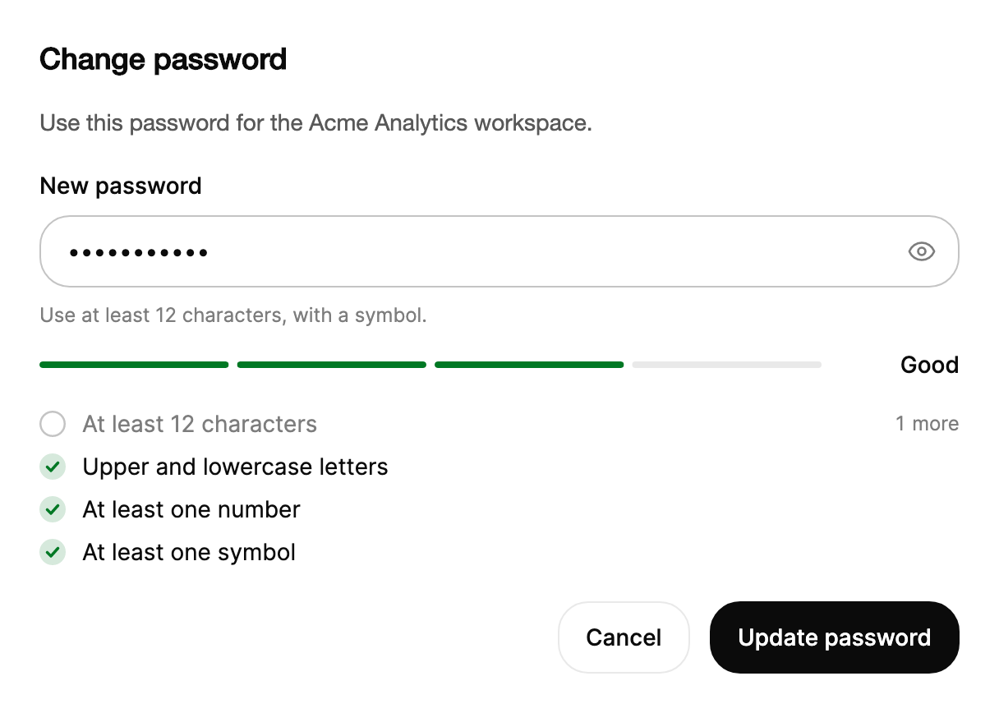

<Demo name="Create" />

## When to use

`PasswordStrength` is the field for choosing a new password: the sign-up step of a SaaS product, the change password
page in account settings, or the reset form that opens from an emailed link. It is a masked password field with a
four-step meter, a strength word and a checklist of requirements, so the person sees what is still missing while they
type, not after the first failed submit.

- **Sign-up for a workspace or a customer portal**: a new owner chooses the password for the account that holds
  billing and invoices. The meter and the checklist explain the policy before the first submit, which reduces the
  number of rejected forms.
- **Changing a password in account settings**: the person already knows the current password, so the new value is the
  only place where the rules matter. Keep the current password in a plain `PasswordField` and show the rules here.
- **Password reset from an emailed link**: the person arrives without context, so the requirements are the only
  guidance on the page. Use the same rule list as the sign-up form so the policy reads the same everywhere.
- **Administrators setting a temporary password**: an admin console that creates a teammate's account can show whether
  the temporary password meets the policy before it is saved to the directory.
- **Internal tools with a stricter policy**: a fintech back office that requires 16 characters passes its own `Rules`
  and `ShortLength`, so the checklist matches the rule the server enforces.

## When not to use

- **Signing in to an existing account**: use `PasswordField`. The person already has the password, so a meter and a
  checklist only add noise, and they reveal the policy to someone guessing.
- **A measured quantity that is not a password**, such as the progress of an export or a backup: use `Progress`.
- **Text that is not secret**, such as a workspace name or a key label: use `Input`. A strength meter has no meaning for
  a value that is not a password.
- **A secret the system generates**, such as an API token shown once: show it in a read-only `Input` with a copy
  action. The person never chooses that value, so there is nothing to score.
- **A policy that needs a breach or dictionary check**: the built-in estimator only counts rules and runs on the device.
  Plug in an `IPasswordStrengthScorer` through `Scorer` for a local check, or run the check on the server and show its
  result with `ErrorMessage`.

## Usage

The meter, the strength word and the rule list update on every key press. Scoring runs on the device with the
default rules: a minimum length of 12 characters, upper and lower case, a number and a symbol.

```xml
<UserControl xmlns="https://github.com/avaloniaui"
             xmlns:arc="https://github.com/AIDotNet/TKCode.Arc">
    <arc:PasswordStrength Label="New password"
                          Placeholder="Choose a password"
                          Width="400"
                          HorizontalAlignment="Left" />
</UserControl>
```

`PasswordStrength` derives from `PasswordField`, which derives from the shared Arc field base over Avalonia's
`TextBox`. It inherits the masked text, the reveal toggle (`IsRevealed`), `Label`, `Description`, `ErrorMessage`,
`Size` and the Arc frame from the text fields, and adds the meter, the strength word and the requirement list under the
field. The caret, selection, undo, IME composition and clipboard shortcuts are the native `TextBox` behavior.

### Anatomy

1. **Label** (`Label`): 14 px, medium weight, 8 px above the frame, the same as `Input`. It is the field's accessible
   name. Hide it with `IsLabelVisible="False"` only when a visible heading already names the field.
2. **Frame**: the Arc frame with 16 px of padding on the left and 5 px on the right. The prefix, the
   text and the suffix are spaced 4 px apart.
3. **Text and placeholder**: the masked password. `Placeholder` shows in the muted text color while the field is empty.
4. **Reveal toggle**: a 34 px square button with a 13 px corner radius at the end of the frame and an 18 px eye glyph.
   It scales to 94% while pressed and reports its on state while the password is shown.
5. **Description and error rows** (`Description`, `ErrorMessage`): the shared helper and error rows from `Input`, 12 px
   copy under the frame. The error row swaps its whole message at once.
6. **Meter row**: 12 px below the field or its error row. Four equal segments, 4 px tall, with 5 px gaps, on a track in
   the border color.
7. **Strength word**: At the end of the meter row, a slot at least 72 px wide that grows for localized labels,
   12 px from the meter, right aligned, in the medium weight of the small body size. It is empty while the field is empty.
8. **Requirement list** (`Rules`): 16 px below the meter, 6 px between rules. Each row has a 16 px circle that gains a
   faint success tint and a tick when the rule is met, then the rule label. An unmet rule with a `Remaining` function
   also shows a rolling count such as "4 more" in the muted color.

### Strength levels

The level is the share of rules the password meets, spread over four steps. Below `ShortLength` characters the level
is held at 1, whatever the rules say, so a short password never looks strong.

| Level | Strength word | Meter | Tone |
|---|---|---|---|
| 0 | None (empty field) | No segments; the status reads "No password yet" | Track and empty segments |
| 1 | `Weak`, or `Too short` below `ShortLength` | 1 segment | Danger |
| 2 | `Fair` | 2 segments | Warning |
| 3 | `Good` | 3 segments | Success |
| 4 | `Strong` | 4 segments | Success |

With the four default rules, meeting one rule gives level 1, two rules give level 2, three give level 3 and all four
give level 4. A custom list with five rules maps 1 to 1, 2 to 2, 3 to 2, 4 to 3 and 5 to 4, because the share is
rounded to the nearest step. `Good` and `Strong` share the success tone, so the meter moves from red to amber to green
and does not split the top two steps by color.

Set `ShortLength` to the minimum length of your policy when that minimum is above the default of 8. A password between
8 and the policy minimum then reads `Weak` with a length rule still unmet, which is less clear than `Too short`.

### Bind the value

`Text` is a two-way property. Bind it to a view model string and bind the error from the same view model to
`ErrorMessage`. The view model clears the error when the person changes the password, so an old server message does not
stay on screen.

```csharp
public partial class PasswordChangeViewModel : ObservableObject
{
    // Returns null when the change is saved, otherwise the message to show on the field.
    private readonly Func<string, Task<string?>> _changePassword;

    public PasswordChangeViewModel(Func<string, Task<string?>> changePassword)
    {
        _changePassword = changePassword;
    }

    [ObservableProperty]
    private string _newPassword = string.Empty;

    [ObservableProperty]
    private string? _newPasswordError;

    partial void OnNewPasswordChanged(string value) => NewPasswordError = null;

    [RelayCommand]
    private async Task SetPasswordAsync()
    {
        NewPasswordError = await _changePassword(NewPassword);
    }
}
```

```xml
<StackPanel Spacing="16">
    <arc:PasswordStrength Label="New password"
                          Text="{Binding NewPassword, Mode=TwoWay}"
                          ErrorMessage="{Binding NewPasswordError}"
                          Width="400"
                          HorizontalAlignment="Left" />
    <arc:Button Content="Update password"
                Command="{Binding SetPasswordCommand}"
                IsDefault="True"
                HorizontalAlignment="Left" />
</StackPanel>
```

`Text` is two-way by default. `IsRevealed` is two-way only when the binding says so (`Mode=TwoWay`), which lets the view
model remember whether the person chose to show the password. The read-only values `Level`, `StrengthLabel` and `Score`
are one-way: read them in code, not in bindings that write back. `StrengthChanged` is the only event; the control has
no command.

### React to the strength

`StrengthChanged` is raised after a scored change. `Level` runs from 0 (empty) to 4 (strong), `Label` is the strength
word, and `Score.MetRuleIds` lists the rules that are met. The event fires only when the level, the short state or the
set of met rules changes. Typing another lowercase letter into a password that already meets the case rule raises
nothing, so read `Score` or `Level` in your own handler if you need every key press.

```csharp
create.StrengthChanged += (_, e) =>
{
    result.Text = e.Level == 0
        ? "Strength: none yet"
        : $"Strength: {e.Label} (level {e.Level}, {e.Score.MetRuleIds.Count} rules met)";
};
```

### Custom rules

Pass a rule list to `Rules`. Each `PasswordRule` has an id that is reported in `Score.MetRuleIds`, a label for the
checklist, a test and an optional `Remaining` function. The row order is the list order. Assigning `Rules` rebuilds
the checklist and scores the password again, so assign it once when the page loads rather than on each key press.

`PasswordRules.Create` builds the built-in rules with your own minimum length, labels and character count. Use it when
the policy changes only the numbers, and write a `PasswordRule` yourself when a rule is different in kind.

<Demo name="CustomRules" />

```csharp
var rules = new List<PasswordRule>
{
    new("length", "At least 10 characters", p => p.Length >= 10),
    new("digit", "Contains a digit", p => p.Any(char.IsDigit))
};
```

The `remaining` argument is optional. Without it, an unmet rule shows its label only; with it, the row shows the rolling
count while the function returns more than 0. The built-in length rule uses it, so the checklist reads "4 more" until
the password is long enough.

### Validation

The meter and the checklist are guidance while the person types. They never block input and they are not errors. Keep
the policy checks that decide whether the password is accepted on submit, and show their results with `ErrorMessage`.

| Rule | When to check | Where it shows |
|---|---|---|
| Strength and requirements | While typing | The meter, the strength word and the checklist |
| Minimum length and character classes | While typing; on submit if the field is empty | The checklist; `ErrorMessage` only after submit |
| Confirmation that matches the first password | On blur of the confirmation field | `ErrorMessage` on the confirmation `Input` |
| Reuse of the current password, or a breached password | On submit, from the server | `ErrorMessage` on the new password field |
| Server rejection of the change | After the request returns | `ErrorMessage`; clear it when the value changes |

```csharp
// Show the server's answer on the field it is about, and clear it once the person edits the value.
newPassword.ErrorMessage = result.IsSuccess ? null : result.Error;
newPassword.TextChanged += (_, _) => newPassword.ErrorMessage = null;
```

### Errors

Set `ErrorMessage` to mark the field invalid. A message that differs from the one already shown shakes the field once.
Submitting the same text again does not shake it, so set a different message, or clear the error and set it again, when
the person submits again and needs the feedback.

<Demo name="Errors" />

### Scoring with a custom scorer

`Scorer` takes an `IPasswordStrengthScorer`. The control calls `ScoreAsync` on every change of `Text`, passing the current
rules, and shows the returned `PasswordStrengthScore`. When `Scorer` is set, `ShortLength` and `CharacterCounter` are not
used by the control; the scorer decides the level, the short state and the met rules. A result that arrives after a newer
key press is ignored, so a slow scorer never shows the strength of an older password.

```csharp
public sealed class BreachCheckedScorer : IPasswordStrengthScorer
{
    private readonly Func<string, CancellationToken, ValueTask<bool>> _isKnownBreached;

    public BreachCheckedScorer(Func<string, CancellationToken, ValueTask<bool>> isKnownBreached)
    {
        _isKnownBreached = isKnownBreached;
    }

    public async ValueTask<PasswordStrengthScore> ScoreAsync(
        string password, IReadOnlyList<PasswordRule> rules, CancellationToken cancellationToken)
    {
        var score = PasswordStrengthEstimator.Default.Score(password, rules);
        if (score.Level > 0 && await _isKnownBreached(password, cancellationToken))
        {
            return new PasswordStrengthScore(1, score.MetRuleIds, false);
        }
        return score;
    }
}

var knownBreached = new HashSet<string>(StringComparer.OrdinalIgnoreCase) { "Welcome-2026", "Password-123" };
field.Scorer = new BreachCheckedScorer((password, _) => ValueTask.FromResult(knownBreached.Contains(password)));
```

The delegate is the application's own check; the set above stands in for a local breach list. Keep the scorer fast when it runs on the UI thread: the control awaits
the result, so a blocking call delays the key press that started it. Call the server only after a pause, or keep the
check on the server and show its answer with `ErrorMessage`.

### Messages and localization

Every string the control shows is in `Messages`, a `PasswordStrengthMessages` record with English defaults. Replace the
record, or change one value with `with`, to translate the strength words, the reveal toggle name, the accessible names
and the summary that screen readers hear.

```csharp
field.Messages = field.Messages with
{
    Weak = "Schwach",
    Fair = "Mittel",
    Good = "Gut",
    Strong = "Stark",
    TooShort = "Zu kurz",
    RemainingSuffix = "fehlen",
    SummaryFormat = "Stärke: {0}. {1} von {2} Anforderungen erfüllt."
};
```

`SummaryFormat` takes three placeholders in order: the strength word, the number of rules met and the number of rules.
`RemainingSuffix` follows the rolling count in the checklist, so "4 more" becomes "4 fehlen" in the example.

### Example: Change password form

A settings page where a signed-in user changes the password for the workspace. The field shows the policy in its
description, the checklist is visible before the person types a letter, and the screenshot catches the state after a
partial entry: three of the four rules are met and the length rule still shows "1 more". The submit button names the
action and sits at the end of the form, with the verb and the object in its text. The meter does not block the button;
the server decides on submit.



```xml
<StackPanel Width="560" Spacing="20">
    <TextBlock Text="Change password"
               FontSize="18"
               FontWeight="SemiBold"
               Foreground="{arc:ArcDesignTokenResource Foreground}" />
    <TextBlock Text="Use this password for the Acme Analytics workspace."
               FontSize="14"
               TextWrapping="Wrap"
               Foreground="{arc:ArcDesignTokenResource TextSecondary}" />
    <arc:PasswordStrength Label="New password"
                          Text="Ledger-2026"
                          Description="Use at least 12 characters, with a symbol."
                          Placeholder="Choose a password" />
    <StackPanel Orientation="Horizontal"
                HorizontalAlignment="Right"
                Spacing="12">
        <arc:Button Content="Cancel" Variant="Secondary" />
        <arc:Button Content="Update password" />
    </StackPanel>
</StackPanel>
```

### Content guidelines

Name the purpose of the field and state each rule in the positive form the default labels use. An error says what to change.

| Instead of | Write |
|---|---|
| Password | New password |
| Password is invalid | Use at least 12 characters, with a symbol. |
| Weak password | Add a symbol to make it stronger. |
| Enter a strong password | Choose a password with at least 12 characters. |
| Submit | Update password |

Use sentence case, digits for counts and no exclamation marks. Keep the description to one sentence that states the policy.

### Best practices

**Do**

- Show the checklist from the first key press. People need the rules before they guess, and a rule that appears only after
  a failed submit costs a round trip.
- Build one rule list with `PasswordRules.Create` and assign it to every password form in the product. A rule the meter
  accepts but the server rejects causes a failed submit.
- Enforce the same rules on the server. The meter is an on-device estimate, and a client check can be bypassed.
- Set `ShortLength` to the policy minimum when it is above 8, so a short password reads "Too short" rather than "Weak".

**Avoid**

- Disabling submit because the meter is weak. Validate on submit and show the reason on the field instead.
- Showing this control for sign-in, where the rules only reveal the policy to someone guessing.
- Assigning `Rules` or `Messages` on every key press. Assigning `Rules` rebuilds the checklist and scores the password again.
- A scorer that blocks the UI thread. The control awaits `ScoreAsync` on each change, so a blocking call delays the key
  press that started it.

### Common questions

**Why does the meter say "Too short" when three rules are met?** Below `ShortLength` (8 by default) the level is held at 1
whatever rules are met, while the checklist rows still show their own state. Change `ShortLength` to move the threshold.

**Why did `StrengthChanged` not fire on my last key press?** It fires only when the level, the short state or the set of
met rules changes. Read `Score` or `Level` in your own `TextChanged` handler when you need every key press.

**The length rule and `CharacterCounter` disagree.** `CharacterCounter` changes only `ShortLength` and the estimator the
control builds by default. The default rules count code points. Build the list with
`PasswordRules.Create(countCharacters: ...)` so the rule counts the same way.

**Does `Scorer` override `ShortLength`?** Yes. When `Scorer` is set, the control uses it directly, so `ShortLength` and
`CharacterCounter` are not applied. The returned `PasswordStrengthScore` decides the level and the "Too short" state.

## API reference

<!-- api: PasswordStrength -->

### Companion types

`StrengthChanged` passes a `PasswordStrengthChangedEventArgs`. `Score` and the event arguments carry this result:

| Member | Type | Meaning |
|---|---|---|
| `Level` | `int` | 0 for an empty password, then 1 (weak or too short) to 4 (strong) |
| `MetRuleIds` | `IReadOnlyList<string>` | The ids of the rules the password meets |
| `IsShort` | `bool` | True while the password is shorter than `ShortLength`; the meter holds at level 1 |

A `PasswordRule` is built from an id, a label, a test and an optional count of what remains.

| Constructor argument | Type | Meaning |
|---|---|---|
| `id` | `string` | Stable id reported in `MetRuleIds` |
| `label` | `string` | The text shown in the checklist |
| `test` | `Func<string, bool>` | True when the password meets the rule |
| `remaining` | `Func<string, int>?` | Characters still missing, shown as a rolling count; optional |

## Accessibility

- `Label` names the field. The checklist and the error are part of its help text.
- The meter is exposed as a read-only progress bar with a value from 0 to 4. Its name is `Messages.MeterLabel`, and its
  item status is the strength word, or "No password yet" while the field is empty.
- Each requirement row is named with its label followed by ", met" or ", not met". The checklist itself is named
  `Messages.RulesLabel`.
- A summary of the strength and the requirements met is read politely after each change, for example "Strength: Good.
  3 of 4 requirements met."
- The reveal toggle keeps one name, "Show password", in both states. Its on state tells assistive technology that the
  password is visible.
- The error row is the same as in `Input`. Its message swaps as a whole, so a screen reader reads one complete message.
- Caret, selection, IME, undo and clipboard shortcuts are the native `TextBox` behavior.

### Keyboard

| Keys | Action |
|---|---|
| `Tab` / `Shift+Tab` | Move between the field and the reveal toggle, which follows the text in the tab order |
| `Enter` or `Space` on the reveal toggle | Show or hide the password |
| Text keys, `Ctrl+Z` / `Ctrl+Y` (`Cmd` on macOS) | Edit, undo and redo as in `TextBox` |

## Motion

- The four meter segments fill in a wave and change tone. The strength word rises or drops with the level.
- A rule ticks off with a small scale-in and a line drawn through its mark. The count of remaining rules rolls.
- A new error shakes the field once.
- Reduced motion removes the shake, the wave and the rolling count, and changes the values at once. Off does the same.

| Change | Full | Reduced | Off |
|---|---|---|---|
| Meter segments fill or clear | Each segment slides in on a smooth spring, staggered as a wave | Immediate | Immediate |
| Strength word | Rises when strength improves, drops when it falls, out of a soft blur | Crossfade | Immediate |
| Requirement mark | The circle grows on a snappy spring and the tick draws shortly after; unchecking retracts faster | Immediate | Immediate |
| Requirement label | Its color crossfades to the foreground when the rule is met | Immediate | Immediate |
| Remaining count | The digits roll to the new value | Immediate | Immediate |
| New error | The field shakes once and settles on a spring | No shake | No shake |

## Related

- `PasswordField` for signing in, where the password is checked rather than chosen.
- `Input` for text that is not secret.
- `Progress` for a measured value that is not a password.

| Component | Choose it when |
|---|---|
| `PasswordField` | The person signs in with a password they already have |
| `Input` | The value is text that is not secret, such as a name or a key label |
| `Progress` | A measured value, such as an export or upload, needs a bar |
| `Field` + `FieldFrame` | You build your own editor and want the same label, frame and message rows |
| `Textarea` | A long note or a description is written as several lines |
| `Button` | The form needs a submit action; use `IsDefault="True"` for Enter |
