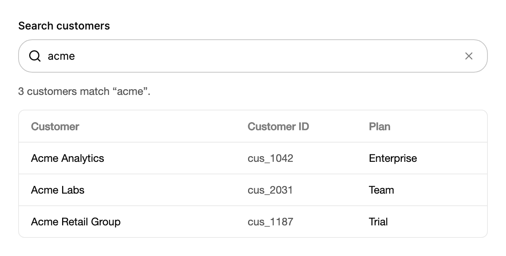

<Demo name="FilterList" />

## When to use

`SearchField` is the search box for a view that already shows the items it searches: a customer table, an invoice list,
a settings page with many toggles. It sits above the results, narrows them as the person types, and keeps its width
steady when the clear button appears, so the toolbar around it does not shift while the person works.

- **Filtering a customer or invoice table on the same page**: the table is on screen, so each key press narrows the rows
  and the person sees the effect at once. Filter in the `TextChanged` handler and keep the table's sort and paging
  unchanged.
- **Finding a setting or a feature toggle in a long settings page**: a settings page with forty switches can hide the
  matching rows as the person types a word such as "webhook" or "export", with the section headings kept.
- **Opening a record by its ID in an admin console**: an operator pastes `inv_2026_0412` and presses Enter. `SearchSubmitted`
  carries the text, so the console can open the record instead of filtering a list.
- **Dense toolbars in data-heavy tools**: a monitoring or billing table with a filter bar uses `Size="Small"` so the search
  field lines up with the other toolbar controls in a 36 px row.
- **Search that clears with one key**: Escape clears the field from the keyboard, and the clear button returns focus to the
  field, so an operator can search, clear and search again without the mouse.

## When not to use

- **A compact header search that opens a panel of results**: use `ExpandingSearch`. It starts as an icon, expands on
  demand, and groups its results beneath the field.
- **A search whose text is stored as a form value**: use `Combobox`, which lets the person choose from a list and keeps
  the chosen value rather than a free query.
- **Several filters and sort options side by side**: use `FilterToolbar`, which places the search with the other filter
  controls and keeps them aligned.
- **A name, a title or a note that is not a query**: use `Input`. A search field clears on Escape and submits on Enter,
  which is not what a name or a note needs.
- **Several lines of text, such as a long question for a support assistant**: use `Textarea`.

## Usage

The field has a search glass at the start. A clear button appears at the end while the field has text.

```xml
<UserControl xmlns="https://github.com/avaloniaui"
             xmlns:arc="https://github.com/AIDotNet/TKCode.Arc">
    <arc:SearchField Label="Search people"
                     Placeholder="Filter by name"
                     Width="360"
                     HorizontalAlignment="Left" />
</UserControl>
```

`SearchField` derives from the shared Arc field base over Avalonia's `TextBox`. `Text` is the query and is two-way,
`TextChanged` fires on each key press, and `PlaceholderText`, `IsReadOnly`, the caret, selection, undo, IME and the
clipboard all behave as in a text box. The field adds the label, the search glass, the clear button and the Arc frame.
It also carries the helper and error rows of `Input`, through `Description` and `ErrorMessage`, so a search that fails
for a reason the person must see can use the same message row as a form field.

### Anatomy

1. **Label** (`Label`): 14 px, medium weight, 8 px above the frame. It is the field's accessible name. Hide it with
   `IsLabelVisible="False"` only when a visible heading names the search, for example a toolbar with a clear title.
2. **Search glass**: an 18 px search icon with a 2 px stroke at the start of the frame. It is muted at rest and turns to
   the full foreground color while the field is focused or has text. It is hidden from assistive technology.
3. **Text and placeholder** (`Placeholder`): the query. The placeholder shows in the muted text color while the field
   is empty, and the glass is muted until the person starts.
4. **Clear slot**: a 24 px square slot that is always reserved at the end of the frame. The 24 px clear button, with a
   16 px cross, sits in the slot only while the field has text and is editable. Because the slot never goes away, the
   field keeps its width.
5. **Description and error rows** (`Description`, `ErrorMessage`): the shared Field rows, 12 px copy under the frame,
   with the same behavior as `Input`.

### Sizes

`Size` sets the frame height: `Small` is 36 px, `Medium` is 44 px (the default) and `Large` is 50 px. `Large` also
raises the text to the base type size and its line height, so it reads well as the main search on a page.

<Demo name="Sizes" />

Keep one size per toolbar. Use `Small` for dense admin tables and filter bars, `Medium` for a search above a list, and
`Large` for a search that is the main action of a page, such as a directory or a help center. Give a field in a toolbar the same
`Size` as the controls beside it, so the row shares one height.

### Binding the query

`Text` is two-way, so a view model can read the query, reset it and keep it across navigation. Bind it with the default
mode and let the view model filter the rows it owns.

```csharp
public partial class CustomerListViewModel : ObservableObject
{
    private static readonly string[] AllCustomers =
    [
        "Acme Analytics", "Acme Labs", "Acme Retail Group", "Northwind Logistics",
        "Contoso Health", "Fabrikam Energy"
    ];

    [ObservableProperty]
    private string _query = string.Empty;

    public ObservableCollection<string> Visible { get; } = new(AllCustomers);

    partial void OnQueryChanged(string value)
    {
        Visible.Clear();
        foreach (var name in AllCustomers.Where(n => n.Contains(value, StringComparison.CurrentCultureIgnoreCase)))
        {
            Visible.Add(name);
        }
    }

    [RelayCommand]
    private void ClearSearch() => Query = string.Empty;
}
```

```xml
<StackPanel Spacing="12">
    <arc:SearchField Label="Search customers"
                     Placeholder="Filter by name"
                     Text="{Binding Query}"
                     Width="360"
                     HorizontalAlignment="Left" />
    <ItemsControl ItemsSource="{Binding Visible}" />
</StackPanel>
```

`ClearSearch` is the application's own command; the field clears itself with its clear button and with Escape, so the
command is only needed for a Clear link elsewhere on the page. The control has no command of its own.

### Filter as the user types

`Text` changes on every key press. Filter in the `TextChanged` handler, or in the property change of the view model
above. If the filter is expensive, debounce it in your code so the list updates after the person pauses.

```csharp
search.TextChanged += (_, _) =>
{
    var query = search.Text ?? string.Empty;
    list.Children.Clear();
    foreach (var name in names.Where(n => n.Contains(query, StringComparison.CurrentCultureIgnoreCase)))
    {
        list.Children.Add(new TextBlock { Text = name });
    }
};
```

### Submit

Enter raises `SearchSubmitted` with the text in the field, and the event is handled, so Enter does not press a default
button in the window. Use it for a search that opens one result, such as an ID or a ticket number, rather than for a
list that already updates on each key.

```csharp
search.SearchSubmitted += (_, e) => submitted.Text = $"Submitted “{e.Query}”";
```

Escape clears a field that has text and is not read-only, and keeps the focus in the field.

### Clear from code

Call `Clear` to empty the field from code. The focus stays in the field unless you pass `false`. The change raises
the usual text change, so a filter in the `TextChanged` handler runs as well.

```csharp
search.Clear();
search.Clear(focus: false);
```

### Filtering large lists

The field passes every key press to `Text`. The view model should keep the full data set in memory and filter it from
that set, not from the rows on screen, so that clearing the query restores every row. For a remote data source, use the
`SearchSubmitted` event or a pause in typing rather than one request per key.

```csharp
search.TextChanged += async (_, _) =>
{
    var query = search.Text ?? string.Empty;
    await Task.Delay(250);
    if (query != (search.Text ?? string.Empty))
    {
        return;
    }
    await LoadCustomersAsync(query);
};
```

The delay check drops a query that was overtaken by a newer key press, so a slow response never replaces the results of
the latest text.

### Example: Customer table with a search filter

A customer table on a billing console. The search field sits above the table, with the query `acme` already typed so
the clear button and the filtered rows are visible. The field is a sibling of the rows, not a separate page, so the
person sees the effect of each key press in the same view. The match count under it states the result in words, not only
through the rows.



```xml
<StackPanel Width="620" Spacing="16">
    <arc:SearchField Label="Search customers"
                     Placeholder="Filter by name or ID"
                     Text="acme" />
    <TextBlock Text="3 customers match “acme”."
               FontSize="14"
               Foreground="{arc:ArcDesignTokenResource TextSecondary}" />
    <Border BorderBrush="{arc:ArcDesignTokenResource Border}"
            BorderThickness="1"
            CornerRadius="8">
        <StackPanel>
            <Grid ColumnDefinitions="*,160,140" Margin="16,12">
                <TextBlock Text="Customer" FontWeight="SemiBold"
                           Foreground="{arc:ArcDesignTokenResource TextMuted}" />
                <TextBlock Grid.Column="1" Text="Customer ID" FontWeight="SemiBold"
                           Foreground="{arc:ArcDesignTokenResource TextMuted}" />
                <TextBlock Grid.Column="2" Text="Plan" FontWeight="SemiBold"
                           Foreground="{arc:ArcDesignTokenResource TextMuted}" />
            </Grid>
            <Border Height="1" Background="{arc:ArcDesignTokenResource Border}" />
            <Grid ColumnDefinitions="*,160,140" Margin="16,12">
                <TextBlock Text="Acme Analytics" Foreground="{arc:ArcDesignTokenResource Foreground}" />
                <TextBlock Grid.Column="1" Text="cus_1042"
                           Foreground="{arc:ArcDesignTokenResource TextSecondary}" />
                <TextBlock Grid.Column="2" Text="Enterprise"
                           Foreground="{arc:ArcDesignTokenResource Foreground}" />
            </Grid>
            <Border Height="1" Background="{arc:ArcDesignTokenResource Border}" />
            <Grid ColumnDefinitions="*,160,140" Margin="16,12">
                <TextBlock Text="Acme Labs" Foreground="{arc:ArcDesignTokenResource Foreground}" />
                <TextBlock Grid.Column="1" Text="cus_2031"
                           Foreground="{arc:ArcDesignTokenResource TextSecondary}" />
                <TextBlock Grid.Column="2" Text="Team"
                           Foreground="{arc:ArcDesignTokenResource Foreground}" />
            </Grid>
            <Border Height="1" Background="{arc:ArcDesignTokenResource Border}" />
            <Grid ColumnDefinitions="*,160,140" Margin="16,12">
                <TextBlock Text="Acme Retail Group" Foreground="{arc:ArcDesignTokenResource Foreground}" />
                <TextBlock Grid.Column="1" Text="cus_1187"
                           Foreground="{arc:ArcDesignTokenResource TextSecondary}" />
                <TextBlock Grid.Column="2" Text="Trial"
                           Foreground="{arc:ArcDesignTokenResource Foreground}" />
            </Grid>
        </StackPanel>
    </Border>
</StackPanel>
```

### Content guidelines

Name the collection being searched, and let the placeholder show examples of what matches rather than an instruction.

| Instead of | Write |
|---|---|
| Search | Search customers |
| Type to search | Filter by name or ID |
| No results | No customers match “acme”. |
| Clear | Clear search |
| Go | Open invoice |

Use sentence case. Put the number of matches in plain text beside the field, and write the empty result as a sentence
that repeats the query, so the person can see what did not match.

### Best practices

**Do**

- Name the collection in the label, for example "Search customers" rather than "Search". The person knows what the query
  applies to, and a screen reader announces the same name.
- Filter from the full data set, not from the rows on screen. Clearing the query then restores every row.
- Show the match count beside the field. The person sees that a query matched nothing before scanning an empty list.
- Keep the field width fixed. The reserved clear slot already keeps it steady, so do not resize the field when the button
  appears.

**Avoid**

- Sending one request per key press to a remote source. Debounce the query or wait for Enter, because responses to earlier
  queries can arrive after later ones.
- Using `SearchSubmitted` for a list that already filters on each key. Enter then adds nothing and people wonder what it
  does.
- Putting a chosen value in a search field. Use `Combobox`, which keeps the choice rather than a free query.
- Relying on Escape alone to clear the field. The clear button is the visible affordance, and Escape is not discoverable.

### Common questions

**Why does Escape do nothing in a read-only field?** Escape clears only a field that has text and is not read-only. The
clear button follows the same rule, so it is hidden when `IsReadOnly` is true.

**How do I translate the clear button?** Set `ClearText`. Its default is "Clear search", and it is the button's accessible
name.

**Does `Clear` move focus?** Yes, by default. `Clear(focus: false)` empties the field and leaves focus where it is, which is
what Escape does.

**Does Enter submit when the field is empty?** Yes. `SearchSubmitted` is raised with an empty `Query`, so ignore empty
queries in your handler if an empty submit should do nothing.

## API reference

<!-- api: SearchField -->

## Accessibility

- `Label` names the field. The search glass is hidden from assistive technology, so the field is announced by its label
  and its value.
- The clear button is named "Clear search" by default. Set `ClearText` to translate it.
- Enter submits the query and Escape clears the field from the keyboard.
- The clear button is reachable with the keyboard while it is shown and draws the focus ring when focused. Enter on it
  clears the field and returns focus to the field, so keyboard users do not lose their place.
- `Description` and `ErrorMessage` form the field's help text, read after the name and the value, as in `Input`.
- Show the number of matches in plain text beside the field, as in the example, so the result is visible without
  counting the rows.

### Keyboard

| Keys | Action |
|---|---|
| Text keys | Edit the query; `TextChanged` runs on each key |
| `Enter` | Raises `SearchSubmitted` with the query and marks the key as handled |
| `Escape` | Clears a field that has text and is not read-only; focus stays in the field |
| `Tab` / `Shift+Tab` | Move to the clear button while it is shown, then to the next control |
| `Enter` on the clear button | Clears the field and returns focus to the field |
| `Left` / `Right`, `Home` / `End`, `Shift` selection, `Ctrl+A` | Native text box editing |

## Motion

- The clear button scales in from a slightly smaller size with a light blur.
- Its slot is always reserved, so the field keeps its width whether or not the button is visible.
- Pressing the clear button scales it down slightly, with full motion only.
- Reduced motion only fades the clear button, with no scale and no blur. Off shows and hides it at once.

| Change | Full | Reduced | Off |
|---|---|---|---|
| Clear button appears | Scales in from 0.8 on a snappy spring with a soft blur | Fades in | Immediate |
| Clear button leaves | Animates out before it is removed | Fades out | Immediate |
| Clear button pressed | Scales to 0.96 | No scale | No scale |

## Related

- `ExpandingSearch` for a compact search in a header that shows results beneath it.
- `Combobox` for a value chosen from a list.
- `Input` for a general single-line field.

| Component | Choose it when |
|---|---|
| `ExpandingSearch` | The search lives in a header or toolbar and opens only when used |
| `FilterToolbar` | The search sits with other filters, sort options or view switches |
| `Combobox` | The chosen value is saved in a form, not a query |
| `Input` | The text is a name, a title or a value rather than a query |
| `Textarea` | The query needs several lines, such as a question for an assistant |
| `Select` | The person chooses one option from a fixed list instead of typing |
