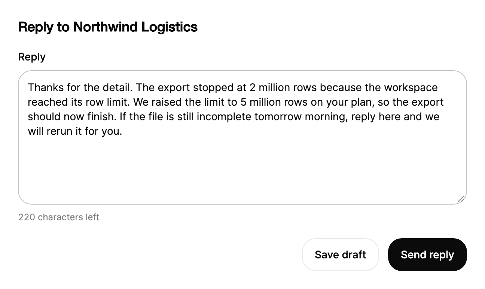

<Demo name="LiveCount" />

## 何時使用

`Textarea` 用於跨越多行的自由文字：對客戶工單的回覆、事件摘要、商品描述、發票上的備註。它填滿所在欄，以可用的高度開始，並允許使用者將其拖高，因此較長的內容仍然易讀，表單也不會因此跳動。說明文字列和錯誤列與 `Input` 相同，因此多行欄位無需特殊版面即可放入表單欄。

- **客服後台中的回覆**：客服人員為工單寫幾句回覆。對照回覆上限的即時計數告訴他還剩多少空間，並且在他核對訂單時保留草稿。
- **事件摘要與變更說明**：維運人員記錄發生了什麼、何時發生、改動了什麼。多個段落需要換行和空間以便反覆閱讀，這是單行 `Input` 無法提供的。
- **商品與目錄描述**：商品編輯輸入會在商店中顯示的描述，並依商店的限制統計字元數。
- **意見回饋與問卷回答**：一個簡短的自由文字問題，例如「什麼會讓匯出更快？」，並附帶在使用者送出時檢查的最小長度規則。
- **帳戶或發票上的內部備註**：帳務人員記錄退款獲准的原因。備註會與紀錄一起儲存，備註較長時，可調整大小的欄位會更有幫助。

## 何時不用

- **單行內容，例如姓名、電子郵件或主旨**：用 `Input`，它有相同的訊息列，且無需管理換行。
- **機密**：用 `PasswordField`；當使用者選擇新密碼時用 `PasswordStrength`。
- **帶標題、清單、連結或強調的文字**：用 `RichTextEditor`。`Textarea` 只保存純文字。
- **在頁面上原位編輯標題或簡短描述**：用 `InlineEdit`，它在編輯前看起來就是一般文字。
- **由簡短值組成的清單，例如標籤或收件人**：用 `TagInput`，它會把每一項變成一個權杖。

## 用法

按 Enter 會新增一行。欄位填滿所在欄，並且至少 110 px 高。

```xml
<UserControl xmlns="https://github.com/avaloniaui"
             xmlns:arc="https://github.com/AIDotNet/TKCode.Arc">
    <arc:Textarea Label="個人簡介"
                  Placeholder="用一兩句話介紹你自己"
                  Description="還剩 160 個字元"
                  MaxLength="160"
                  Width="420"
                  HorizontalAlignment="Left" />
</UserControl>
```

`Textarea` 衍生自 Avalonia `TextBox` 之上的共用 Arc 欄位基底類別。它開啟 `AcceptsReturn`，並依外框寬度換行，因此換行就是一般的 Enter。`Text` 是雙向的，`MaxLength` 在上限處阻止繼續輸入；`IsReadOnly`、游標、選取、復原、輸入法和剪貼簿都是原生文字方塊的行為。欄位在此之上加入標籤、Arc 外框、說明文字列和錯誤列、焦點環以及縮放把手。

### 結構

1. **標籤**（`Label`）：14 px、中等字重，位於外框上方 8 px，與 `Input` 相同。它是欄位的無障礙名稱。只有當可見標題已經為欄位命名時，才用 `IsLabelVisible="False"` 隱藏它。
2. **外框**：1 px 邊框、控制項圓角、表面色背景，四周各 12 px 內距。懸停與聚焦只加深邊框。聚焦的欄位會在邊框外繪製 3 px 焦點環。
3. **文字與預留位置文字**（`Placeholder`）：文字在外框內寬度處換行。欄位為空時，預留位置文字以弱化文字顏色顯示。
4. **最小高度**：外框在所有尺寸下至少 110 px 高。外框不會隨內容增長；當文字長於外框時，文字在其中捲動。
5. **縮放把手**（`IsResizable`）：位於右下角的 12 px 區域，帶兩條短的斜線，拉入內距中，使其緊貼邊框。當 `IsResizable` 為 false 或欄位被停用時隱藏。
6. **說明文字列**（`Description`）：外框下方 12 px、弱化顏色的輔助文案。「還剩 120 個字元」之類的計數顯示在這裡。
7. **錯誤列**（`ErrorMessage`）：12 px、危險色文案。只要它有內容，欄位即處於無效狀態。

### 選擇高度

外框從 110 px 開始，並保持該高度，直到使用者拖動把手或你的程式碼設定 `FrameHeight`。把手會以像素寫入所選高度；低於 110 px 最小值的任何值都會被提升到最小值。

- **表單欄中的簡短備註**（評論、變更原因）：保留 110 px 最小值並保持把手開啟，使用者無需另外的頁面即可為較長的備註騰出空間。
- **多段落的回覆和摘要**：將 `FrameHeight` 設為約 200，增加初始高度，使第一屏就能顯示整份草稿。
- **固定版面，例如儀表板卡片或側邊面板**：設定 `IsResizable="False"`，使卡片保持其幾何尺寸。此時欄位會捲動其文字。
- **必須保留使用者所選尺寸的欄位**：以 `Mode=TwoWay` 繫結 `FrameHeight`，並將該值保存在檢視模型或使用者設定中。`FrameHeight` 預設為單向。

### 繫結到檢視模型

檢視模型擁有回覆及其規則。它統計字元數，在送出時回報錯誤，並在回覆變化時清除錯誤。

```csharp
public partial class ReplyViewModel : ObservableObject
{
    private const int MaxReplyLength = 500;

    [ObservableProperty]
    private string _replyText = string.Empty;

    [ObservableProperty]
    private string? _replyError;

    public string CountText => $"還剩 {MaxReplyLength - ReplyText.Length} 個字元";

    partial void OnReplyTextChanged(string value)
    {
        ReplyError = null;
        OnPropertyChanged(nameof(CountText));
    }

    [RelayCommand]
    private void SendReply()
    {
        ReplyError = ReplyText.Trim().Length < 40
            ? "請再補充一些細節：至少 40 個字元。"
            : null;
        if (ReplyError is not null)
        {
            return;
        }
        // 在此處把回覆傳送到工單服務。
    }
}
```

```xml
<StackPanel Spacing="16">
    <arc:Textarea Label="回覆客戶"
                  Text="{Binding ReplyText}"
                  Description="{Binding CountText}"
                  ErrorMessage="{Binding ReplyError}"
                  MaxLength="500"
                  Width="520"
                  HorizontalAlignment="Left" />
    <arc:Button Content="傳送回覆"
                Command="{Binding SendReplyCommand}"
                HorizontalAlignment="Left" />
</StackPanel>
```

`Text` 是雙向的。`Description`、`ErrorMessage`、`IsResizable` 和 `IsEnabled` 是單向的。`FrameHeight` 除非如上所述以 `Mode=TwoWay` 繫結，否則也是單向的。此控制項沒有自己的命令；傳送操作是檢視模型上的命令。

### 即時計數與驗證

隨著文字變化更新描述。只有變化的數字會滾動。設定 `ErrorMessage` 可將欄位標記為無效；值為空時清除錯誤。

<Demo name="Validation" />

```csharp
const int limit = 160;
bio.TextChanged += (_, _) =>
{
    var length = bio.Text?.Length ?? 0;
    bio.Description = $"還剩 {limit - length} 個字元";
    bio.ErrorMessage = length < 40 ? "再多寫一點吧：至少 40 個字元。" : null;
};
```

`MaxLength` 會在上限處阻止使用者繼續輸入，但不顯示任何內容，因此計數必須來自你的程式碼，如上所示。請依商店或伺服器計算長度的方式計數：`TextBox` 以 UTF-16 字元計數，因此一個表情符號占兩個字元。

驗證規則與 `Input` 遵循相同的模式：在使用者能夠處理某條規則的時刻檢查它。

| 規則 | 何時檢查 | 顯示在哪裡 |
|---|---|---|
| 最大長度 | 輸入時；`MaxLength` 阻止繼續輸入 | `Description` 倒數計數；無需錯誤 |
| 回覆的最小長度 | 送出時，之後在回覆仍然過短時 | `ErrorMessage`；把焦點移到該欄位 |
| 必填 | 送出時 | `ErrorMessage` |
| 伺服器的內容檢查，例如遮蔽詞 | 請求返回後 | `ErrorMessage`，文字變化時清除 |

### 繫結文字

`Text` 是雙向屬性。將其繫結到檢視模型中的字串。

```xml
<arc:Textarea Label="意見回饋"
              Text="{Binding Feedback}"
              ErrorMessage="{Binding FeedbackError}" />
```

按 Enter 會在 `Text` 中存入換行字元。在 Windows 上，換行可能存為 `\r\n`，因此在比較兩個值或把文字儲存到需要 `\n` 的系統之前，請統一換行字元。

### 縮放

拖動右下角把手可使欄位變高。高度從最小值開始，且不跟隨內容；欄位會改為捲動。使用 `IsResizable` 關閉把手。

```xml
<arc:Textarea Label="備註"
              IsResizable="False"
              Text="固定高度。" />
```

使用者拖動把手時，`FrameHeight` 保存所選的高度（以像素為單位）。在程式碼中設定它，可使欄位以指定高度開始。

```csharp
notes.FrameHeight = 200;
```

### 停用

停用的欄位透明度降為 0.6，並且沒有把手。

<Demo name="Disabled" />

### 範例：支援回覆表單

支援後台中的回覆表單。客服人員已寫了 280 個字元的回覆，上限為 500，因此計數顯示還剩 220 個字元。欄位比最小高度略高，因為回覆通常是幾句話，而右下角的把手表示欄位可以更高。欄位下方的按鈕使用客服人員需要的動詞和對象：儲存草稿，或傳送回覆。截圖是穩定狀態：沒有錯誤，計數已定，文字適合外框。



```xml
<StackPanel Width="600" Spacing="20">
    <TextBlock Text="Reply to Northwind Logistics"
               FontSize="18"
               FontWeight="SemiBold"
               Foreground="{arc:ArcDesignTokenResource Foreground}" />
    <arc:Textarea Label="Reply"
                  Text="Thanks for the detail. The export stopped at 2 million rows because the workspace reached its row limit. We raised the limit to 5 million rows on your plan, so the export should now finish. If the file is still incomplete tomorrow morning, reply here and we will rerun it for you."
                  Description="220 characters left"
                  MaxLength="500"
                  FrameHeight="180" />
    <StackPanel Orientation="Horizontal"
                HorizontalAlignment="Right"
                Spacing="12">
        <arc:Button Content="Save draft" Variant="Secondary" />
        <arc:Button Content="Send reply" />
    </StackPanel>
</StackPanel>
```

### 文案規範

命名內容，而不是控制項。標籤說明備註是為了什麼，錯誤說明需要補充什麼。

| 不要寫 | 改為 |
|---|---|
| 備註 | 退款原因 |
| 在此輸入文字 | 描述出現錯誤前你嘗試過的操作 |
| 輸入無效 | 再多寫一些細節：至少 40 個字元。 |
| 最多 500 | 還剩 220 個字元 |
| 送出 | 傳送回覆 |
| 此欄位必填 | 請填寫退款原因。 |

標籤和訊息使用句子式大小寫，計數使用阿拉伯數字，每條錯誤使用一個完整的句子。說明中的計數在各處都使用相同的措辭，使回覆在每個畫面上都以同樣的形式顯示「還剩……個字元」。

### 最佳做法

**建議**

- 在接近上限之前就顯示計數，並依伺服器的計數方式計算。能看到剩餘空間的使用者會在儲存被拒絕之前縮短文字。
- 使用 `MaxLength` 作為硬性上限，使用說明作為回饋。只有 `MaxLength` 不會給出任何回饋，使用者只會在文字停止變化時才得知存在上限。
- 短備註從 110 px 最小值開始，長內容則設定 `FrameHeight`。一個很高的空欄位會讓簡短的表單顯得未完成。
- 使用者離開頁面時，將草稿保留在檢視模型中。多行草稿是最難重新輸入的值。
- 在比較或儲存文字之前統一換行字元。Windows 的 `\r\n` 換行與其他系統的 `\n` 換行，否則會被當作不同的值。

**避免**

- 期望欄位隨內容增長。它會捲動，因此使用者無法一次看到整份草稿；請給它一個適合任務的高度。
- 在使用者仍在寫第一句話時就顯示最小長度錯誤。這讀起來像是在指責使用者；應在失去焦點或送出時檢查。
- 用 `Textarea` 填寫單行內容，例如姓名或主旨。Enter 會新增一行，貼上的文字也會保留其換行。
- 在使用者需要閱讀長文字的表單中關閉 `IsResizable`。欄位將只有最小高度，文字會在一個小視窗中捲動。
- 依賴把手服務鍵盤使用者。把手只回應指標，因此應使欄位的高度在不縮放時也能正常運作。

### 常見問題

**為什麼我輸入更多行時欄位高度保持不變？** 它保持高度，以免表單版面移動。文字在外框內捲動。讓使用者拖動把手，或將 `FrameHeight` 設為任務所需的高度。

**為什麼 `FrameHeight` 為 60 時欄位仍是 110 px？** 低於 110 px 最小值的任何高度都會被提升到最小值。最小值適用於每個 `Size`，因此 `Small` 不會使欄位變矮。

**使用者按 Tab 時欄位會插入定位字元嗎？** 不會。`AcceptsTab` 為 false，因此 Tab 會把焦點移到下一個控制項。只有當欄位是程式碼或表格編輯器、且定位字元本身就是值時，才設定 `AcceptsTab="True"`。

**鍵盤使用者能調整欄位大小嗎？** 不能。把手只回應指標。請在程式碼中設定 `FrameHeight`，或選擇在最小高度下也能正常運作的固定版面。

## API 參考

<!-- api: Textarea -->

## 無障礙

- `Label` 為欄位命名。`Description` 與 `ErrorMessage` 會合併為它的說明文字。
- 錯誤出現時會以 assertive 即時區域立即播報。動畫文案對輔助技術隱藏，輔助技術讀取的是純文字版本。
- 按 Enter 會插入換行。游標、選取、輸入法、復原和剪貼簿快速鍵都是原生 `TextBox` 的行為。
- 聚焦時會在外框周圍繪製 3 px 焦點環。
- 縮放把手只回應指標。鍵盤使用者保持最小高度並捲動文字，因此版面在 110 px 下也必須可用。當內容需要更多空間時，請在程式碼中設定 `FrameHeight`，使所有人都能獲得足夠的空間。

### 鍵盤

| 按鍵 | 操作 |
|---|---|
| 文字按鍵 | 輸入文字；`Enter` 插入換行 |
| `Up` / `Down` | 在行之間移動游標 |
| `Home` / `End`，`Ctrl+Home` / `Ctrl+End`（macOS 上為 `Cmd`） | 移到行首或行尾，或移到文字的開頭或結尾 |
| `Shift` + 以上任一按鍵 | 擴充選取範圍 |
| `Ctrl+A`、`Ctrl+C`、`Ctrl+X`、`Ctrl+V`、`Ctrl+Z`、`Ctrl+Y`（macOS 上為 `Cmd`） | 全選、複製、剪下、貼上、復原與重做 |
| `Tab` / `Shift+Tab` | 將焦點移到下一個或上一個控制項；`AcceptsTab` 保持為 false，因此 Tab 不會插入定位字元 |

## 動態效果

- 輔助文字列與錯誤列以平滑彈簧展開高度。變化的詞帶著柔和模糊升起。
- 字元計數只滾動變化的數字位。
- 拖動把手會直接設定高度，因此外框無需過渡即可跟隨指標。
- 減少動態效果時，彈簧、數字滾動和模糊都會移除，文案立即改變。關閉動態效果時同樣如此。

| 變化 | 完整 | 減少 | 關閉 |
|---|---|---|---|
| 訊息列出現或消失 | 高度以平滑彈簧展開，文字淡入 | 以完整高度直接顯示 | 立即完成 |
| 訊息變化 | 只有變化的詞帶著柔和模糊從下方升起 | 瞬時淡入 | 立即完成 |
| 計數中的數字變化 | 只有變化的數字滾動，增大時向上，減小時向下 | 瞬時淡入 | 立即完成 |
| 懸停、聚焦、無效 | 邊框顏色漸變 | 邊框顏色漸變 | 立即完成 |

## 相關元件

- `Input`：單行文字。
- `InlineEdit`：無可見外框、原位編輯值。
- `TagInput`：由簡短值組成的清單，而不是自由文字。
- `RichTextEditor`：需要標題或清單的文字。

| 元件 | 適用情境 |
|---|---|
| `Input` | 值只有一行，例如姓名、電子郵件或主旨 |
| `RichTextEditor` | 文字需要標題、清單、連結或強調 |
| `InlineEdit` | 標題或簡短描述在顯示位置直接重新命名 |
| `TagInput` | 值是由簡短權杖組成的清單，例如標籤或收件人 |
| `PasswordField` / `PasswordStrength` | 值是機密 |
| `SearchField` | 文字用於篩選清單，而不是保存 |
