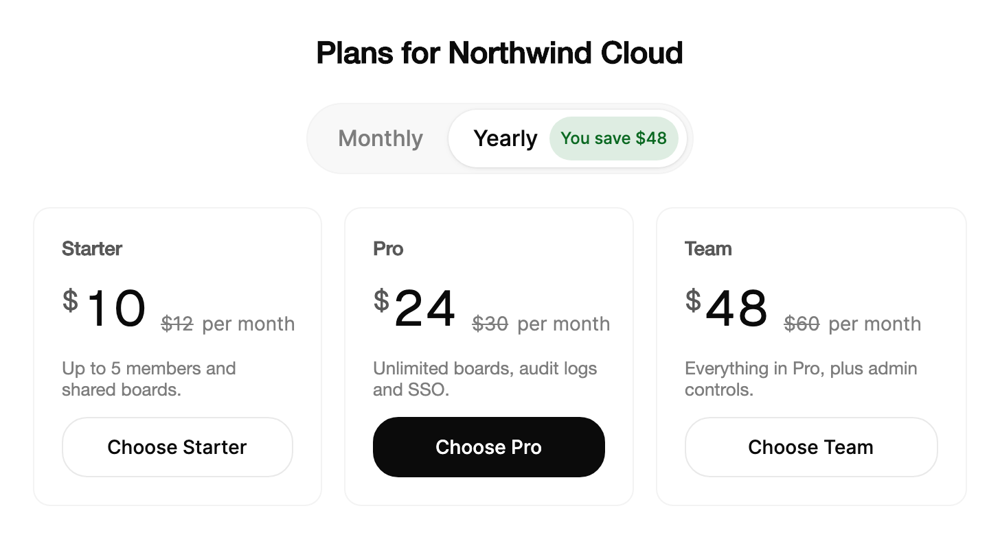

<Demo name="Pricing" />

## 何时使用

`BillingToggle` 是用于选择计费周期的分段切换，通常位于定价页顶部，或计费设置页的套餐区域。它与 `BillingPrice` 配合使用：后者显示所选周期对应的金额，周期变化时数字会滚动到新值，让人无需离开页面就能看到每种选择的费用。

- **定价页的计费周期**：销售按月和按年套餐的 SaaS 产品。按年选项上的节省徽标（“省 20%”）在做决定的地方说明折扣。
- **计费设置中的套餐变更**：管理员把工作区从按月计费改为按年计费的账号页面。在人确认之前，切换会显示新金额和“按年计费”的周期文字。
- **订阅之外的终身或一次性选项**：一款销售按月、按年和终身授权的开发者工具。带有“最划算”徽标的三选项切换，让所有选择都保持在一行内。
- **带周期切换的结账摘要**：结账步骤显示按月或按年计费的总额，所选选项上的徽标以金额说明节省了多少（“你省 $48”）。

## 何时不用

- **切换的视图不改变价格**，例如同一批订单的列表和看板：用 `SegmentedControl`。它没有徽标，也没有价格语义。
- **选项需要描述或纵向布局**，例如每个套餐都有一句说明的列表：用 `RadioGroup` 或 `RadioCards`。`BillingToggle` 是一行简短标签的水平排列。
- **单个开关式设置**，例如“自动续费”：用 `Switch`，它表现为即时生效的设置。
- **每个套餐都有价格、功能以及不可用原因**：用 `RadioCards`。价格放在卡片中，切换只负责周期。
- **从很长的计费货币或地区列表中选择**：用 `Select` 或 `Combobox`。切换适合两到三个能放在一行内的选项。

## 用法

没有选项时，切换显示“按月”和“按年”，其中“按年”带有徽标“省 20%”。将 `Value` 设为所选选项的值。

```xml
<UserControl xmlns="https://github.com/avaloniaui"
             xmlns:arc="https://github.com/AtomUICommunity/TKCode.Arc">
    <arc:BillingToggle Value="yearly" />
</UserControl>
```

`BillingToggle` 派生自 Avalonia 的 `SelectingItemsControl`，因此具备常规的项模型（`ItemsSource`、`Items`、`SelectedIndex`、`SelectedItem`、`SelectedValue`）以及该基类的选择事件。应用程序中应使用的是 `Value`：它以字符串形式保存所选选项的值，是双向的，并与 `SelectedValue` 保持同步。切换在选择控件之上增加了节省徽标、滑动的滑块以及周期语义，因此计费页面无需自定义模板即可获得完整的控件。

### 结构

1. **轨道**（`BillingToggle` 本身）：一个胶囊形状，使用弱化的表面色并带有 1 px 的细边框。四周各内缩 3 px（`Large` 时为 4 px），选项水平排列其中。
2. **滑块**：位于所选选项下方的凸起胶囊，使用凸起表面色并带有柔和阴影。整个轨道共用一个形状，它在选项之间移动，而不是在每个选项中分别出现。
3. **选项**（每个周期对应一个 `BillingToggleOption`）：`Medium` 时高 34 px，`Large` 时高 42 px。左右内边距为 14 px（`Large` 时为 18 px），标签使用中等字重。
4. **标签**（`Label`；未设置标签时使用 `Value`）：周期名称，例如“按月”或“按年”。`Medium` 使用小号字体，`Large` 使用基础字号。
5. **徽标**（`Badge`）：节省说明，`Medium` 时高 24 px，`Large` 时高 32 px，左右内边距 8 px，位于胶囊中，背景为安静的底色（前景色的 6%），文字使用次要色。它位于标签之后 8 px。
6. **激活徽标**（`ActiveBadge`）：选项被选中时徽标显示的文字，例如“你省 $48”。未设置时，徽标保持 `Badge`。选中时徽标采用强调色（见“尺寸与强调色”）。
7. **焦点环**：所选选项周围 2 px 的环，仅在键盘焦点时出现。

`BillingPrice` 是独立控件，有自己的组成部分：货币符号、使用显示字体的金额、位于周期文字左侧带删除线的旧价格（`WasAmount`），以及周期文字（`Period`）。货币符号的字号约为金额的 0.55，并上提至与数字顶部齐平。

### 自定义选项

可以内联编写选项，也可以将 `ItemsSource` 绑定到 `BillingToggleOption` 对象的列表。内联添加的选项必须在切换加入逻辑树之前就存在，因为切换只有在那一刻没有任何选项时，才会安装默认的“按月”和“按年”选项。`Badge` 显示在选项上。`ActiveBadge` 在选项被选中时替换它，因此说明可以原地变化，而不会挪动周围的内容。选项可以显示的每段徽标文字都会预留相同的宽度，因此“省 20%”和“你省 $48”不会推动相邻的选项。

徽标适用于帮助人做出选择的信息：节省金额、“最划算”标记或套餐限制。若每个选项的费用都相同，就不要添加徽标，因为一个没有额外信息的徽标只会给这一行增加噪音。

<Demo name="ThreePeriods" />

### 价格

`BillingPrice` 显示一个金额。`Currency` 默认为 `$`，`Decimals` 默认为 0；负的 `Decimals` 按 0 处理。`Amount` 是 `decimal` 类型，数值以 en-US 文化格式化，因此应使用 `decimal`，而不是格式化后的字符串。当 `WasAmount` 高于 `Amount` 时，它以删除线绘制旧价格；较低或为 null 的值会隐藏旧价格。`Period` 是金额后的文字，变化时会在原位切换。

```xml
<arc:BillingPrice Amount="24" WasAmount="30" Period="每月" />
```

切换周期时，应在接收切换值的同一个处理程序中更新价格。金额滚动到新数字，旧价格带着它最后的数值淡出，周期文字切换。下面的示例一次设置三个值，因此卡片永远不会出现新金额搭配旧周期的情况。

```csharp
var toggle = new BillingToggle { Value = "yearly" };
var price = new BillingPrice { Amount = 24, WasAmount = 30, Period = "每月，按年计费" };

toggle.ValueChanged += (_, e) =>
{
    var yearly = e.NewValue == "yearly";
    price.Amount = yearly ? 24 : 30;
    price.WasAmount = yearly ? 30 : null;
    price.Period = yearly ? "每月，按年计费" : "每月";
};
```

`ValueChanged` 事件携带 `OldValue` 和 `NewValue`。它会冒泡，因此父面板上的处理程序也会收到它。副作用（例如埋点或重新加载报价）使用该事件；数据则使用绑定的视图模型。

### 尺寸与强调色

`Size` 设置选项高度：`Medium` 为 34，`Large` 为 42。整个计费区域使用同一种尺寸。`Medium` 适合设置表单和定价行；`Large` 适合定价页的主视觉区，因为访客最先接触的控件就是切换。轨道的内缩和文字大小会随尺寸一同增长，因此两种尺寸并不只是简单的等比缩放。

`BadgeAccent` 为选中的徽标着色，默认为 Arc 的成功色。徽标背景在浅色主题下为强调色的 13% 不透明度，在深色主题下为 18%；徽标文字在浅色主题下是强调色与少量前景色的混合。强调色是应用可以设置的画刷，因此它在代码中推导，而不是从令牌读取。请让强调色保持在成功或信息色系：红色或琥珀色的徽标会被理解为警告，而不是节省。

```xml
<arc:BillingToggle Size="Large" Value="yearly" />
```

### 绑定到视图模型

`Value` 是双向的，承载所选选项的值。将它绑定到视图模型中的字符串属性。价格是 `BillingPrice` 的单向输入，因此金额由视图模型持有。

```csharp
public partial class PricingViewModel : ObservableObject
{
    [ObservableProperty]
    private string? _billingPeriod = "yearly";

    [ObservableProperty]
    private decimal _proAmount = 24;

    [ObservableProperty]
    private decimal? _proWasAmount = 30;

    [ObservableProperty]
    private string _proPeriod = "每月，按年计费";

    partial void OnBillingPeriodChanged(string? value)
    {
        var yearly = value == "yearly";
        ProAmount = yearly ? 24 : 30;
        ProWasAmount = yearly ? 30 : null;
        ProPeriod = yearly ? "每月，按年计费" : "每月";
    }
}
```

```xml
<StackPanel Spacing="24">
    <arc:BillingToggle Value="{Binding BillingPeriod}" HorizontalAlignment="Center" />
    <arc:BillingPrice Amount="{Binding ProAmount}"
                      WasAmount="{Binding ProWasAmount}"
                      Period="{Binding ProPeriod}" />
</StackPanel>
```

- `Value` 是双向的。由人做出的更改会把新值写回 `BillingPeriod`，由代码做出的更改会选中匹配的选项。
- 将 `BillingPeriod` 绑定为 `string`。选项的值是 "monthly" 和 "yearly" 这样的字符串；在视图模型中把它映射为枚举。
- 三个价格属性应由同一个方法设置，就像 `OnBillingPeriodChanged` 那样，这样视图模型永远不会暴露只更新了一半的价格。
- 编译绑定需要在视图上设置 `x:DataType`（为简洁起见，示例省略了它）。

### 示例：定价页的套餐区域

Northwind Cloud 项目管理产品的定价页。切换位于三个套餐之上。每个套餐在按年计费时显示其月价，旧的月价带删除线，周期文字紧随其后。按年选项带有节省说明，专业版套餐在一张与相邻卡片等高的卡片中有一个行动按钮。



```xml
<StackPanel Width="680" Spacing="24">
    <TextBlock Text="Plans for Northwind Cloud"
               FontSize="22"
               FontWeight="SemiBold"
               HorizontalAlignment="Center"
               Foreground="{arc:ArcDesignTokenResource Foreground}" />
    <arc:BillingToggle Size="Large" Value="yearly" HorizontalAlignment="Center">
        <arc:BillingToggleOption Value="monthly" Label="Monthly" />
        <arc:BillingToggleOption Value="yearly"
                                 Label="Yearly"
                                 Badge="Save 20%"
                                 ActiveBadge="You save $48" />
    </arc:BillingToggle>
    <Grid ColumnDefinitions="*,*,*">
        <Border Grid.Column="0"
                Margin="0,0,16,0"
                Padding="20"
                CornerRadius="12"
                BorderThickness="1"
                BorderBrush="{arc:ArcDesignTokenResource BorderSubtle}"
                Background="{arc:ArcDesignTokenResource SurfaceRaised}">
            <StackPanel Spacing="12">
                <TextBlock Text="Starter" FontWeight="SemiBold"
                           Foreground="{arc:ArcDesignTokenResource TextSecondary}" />
                <arc:BillingPrice Amount="10" WasAmount="12" Period="per month" />
                <TextBlock Text="Up to 5 members and shared boards."
                           TextWrapping="Wrap" FontSize="13"
                           Foreground="{arc:ArcDesignTokenResource TextMuted}" />
                <arc:Button Content="Choose Starter" Variant="Secondary" HorizontalAlignment="Stretch" />
            </StackPanel>
        </Border>
        <Border Grid.Column="1"
                Margin="0,0,16,0"
                Padding="20"
                CornerRadius="12"
                BorderThickness="1"
                BorderBrush="{arc:ArcDesignTokenResource BorderSubtle}"
                Background="{arc:ArcDesignTokenResource SurfaceRaised}">
            <StackPanel Spacing="12">
                <TextBlock Text="Pro" FontWeight="SemiBold"
                           Foreground="{arc:ArcDesignTokenResource TextSecondary}" />
                <arc:BillingPrice Amount="24" WasAmount="30" Period="per month" />
                <TextBlock Text="Unlimited boards, audit logs and SSO."
                           TextWrapping="Wrap" FontSize="13"
                           Foreground="{arc:ArcDesignTokenResource TextMuted}" />
                <arc:Button Content="Choose Pro" HorizontalAlignment="Stretch" />
            </StackPanel>
        </Border>
        <Border Grid.Column="2"
                Padding="20"
                CornerRadius="12"
                BorderThickness="1"
                BorderBrush="{arc:ArcDesignTokenResource BorderSubtle}"
                Background="{arc:ArcDesignTokenResource SurfaceRaised}">
            <StackPanel Spacing="12">
                <TextBlock Text="Team" FontWeight="SemiBold"
                           Foreground="{arc:ArcDesignTokenResource TextSecondary}" />
                <arc:BillingPrice Amount="48" WasAmount="60" Period="per month" />
                <TextBlock Text="Everything in Pro, plus admin controls."
                           TextWrapping="Wrap" FontSize="13"
                           Foreground="{arc:ArcDesignTokenResource TextMuted}" />
                <arc:Button Content="Choose Team" Variant="Secondary" HorizontalAlignment="Stretch" />
            </StackPanel>
        </Border>
    </Grid>
</StackPanel>
```

### 文案规范

- **选项标签**：表示周期的单个词：“按月”“按年”“终身”。避免“按年付费”或“年度计费”，因为切换表示的是周期的选择，而不是一个操作。
- **徽标**：简短的节省说明或单一事实：“省 20%”“最划算”。百分比写成数字加百分号；金额为整数时使用货币符号且不带小数。
- **激活徽标**：所选周期的金额节省，例如“你省 $48”。尽量与徽标长度保持一致；激活文字过长会使选项变宽，整行跳动。
- **价格周期**：说明价格的计算基础，例如“每月，按年计费”，让人知道将被收取的总额。没有周期的价格含糊不清。
- **无障碍名称**：当“计费周期”不是合适的名称时，为该组命名其所选的内容，例如续订对话框中的“订阅期限”。

| 不要写 | 改为 |
|---|---|
| 按年付费 | 按年 |
| 节省 20 个百分点 | 省 20% |
| $24/月 | 每月 $24，按年计费 |
| 超值优惠！！！ | 最划算 |
| 年度套餐计费周期 | 计费周期 |

### 最佳实践

**推荐**

- 显示年付价格时，同时保留月价，用 `WasAmount` 或旁边的文字展示，让节省可以对照真实数字来核对。
- 定价页的主切换使用 `Size="Large"`，设置页使用 `Medium`。同一行混用尺寸会让选项看起来互不相关。
- 在同一个处理程序或同一个视图模型方法中，同时更新金额、旧价格和周期。
- 将 `Value` 绑定到字符串属性，并保持选项的值稳定（"monthly"、"yearly"），因为你的后端和分析会存储它们。

**避免**

- 用切换来切换列表或仪表板视图。人们期望周期切换改变价格，因此切换视图却移动了徽标和数字，会被理解为价格变化出错。
- 在短选项中使用很长的徽标文字。徽标会为它可能显示的所有文字预留宽度，因此过长的激活文字会迫使整行变宽。
- 期望划线而把 `WasAmount` 设为小于或等于 `Amount` 的值。它会隐藏旧价格，节省也随之消失，且没有任何说明。
- 用警告色为徽标着色；强调色用于节省或收益，而警告色会掩盖信息。
- 隐藏周期文字。它会告诉人这个金额是按月还是按年的总额。

### 常见问题

**为什么我没有添加选项，切换却显示“按月”和“按年”？** 切换自身没有选项时，会在加入逻辑树时安装 `DefaultOptions`（“按月”，以及带有“省 20%”的“按年”）。在切换挂载之前添加你自己的选项或 `ItemsSource`，即可显示不同的周期。

**不设置 `Value` 时选中哪一项？** `Value` 未设置时选中第一个选项，并且该选择会写回 `Value`。当默认周期必须是某一个（例如按年）而不是第一个选项时，请显式设置 `Value`。

**旧价格没有出现。** `WasAmount` 只有高于 `Amount` 时才显示。将它设为 `null` 可隐藏旧价格，或检查月价是否确实是较大的数字。

**可以用数字或枚举作为值吗？** `Value` 属性和 `BillingToggleOption.Value` 都是字符串。使用 "yearly" 这样的字符串键，并在视图模型中映射到你的枚举。

**如何更改该组的无障碍名称？** 在切换上设置 `AutomationProperties.Name`。默认名称是“计费周期”。每个选项会连同其标签和当前徽标一起播报，例如“按年 省 20%”。

## API 参考

<!-- api: BillingToggle -->
<!-- api: BillingPrice -->
<!-- api: BillingToggleOption -->

### BillingToggleValueChangedEventArgs

| 属性 | 类型 | 说明 |
|---|---|---|
| `OldValue` | `string?` | 变化前的值。 |
| `NewValue` | `string?` | 变化后的值。 |

### BillingToggleSize

| 成员 | 说明 |
|---|---|
| `Medium` | 34 px 的选项（默认值）。 |
| `Large` | 42 px 的选项，使用基础文字大小。 |

## 无障碍

- 该组默认名为“计费周期”。设置 `AutomationProperties.Name` 可为其指定其他名称。
- 每个选项都是一个单选按钮。其名称为标签与当前徽标，例如“按年 省 20%”。选中时显示的徽标文字为激活徽标（如已设置）。
- 滑块对辅助技术隐藏。`BillingPrice` 会被朗读为金额、旧价格和周期，例如“$24，原价 $30，每月”。
- Tab 聚焦所选选项。方向键选择并聚焦下一个或上一个选项，并且会循环。Home 与 End 分别选中第一个和最后一个选项。
- 键盘焦点绘制 2 px 的轮廓，并偏移 2 px。指针焦点不绘制。

### 键盘

| 按键 | 操作 |
|---|---|
| `Tab` / `Shift+Tab` | 将焦点移入该组的所选选项，并移出。只有所选选项是 Tab 停靠点。 |
| `Right` / `Down` | 选中并聚焦下一个选项；从最后一个选项循环到第一个。 |
| `Left` / `Up` | 选中并聚焦上一个选项；从第一个选项循环到最后一个。 |
| `Home` / `End` | 选中并聚焦第一个或最后一个选项。 |

## 动效

- 滑块以约 0.34 秒的临界阻尼弹簧滑动到所选选项之下，没有回弹。
- 所选选项的徽标采用强调色，其文字以模糊过渡切换。
- 价格滚动到新金额。旧价格收起消失，周期文字在原位切换。
- 减弱动效时，滑块立即就位，未选中的选项不做按下缩放。关闭动效时效果相同。

| 变化 | 完整 | 减弱 | 关闭 |
|---|---|---|---|
| 所选选项改变 | 滑块以临界阻尼弹簧滑动，约 0.34 s，没有回弹 | 滑块立即移动 | 滑块立即移动 |
| 未选中的选项被按下 | 按下时选项缩放至 97% | 无按下缩放 | 无按下缩放 |
| 选项文字在悬停或选中时变色 | 颜色通过快速补间缓动 | 立即 | 立即 |
| 所选徽标采用强调色 | 背景通过标准补间缓动；徽标文字以模糊切换 | 立即 | 立即 |

## 相关组件

- `SegmentedControl`：用于不涉及价格、只切换内容的视图。
- `RadioGroup`：用于需要描述或纵向布局的选项。
- `RadioCards`：用于需要价格、描述以及不可用原因的套餐。
- `Switch`：用于立即生效的单个设置。

| 组件 | 适用场景 |
|---|---|
| `SegmentedControl` | 选项切换视图、筛选或布局，且不带价格或节省信息 |
| `RadioGroup` | 选项需要描述或纵向布局 |
| `RadioCards` | 每个选项都是一个套餐，带有各自的价格、功能和不可用原因 |
| `Switch` | 单个设置立即生效 |
| `Select` / `Combobox` | 列表很长，或选项不是一个简短的固定集合 |
| `Checkbox` | 人选择的是多个独立项，而不是一个周期 |
