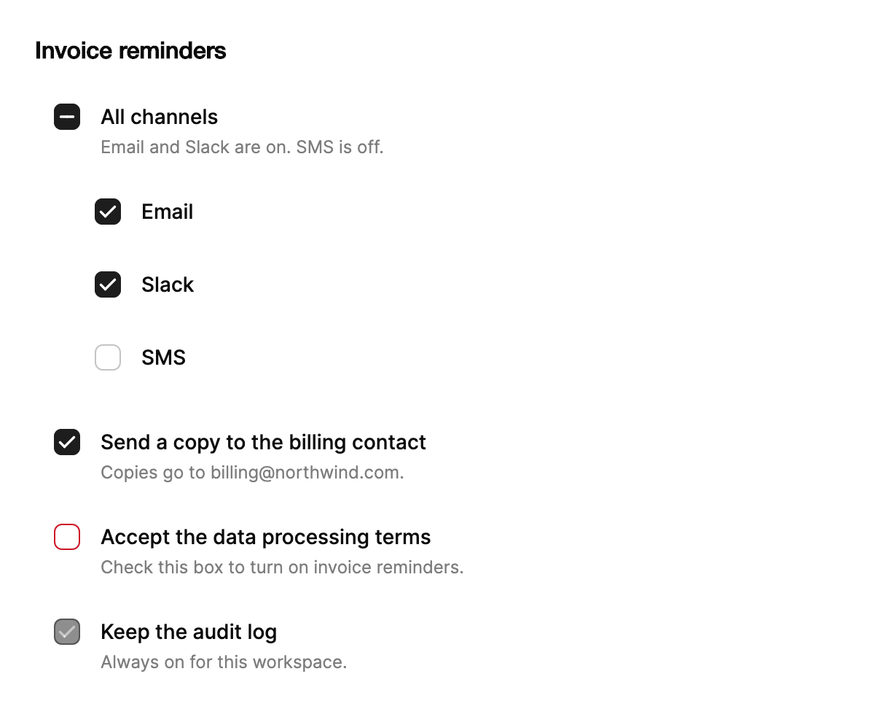

<Demo name="LabelAndDescription" />

## When to use

`Checkbox` is the control for an independent yes or no choice that a person makes inside a form, a settings panel or a
table toolbar. It carries its own label and help text, and it has an indeterminate state for a parent row whose children
are only partly selected. Use it wherever the choice is confirmed by a submit or a save, and where the result is not
applied the moment the box changes.

- **Consent and terms in sign-up and checkout**: "Accept the data processing terms" with the description that says what
  the consent covers. The checkbox is required before the Create account button continues.
- **Notification channels in an admin console**: a parent row "All channels" with the Email, Slack and SMS children
  under it. The parent shows the indeterminate state when some channels are on, so the summary matches the details.
- **Row selection in a data table**: a header checkbox that selects every visible invoice, shown as indeterminate when
  only some rows are selected. The table applies the selection when the person runs a bulk action.
- **Opt-in options in a settings form**: "Send a copy of each invoice to the billing contact". The value is saved with
  the form, and the description states the consequence in one line.
- **Filters in a list view where the change applies on save**: a set of statuses in an export dialog, where the person
  picks several and presses Export.

## When not to use

- **A setting that takes effect at once**, such as turning on two-factor sign-in or pausing invoice emails: use
  `Switch`, which reads as an immediate on or off.
- **Choosing exactly one option from a set**, such as a billing country or a plan period: use `RadioGroup`, where the
  choice of one clears the others.
- **A frequently toggled filter shown as a row of chips**, such as Open, Overdue and Paid above a table: use
  `ChipGroup`. Chips are compact and read as filters, not as form fields.
- **A period or a view that switches between two states with a price or content change**, such as Monthly and Yearly:
  use `BillingToggle` or `SegmentedControl`.
- **Several independent choices that each need a long description and a price**, such as add-ons on a plan: use
  `RadioCards` when the person picks one plan, or a stack of checkboxes with descriptions in a settings form when the
  choices are independent.

## Usage

The label is the content of the control. `Description` adds a line of help text under the label. The control derives
from Avalonia's `CheckBox`, so `IsChecked` (a `bool?`, where `null` is indeterminate) and `IsThreeState` work as they do
in Avalonia. The Arc additions are the `CheckedState` enum, the description, the invalid and required states, and the
`CheckedStateChanged` event.

```xml
<UserControl xmlns="https://github.com/avaloniaui"
             xmlns:arc="https://github.com/AIDotNet/TKCode.Arc">
    <arc:Checkbox Content="Accept terms and conditions"
                  Description="You agree to our Terms of Service and Privacy Policy." />
</UserControl>
```

### Anatomy

1. **Hit area**: a 44 px square (the Arc control size). The whole square answers a click or a tap, and it is the row's
   pointer target even though the drawn box is smaller. The hit area is at the top of the row, so the first line of the
   label lines up with the box.
2. **Box**: an 18 px square with a 5 px corner radius and a 1 px border. It is centered in the hit area. Unchecked, the
   border uses the strong border color; hover darkens it to the muted text color; invalid (and unchecked) it uses the
   danger color.
3. **Fill and mark**: a checked or indeterminate box fills with the control-on color. The check or the dash is a 1.75 px
   stroke in the control glyph color, drawn with round caps and joins.
4. **Label** (`Content`): medium weight, one or more lines with a 19.6 px line height. It starts after the hit area and
   names the control for assistive technology.
5. **Description** (`Description`): extra-small text in the muted color with a 16.8 px line height, 2 px under the label.
   It is hidden when the description is empty.
6. **Focus ring**: a 2 px ring drawn around the hit area for keyboard focus. It is hidden for pointer focus.

The Arc checkbox has no size property: the box stays 18 px. A checkbox grows taller only with its label and
description, for example when the description runs to two lines.

### Required and invalid

`IsRequired` marks the field as required in a form. It is reported to assistive technology as required and does not draw
anything. `IsInvalid` shows the error state: while the box is unchecked, its border uses the danger color. A checked box
never shows the error, so clear `IsInvalid` as soon as the person checks it, or leave it set and let the check hide the
danger border.

<Demo name="States" />

```xml
<arc:Checkbox Content="Accept terms and conditions"
              Description="Check this box to continue."
              IsRequired="True"
              IsInvalid="True" />
```

### Validation

A checkbox has one rule in most forms: it must be checked before the form is saved. The control reports the requirement
and the danger border, but the application decides when to show them. Show the required state at the moment the person
can act on it, and keep the message in the description so the layout does not move.

| Rule | When to check | Where it shows |
|---|---|---|
| Required consent | On submit, then as the box changes | `IsInvalid` (danger border) and a description such as "Check this box to continue." |
| Parent and children consistent | Whenever a child changes | `CheckedState` of the parent; it is not an error |
| Server rejects the choice | After the request | Description text, cleared when the box changes |

```csharp
// On submit: mark the unchecked box and move focus to it.
acceptTerms.IsInvalid = acceptTerms.IsChecked != true;
if (acceptTerms.IsInvalid)
{
    acceptTerms.Focus();
    return;
}

// Clear the mark as soon as the person checks the box.
acceptTerms.IsCheckedChanged += (_, _) => acceptTerms.IsInvalid = false;
```

### Indeterminate parent

`CheckedState` is an enum with `Unchecked`, `Checked` and `Indeterminate`. `IsChecked` is the same value as a nullable
boolean, where `null` means indeterminate. Set the parent to indeterminate while some children are checked.

<Demo name="IndeterminateParent" />

```xml
<arc:Checkbox Content="All channels" CheckedState="Indeterminate" />
```

To make a click on the parent set every child, handle `CheckedStateChanged` on the parent and set each child's
`IsChecked` to the new state. Skip the indeterminate state in that handler, because a parent cannot set its children to
"partly checked". The demo above also updates the parent from the children, and it guards both handlers with a flag so
they do not call each other.

Clicking an indeterminate parent checks it, as Radix does, and clicking a checked parent clears it. A parent that sets
its children, as the demo does, therefore sets every child on the next click. Use this order when the parent is the
"select all" control of a table or a list.

### Three-state cycle

`IsThreeState="True"` makes a click cycle through unchecked, checked and indeterminate, as the Avalonia `CheckBox` does.
Use the cycle only when the indeterminate state is itself a choice, such as a filter that means "either" in a list. For
a parent that only summarizes its children, keep the default two-state behavior, where a click on indeterminate checks
the box.

<Demo name="TriState" />

### Binding to a view model

In an MVVM app, bind `IsChecked` to a `bool?` property, or bind `CheckedState` to the enum when the view model prefers
three named values. Both are two-way. The indeterminate parent is a computed value, so the view model derives it from
the children rather than storing it.

```csharp
public partial class NotificationsViewModel : ObservableObject
{
    [ObservableProperty]
    [NotifyPropertyChangedFor(nameof(AllChannels))]
    private bool _email = true;

    [ObservableProperty]
    [NotifyPropertyChangedFor(nameof(AllChannels))]
    private bool _slack = true;

    [ObservableProperty]
    [NotifyPropertyChangedFor(nameof(AllChannels))]
    private bool _sms;

    [ObservableProperty]
    private bool _acceptTerms;

    public CheckboxState AllChannels => (Email, Slack, Sms) switch
    {
        (true, true, true) => CheckboxState.Checked,
        (false, false, false) => CheckboxState.Unchecked,
        _ => CheckboxState.Indeterminate
    };

    [RelayCommand]
    private void SetAllChannels(CheckboxState state)
    {
        if (state == CheckboxState.Indeterminate)
        {
            return;
        }
        Email = Slack = Sms = state == CheckboxState.Checked;
    }
}
```

```xml
<StackPanel Spacing="8">
    <arc:Checkbox Content="All channels"
                  CheckedState="{Binding AllChannels, Mode=OneWay}" />
    <arc:Checkbox Content="Email" IsChecked="{Binding Email}" Margin="28,0,0,0" />
    <arc:Checkbox Content="Slack" IsChecked="{Binding Slack}" Margin="28,0,0,0" />
    <arc:Checkbox Content="SMS" IsChecked="{Binding Sms}" Margin="28,0,0,0" />
    <arc:Checkbox Content="Accept terms and conditions"
                  IsChecked="{Binding AcceptTerms}"
                  IsRequired="True" />
</StackPanel>
```

- The parent reads the computed `AllChannels` one way. A click on the parent changes only the control, so handle
  `CheckedStateChanged` in code-behind and pass `e.NewState` to `SetAllChannelsCommand`; the children then update the
  view model. The demo above does the same work in code-behind.
- `IsChecked` is two-way, so a child box changes the view model directly and `AllChannels` updates through the
  notifications.
- Compiled bindings need `x:DataType` on the view (the examples here leave it out for brevity).

### Events

`CheckedStateChanged` reports the old and the new state. It is raised only when the state actually changes, and it
bubbles, so a handler on a parent panel also receives it. `IsCheckedChanged` (inherited from the Avalonia checkbox) is
raised for each change of `IsChecked`, including the change from `true` to `null`.

```csharp
checkbox.CheckedStateChanged += (_, e) =>
{
    Console.WriteLine($"{e.OldState} -> {e.NewState}");
};
```

### Example: notification settings for invoice reminders

A billing settings screen in a SaaS admin console. The parent row "All channels" is indeterminate because Email and
Slack are on and SMS is off, so the summary matches the children. The terms checkbox is required and shows its danger
border because the person has not accepted yet, and the audit line is disabled because the product always records it.
Each label names the thing the box turns on, and each description states the consequence in one line.



```xml
<StackPanel Width="560" Spacing="14">
    <TextBlock Text="Invoice reminders"
               FontSize="16"
               FontWeight="SemiBold"
               Foreground="{arc:ArcDesignTokenResource Foreground}" />
    <arc:Checkbox Content="All channels"
                  CheckedState="Indeterminate"
                  Description="Email and Slack are on. SMS is off." />
    <StackPanel Margin="28,0,0,0" Spacing="6">
        <arc:Checkbox Content="Email" IsChecked="True" />
        <arc:Checkbox Content="Slack" IsChecked="True" />
        <arc:Checkbox Content="SMS" />
    </StackPanel>
    <arc:Checkbox Content="Send a copy to the billing contact"
                  Description="Copies go to billing@northwind.com."
                  IsChecked="True" />
    <arc:Checkbox Content="Accept the data processing terms"
                  Description="Check this box to turn on invoice reminders."
                  IsRequired="True"
                  IsInvalid="True" />
    <arc:Checkbox Content="Keep the audit log"
                  Description="Always on for this workspace."
                  IsChecked="True"
                  IsEnabled="False" />
</StackPanel>
```

### Content guidelines

- **Label**: name the thing the box turns on or agrees to, in sentence case, as a short phrase: "Email invoice
  reminders", "Accept the data processing terms". Avoid a bare noun such as "Email" when the box does something more
  specific.
- **Description**: one sentence with the consequence or the requirement: "Copies go to billing@northwind.com", "Check
  this box to continue". Write numbers as digits.
- **Invalid message**: say what to do, not that something failed. Put it in the description, because `IsInvalid` only
  draws the danger border.
- **Parent label**: use the scope of the children, such as "All channels" or "All invoices on this page", so the parent
  reads as a summary of its children.

| Instead of | Write |
|---|---|
| Email | Email invoice reminders |
| Terms | Accept the data processing terms |
| Required field!!! | Check this box to continue. |
| Yes / No | Send a copy to the billing contact |

### Best practices

**Do**

- Use a checkbox for an independent choice that is saved with the form, and a `Switch` for a setting that applies at
  once. The person expects a checkbox to wait for the save.
- Keep the label and the description short enough for one or two lines, so the hit area and the label line up.
- Show the indeterminate state on a parent row whenever its children are partly selected, so the summary is true.
- Mark a required box only on submit, and move focus to it, so the person is not told about a field they have not yet
  reached.

**Avoid**

- Using a checkbox for one of two mutually exclusive options. A pair of checkboxes that cannot both be on should be a
  `RadioGroup`.
- Putting the only explanation of an error in the danger color. A red border without words tells the person nothing.
- Disabling a checkbox without a reason. Say in the description why it cannot change, as the audit line does.
- Changing the parent's state from its own handler and also from its children in the same pass; the two updates then
  call each other. Guard one direction with a flag, as the demo does.

### Common questions

**Why does clicking an indeterminate box check it instead of clearing it?** That follows Radix and the WAI-ARIA pattern:
an indeterminate box becomes checked on a click. A parent that should set its children to the opposite of the summary
must handle `CheckedStateChanged` and decide the next state itself.

**Why does Enter not toggle the checkbox?** The WAI-ARIA checkbox pattern uses Space. The checkbox does not handle Enter,
so the key reaches the window, and a form's default button runs.

**What is the difference between `IsRequired` and `IsInvalid`?** `IsRequired` tells assistive technology that the field
must be checked before the form is submitted, and draws nothing. `IsInvalid` draws the danger border while the box is
unchecked. Set `IsInvalid` from your own submit logic.

**How do I show a three-state option, such as Yes, No and Any?** Set `IsThreeState="True"` so a click cycles through
unchecked, checked and indeterminate. Store the value with `CheckedState` so the view model reads the three names.

**The box has no label, what name does it report?** When `Content` is empty and no name is set, the checkbox reports
"Checkbox". Set `AutomationProperties.Name` to name a box that has no visible label, such as a row selector in a table.

## API reference

<!-- api: Checkbox -->

### CheckboxState

| Member | Description |
|---|---|
| `Unchecked` | The box is empty. |
| `Checked` | The box shows a check. |
| `Indeterminate` | Some but not all children are checked; the check morphs into a dash. |

### CheckboxStateChangedEventArgs

| Property | Type | Description |
|---|---|---|
| `OldState` | `CheckboxState` | The state before the change. |
| `NewState` | `CheckboxState` | The state after the change. |

## Accessibility

- The label is the checkbox's name. Without a label, set `AutomationProperties.Name`; the name falls back to "Checkbox".
- `Description` is the help text. Assistive technology reads it after the name.
- `IsRequired` is reported to assistive technology as required for the form. The visual mark is not needed for that.
- The indeterminate state is reported as a mixed state. The drawn check and dash are not exposed separately.
- The control exposes the checkbox pattern: a null `IsChecked` is reported as indeterminate, so a screen reader reports a
  parent row as indeterminate.
- Space toggles the box. Enter does not, as in the WAI-ARIA checkbox pattern.
- Keyboard focus draws a 2px outline offset by 2px. Pointer focus does not.
- The invalid border is a visual state. Pair it with a description that says what to fix, so the message does not rely
  on the color alone.

### Keyboard

| Keys | Action |
|---|---|
| `Tab` / `Shift+Tab` | Move focus to the next or previous control. A disabled checkbox is skipped. |
| `Space` | Toggles the box: unchecked becomes checked, checked becomes unchecked, and indeterminate becomes checked. With `IsThreeState`, the cycle is unchecked, checked, indeterminate. |
| `Enter` | Does nothing on the checkbox. The key is not handled, so it reaches the window, and a form's default button still runs. |

## Motion

- The fill grows in from a slightly smaller size when the box is checked, and fades out quickly when it is cleared.
- The check draws in. Switching to indeterminate morphs the check into a dash, and back again.
- Pressing the box scales it down slightly, and release springs it back.
- Reduced motion applies every state change at once and removes the press scale. Off does the same.

| Change | Full | Reduced | Off |
|---|---|---|---|
| The box is checked | The fill grows in on a snappy spring and the check draws in | Applied at once | Applied at once |
| The box is cleared | The fill fades out quickly | Applied at once | Applied at once |
| Checked and indeterminate switch | The check morphs into the dash, or back | Applied at once | Applied at once |
| The box is pressed | The square scales to 95% at once; release springs it back | No press scale | No press scale |
| The border changes color (hover, invalid) | The border color eases quickly | Immediate | Immediate |

## Related

- `Switch` for a setting that takes effect at once.
- `RadioGroup` for choosing exactly one option from a set.
- `ChipGroup` for a set of filters the user toggles often.

| Component | Choose it when |
|---|---|
| `Switch` | A single setting takes effect when the person changes it |
| `RadioGroup` | Exactly one option from a set is chosen |
| `RadioCards` | Exactly one plan is chosen, and each option needs a price and a description |
| `ChipGroup` | A row of filters is toggled often above a list or a table |
| `BillingToggle` | A billing period is chosen with a savings note |
| `SegmentedControl` | The options switch a view without a choice of value to save |
