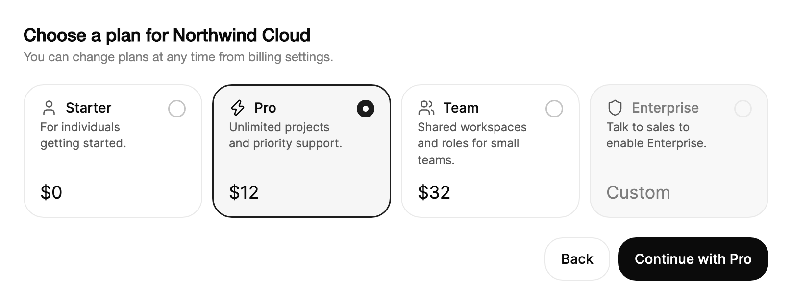

<Demo name="Grid" />

## 何时使用

`RadioCards` 用于单选，并且每个选项在人做决定前需要的信息不止一个标签：价格、配送时间、描述，或无法选择的原因。它出现在表单或流程的某一步中，例如注册时选择套餐、结账时选择配送方式，人选中的卡片就是流程继续的依据。

- **注册或账单步骤中的套餐选择**：一个 SaaS 产品提供入门版、专业版和团队版。每张卡片在元信息插槽中显示套餐价格，并用一行文字说明包含的内容。
- **结账时的配送方式选择**：标准、加急和次日达，每项都带有配送时段和费用。列表布局把时段和价格放在同一行，便于比较费用。
- **管理控制台中的地区或数据驻留选择**：出于合规要求选择工作区地区，每张卡片说明地区，并附一段关于延迟或保留期限的简短备注。
- **无法选择的选项及其原因**：需要联系销售的企业版，或当前账号套餐不包含的存储层级。`DisabledReason` 会在人正在查看的位置说明限制。
- **简短列表中必选的一项**：仪表板对话框中的导出格式或报表周期，人必须在三到四个选项中选一个，之后才能点击“运行”。

## 何时不用

- **仅含简短文字的选项**，例如“是、否、也许”或某种状态：用 `RadioGroup`，它更紧凑，没有价格或描述插槽。
- **同时切换内容的两到四个视图**，例如面板上方的概览、活动和设置：用 `SegmentedControl`。选择的是视图，而不是表单要保存的值。
- **很长的选项列表**，例如国家列表或上百个项目：用 `Select` 或 `Combobox`。卡片每个选项占用大量空间，也不支持筛选。
- **按月或按年切换计费周期并附带节省说明**：用 `BillingToggle`，它是一行带徽章的简短标签。
- **可以同时开启的多个选项**，例如套餐的附加功能：用 `Checkbox`。单选卡片只允许一个选择。

## 用法

卡片就是控件的 `Items`。每个 `RadioCardOption` 接受一个值、一个标签、一段描述，以及一段元信息文字，元信息显示在卡片末端。

```xml
<UserControl xmlns="https://github.com/avaloniaui"
             xmlns:arc="https://github.com/AIDotNet/TKCode.Arc">
    <arc:RadioCards SelectedValue="pro">
        <arc:RadioCardOption Value="starter" Label="入门版" Description="适合刚开始使用的个人。" Meta="$0" />
        <arc:RadioCardOption Value="pro" Label="专业版" Description="无限项目与优先支持。" Meta="$12" />
        <arc:RadioCardOption Value="team" Label="团队版" Description="为小型团队提供共享工作区与角色。" Meta="$32" />
    </arc:RadioCards>
</UserControl>
```

`RadioCards` 派生自 Avalonia 的 `SelectingItemsControl`。它具有常见的项模型（`ItemsSource`、`Items`、`SelectedIndex`、`SelectedItem`）以及该基类的选择事件。应用程序绑定的是 `SelectedValue`，因为它携带的是选项的值，而不是选项对象。卡片在这个选择控件之上加入选中光环、指示点、描述与元信息插槽、不可用原因以及两种布局，因此表单无需自定义模板即可获得完整的单选组。

### 结构

1. **卡片**：20 px 圆角、表面色背景与 1 px 边框。悬停和键盘焦点会加深边框；禁用的卡片使用弱化的表面色和弱化的文字颜色。
2. **选中光环**：一个 1.5 px 的光环，颜色为开启态控件色，绘制在卡片边框之上。它属于整个分组，而不属于某一张卡片，因此会从一张卡片滑向下一张。
3. **指示器**：一个 18 px 的圆形，带 1.5 px 边框，网格卡片位于顶端末侧，列表行位于起始位置。卡片被选中时，它以开启态控件色填充，并在字形颜色中显示一个 6 px 的圆点。
4. **图标**（`Icon`）：标签旁边 18 px 的字形，使用次要文字颜色绘制；卡片被选中时使用前景色。`Geometry` 会自动以 18 px 包装；其他内容按原样放置。
5. **标签**（`Label`）：中等字重，放不下时以省略号截断。
6. **描述**（`Description`）：次要颜色的超小文字，适合一到两行短句，位于标签下方 2 px。禁用的卡片改在这里显示 `DisabledReason`。
7. **元信息**（`Meta`）：价格或预估信息。网格卡片中它位于底部，使用大号文字，上方留 14 px；列表行中它位于末端，使用小号中等字重，前方留 12 px。
8. **焦点环**：围绕卡片的 2 px 环，供键盘焦点使用，指针焦点时隐藏。

同一行中的卡片共享最高卡片的高度，因此价格在整行中对齐。网格以至少 `MinColumnWidth`（默认为 180）的列宽排列卡片，列间距为 10 px。列表每行放置一张全宽卡片，行间距为 8 px。

### 绑定到视图模型

在 MVVM 应用中，视图模型负责选项与所选值。将 `ItemsSource` 绑定到 `ObservableCollection<RadioCardOption>`，将 `SelectedValue` 绑定到所选选项的 id。选择是双向的，选项列表是单向的。使用值而不是选项对象，这样保存的选择就是普通字符串或 id。

```csharp
public partial class PlanViewModel : ObservableObject
{
    public ObservableCollection<RadioCardOption> Plans { get; } = new()
    {
        new RadioCardOption("starter", "入门版", "适合刚开始使用的个人。", "$0"),
        new RadioCardOption("pro", "专业版", "无限项目与优先支持。", "$12"),
        new RadioCardOption("team", "团队版", "为小型团队提供共享工作区与角色。", "$32"),
        new RadioCardOption("enterprise", "企业版", "单一登录、审计日志与专属联系人。", "定制")
        {
            IsDisabled = true,
            DisabledReason = "请联系销售以开通企业版。"
        }
    };

    [ObservableProperty]
    private string? _planId = "pro";

    [RelayCommand]
    private async Task ContinueAsync()
    {
        await _subscriptions.StartAsync(PlanId);
    }
}
```

```xml
<StackPanel Spacing="16">
    <arc:RadioCards ItemsSource="{Binding Plans}"
                    SelectedValue="{Binding PlanId}"
                    AutomationProperties.Name="套餐" />
    <arc:Button Content="继续" Command="{Binding ContinueCommand}" IsDefault="True" />
</StackPanel>
```

- `SelectedValue` 是双向的：人做出的选择会把 id 写入 `PlanId`，代码中设置的值会选中对应的卡片。与任何卡片都不匹配的值会使选择保持为空。
- 当可用性取决于账号时，请在视图模型中对选项设置 `IsDisabled`，而不是在 XAML 中设置。这样卡片无需额外绑定即可显示原因。
- 编译绑定需要在视图上设置 `x:DataType`（这里的示例为简洁起见省略了它）。

### 在代码中设置选项

同样的选项既可以在代码后置或服务中构建，然后赋给 `ItemsSource`，也可以直接在 XAML 中内联。在设置好选项后再赋值 `SelectedValue`，会保留该选择。

```csharp
var plans = new RadioCards
{
    ItemsSource = new[]
    {
        new RadioCardOption("pro", "专业版", "无限项目与优先支持。", "$12") { Icon = ArcIcons.Zap },
        new RadioCardOption("team", "团队版", "为小型团队提供共享工作区与角色。", "$32") { Icon = ArcIcons.Users }
    },
    SelectedValue = "pro"
};
plans.SelectionChanged += (_, _) => Console.WriteLine(plans.SelectedValue);
```

`Icon` 接受一个 `Geometry`。它会以 18px 的图标绘制在卡片的起始位置。

### 选择布局

`Layout="List"` 会将卡片堆叠为全宽行，元信息位于末端。较长的描述会自动换行。默认的 `Grid` 布局会填充至少 `MinColumnWidth`（默认为 180）宽的列。

网格适合套餐和地区，人需要并排比较卡片，而描述正是选择的理由。列表适合配送、支付或交付方式，每个选项是一句带时间和价格的话，人需要自上而下扫读。当容器宽度小于约 370 px（两列 180 加上间距）时，网格会变为单列，因此窄对话框仍能完整显示每张卡片。

<Demo name="List" />

### 不可用的选项

在选项上设置 `IsDisabled`，可使其保持可见但不可用。设置 `DisabledReason` 说明原因。选项被禁用时，该原因会取代描述。方向键会跳过被禁用的选项。

```xml
<arc:RadioCards SelectedValue="pro">
    <arc:RadioCardOption Value="pro" Label="专业版" Description="无限项目与优先支持。" Meta="$12" />
    <arc:RadioCardOption Value="enterprise"
                         Label="企业版"
                         Description="单一登录、审计日志与专属联系人。"
                         Meta="定制"
                         IsDisabled="True"
                         DisabledReason="请联系销售以开通企业版。" />
</arc:RadioCards>
```

### 必填与禁用

`IsRequired` 会在表单中将该组标记为必填。`IsEnabled="False"` 会禁用所有卡片。

```xml
<arc:RadioCards IsRequired="True" IsEnabled="False" />
```

### 示例：注册时选择套餐

一个项目管理产品 Northwind Cloud 的注册步骤。四个套餐在网格中并排比较。被选中的专业版卡片带有光环和填充的指示器，企业版卡片说明为何不能在线选择，主按钮则以所选套餐继续。每张卡片高度相同，因为该行取最高卡片的高度，所以价格在整行中对齐。



```xml
<StackPanel Width="760" Spacing="20">
    <StackPanel Spacing="4">
        <TextBlock Text="Choose a plan for Northwind Cloud"
                   FontSize="18"
                   FontWeight="SemiBold"
                   Foreground="{arc:ArcDesignTokenResource Foreground}" />
        <TextBlock Text="You can change plans at any time from billing settings."
                   FontSize="13"
                   Foreground="{arc:ArcDesignTokenResource TextMuted}" />
    </StackPanel>
    <arc:RadioCards SelectedValue="pro" AutomationProperties.Name="Plan">
        <arc:RadioCardOption Value="starter"
                             Label="Starter"
                             Description="For individuals getting started."
                             Meta="$0"
                             Icon="{x:Static arc:ArcIcons.User}" />
        <arc:RadioCardOption Value="pro"
                             Label="Pro"
                             Description="Unlimited projects and priority support."
                             Meta="$12"
                             Icon="{x:Static arc:ArcIcons.Zap}" />
        <arc:RadioCardOption Value="team"
                             Label="Team"
                             Description="Shared workspaces and roles for small teams."
                             Meta="$32"
                             Icon="{x:Static arc:ArcIcons.Users}" />
        <arc:RadioCardOption Value="enterprise"
                             Label="Enterprise"
                             Description="SSO, audit logs and a dedicated contact."
                             Meta="Custom"
                             Icon="{x:Static arc:ArcIcons.Shield}"
                             IsDisabled="True"
                             DisabledReason="Talk to sales to enable Enterprise." />
    </arc:RadioCards>
    <StackPanel Orientation="Horizontal" Spacing="8" HorizontalAlignment="Right">
        <arc:Button Content="Back" Variant="Secondary" />
        <arc:Button Content="Continue with Pro" />
    </StackPanel>
</StackPanel>
```

### 文案规范

- **标签**：套餐、速度或地区的名称，使用单个词或短语，例如“Pro”“Express”“EU (Frankfurt)”。多词标签使用句首大写。
- **描述**：一行文字，用平实的语言说明这个选择给人带来什么，例如“无限项目与优先支持”“2 到 3 个工作日”。尽量控制在约 60 个字符以内，使其在网格卡片中能容纳两行。
- **元信息**：价格或时间。当单位不明显时，在描述中写明货币符号和单位，例如“$12”“免费”“定制”。数字用阿拉伯数字书写。
- **不可用原因**：说明人可以采取的下一步，而不只是限制本身。“请联系销售以开通企业版。”比“不可用”更好。

| 不要写 | 改为 |
|---|---|
| 专业版（推荐） | 专业版 |
| 发货很快 | 2 到 3 个工作日 |
| 专业档每月 12 美元 | $12 |
| 不可用 | 请联系销售以开通企业版。 |

### 最佳实践

**推荐**

- 把价格、时间或其他比较信息放在 `Meta` 中，描述则只说明选项包含什么。人会先比较元信息这一列。
- 当没有可见的标题为分组命名时，使用 `AutomationProperties.Name` 为其命名，这样选择时朗读的是“套餐”，而不是一串没有名称的卡片。
- 当某个选项是常见选择时，用 `SelectedValue` 设一个默认值，并在描述中说明。
- 每张禁用的卡片都使用 `DisabledReason`，让人知道选项为何不能选择以及该怎么做。

**避免**

- 在三四张卡片的网格中使用过长的描述。两行是设计的预期；一段长文字会让该行变高，并拖慢比较。
- 对没有描述或价格的选项使用网格。对于简短列表，`RadioGroup` 更易读。
- 当人需要知道某个选项存在时，把禁用的选项从集合中移除。应保持其可见并附上原因。
- 设置 `IsRequired` 却没有可见的提示。该属性会报告给辅助技术，但表单仍需要一条消息说明必须选择一个套餐。

### 常见问题

**没有设置 `SelectedValue` 时，选中的是什么？** 什么都没有。在人选择卡片或你的代码设置 `SelectedValue` 之前，该组没有选中项；此时按 Tab 会聚焦第一张可用的卡片。

**键盘如何在卡片之间移动？** 该组只占一个 Tab 停靠点。方向键选中并切换到下一张或上一张可用的卡片，Enter 或空格键选中获得焦点的卡片。方向键会跳过禁用的卡片，Home 与 End 分别选中第一张和最后一张可用的卡片。键盘映射见无障碍部分。

**为什么光环是滑动的，而不是直接跳过去？** 光环是一个形状，它以弹簧效果在被选卡片的位置之间滑动，视线能跟随变化。当布局尺寸变化时，光环会立即移动到新位置。

**如何显示一张既禁用又被选中的卡片？** 在同一个选项上同时设置 `IsDisabled` 和 `SelectedValue`。此时卡片会用其原因替代描述，光环也保持在该卡片上。通常更好的做法是在禁用某个选项之前，先在视图模型中修改选择。

**卡片能容纳控件吗，例如自定义图标或徽章？** `Icon` 接受 `Geometry` 或任意内容，`Meta` 接受任意对象，因此徽章可以作为元信息内容。内容应保持简短，因为卡片的高度与其所在行共享。

## API 参考

<!-- api: RadioCards -->
<!-- api: RadioCardOption -->

## 无障碍

- 对辅助技术而言，每张卡片都是一个单选按钮。当没有可见的标题为该组命名时，请在组上设置 `AutomationProperties.Name`。
- 卡片标签即卡片的名称。描述是其帮助文字。被禁用的卡片会改为报告其 `DisabledReason`。
- 该组只占一个 Tab 停靠点。`IsRequired` 会作为表单的必填项报告给辅助技术。
- 从右到左的布局会镜像方向键：Right 移到上一张卡片，Left 移到下一张。
- 键盘焦点会绘制一个偏移 2px 的 2px 轮廓。指针焦点不会绘制。
- 选中状态以光环和圆点显示，因此不只依赖颜色来传达。

### 键盘

| 按键 | 操作 |
|---|---|
| `Tab` / `Shift+Tab` | 进入该组时聚焦在选中的卡片上；若未选中任何卡片，则聚焦在第一张可用的卡片上；离开时同理。 |
| `Right` / `Down` | 选中并聚焦下一张可用的卡片。从最后一张卡片循环回到第一张。在从右到左的布局中，`Right` 向后移动。 |
| `Left` / `Up` | 选中并聚焦上一张可用的卡片。在从右到左的布局中，`Left` 向前移动。 |
| `Home` / `End` | 选中并聚焦第一张或最后一张可用的卡片。 |
| `Enter` / `Space` | 选中获得焦点的卡片。 |

## 动效

- 选中光环以弹簧效果从一张卡片滑向另一张，首次放置时淡入。布局尺寸变化时，它会立即移动到新位置。
- 选中卡片时，圆点从无到有地放大出现。卡片背景与边框颜色快速变化。
- 减弱动效时，光环与圆点立即进入最终状态，并取消颜色过渡。关闭动效时效果相同。

| 变化 | 完整 | 减弱 | 关闭 |
|---|---|---|---|
| 选择移动到另一张卡片 | 光环以弹簧效果滑到该卡片 | 光环立即位于该卡片 | 光环立即位于该卡片 |
| 首次放置选择 | 光环快速淡入 | 光环立即出现 | 光环立即出现 |
| 选中一张卡片 | 指示点以灵敏的弹簧弹出 | 圆点立即出现 | 圆点立即出现 |
| 布局尺寸变化 | 光环立即移动到新位置 | 光环立即移动 | 光环立即移动 |
| 悬停、按下或聚焦卡片 | 卡片背景与边框颜色快速变化 | 立即完成 | 立即完成 |

## 相关组件

- `RadioGroup`：垂直列表中的简短纯文字选项。
- `SegmentedControl`：两到四个需要同时切换内容的视图。
- `Checkbox`：用户可以选择多个选项的场景。
- `BillingToggle`：按月或按年的计费周期。

| 组件 | 适用场景 |
|---|---|
| `RadioGroup` | 选项是简短文字，没有价格或描述 |
| `SegmentedControl` | 选择用于切换视图，而不是保存为一个值 |
| `Select` / `Combobox` | 列表很长或需要筛选 |
| `BillingToggle` | 选择的是带节省说明的计费周期 |
| `Checkbox` | 一次可以开启多个选项 |
