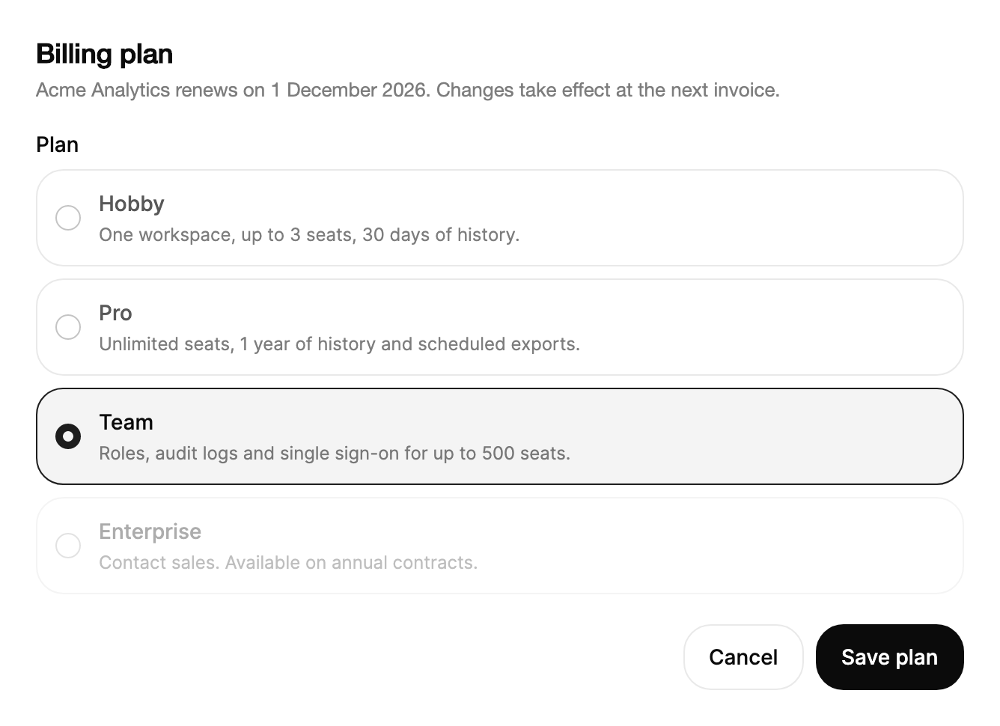

<Demo name="Plans" />

## 何時使用

單選群組以所有選項同時可見的方式，呈現一小組互斥的選項。它適用於表單和設定頁面，使用者需要在送出前比較各個選擇，而且每個選擇都需要說明才能理解。此群組是一個帶標籤的控制項：標題為它命名，各列承載選項，所選的值是一個表單可以讀取或儲存的數值。

- **帳單或升級頁面中的方案選擇**：工作區擁有者在愛好版、專業版和團隊版之間選擇。每一列都附有該方案包含內容的說明，而這正是決策所依據的資訊。
- **結帳時的配送或出貨選項**：標準配送、加急或自取，每項都以配送時段作為說明。所選選項會隨訂單一併送出。
- **分析主控台中的匯出格式或報表範圍**：CSV、Parquet 或 JSON，或「本月」與「年初至今」。每一列都說明檔案包含什麼，讓使用者不必猜測。
- **邀請表單中的存取或角色選擇**：檢視者、編輯者或管理員，每個角色附有其權限的說明。對於使用者自己的方案不包含的角色，使用 `IsDisabled`。
- **開發者工具中的環境或地區選擇**：為表單一次選定部署目標，每個選項都必須保持可見，以便審閱。

## 何時不用

- **在畫面上切換內容的簡短行內視圖**，例如圖表上的日、週和月：用 `SegmentedControl`，它看起來像一排標籤，並立即切換視圖。
- **很長的選項清單**，例如國家、貨幣或數十名成員的團隊：用 `Select`，它在需要之前不會佔用版面。
- **一次需要選取多個選項**，例如選擇多個通知管道或產品領域：對每個選項使用 `Checkbox`，因為單選群組只允許選取一項。
- **選項需要在卡片上顯示價格、中繼資訊或圖示**：用 `RadioCards`，它把每個選項排成可選取的卡片。
- **單一的開關式設定**，例如「透過電子郵件接收發票」：用 `Switch`，它立即生效，不需要分組。

## 用法

`Header` 是此群組的標籤。選項即控制項的 `Items`；每個 `RadioOption` 接受一個值、一個標籤以及可選的說明。

```xml
<UserControl xmlns="https://github.com/avaloniaui"
             xmlns:arc="https://github.com/AIDotNet/TKCode.Arc">
    <arc:RadioGroup Header="方案" Width="420" SelectedValue="pro">
        <arc:RadioOption Value="hobby" Label="愛好版" Description="適合個人專案和嘗試。" />
        <arc:RadioOption Value="pro" Label="專業版" Description="適合每週都要交付的專業人士。" />
        <arc:RadioOption Value="team" Label="團隊版" Description="為不斷壯大的團隊提供共享工作區、角色與稽核紀錄。" />
    </arc:RadioGroup>
</UserControl>
```

`RadioGroup` 衍生自 Avalonia 的 `HeaderedSelectingItemsControl`。因此選取、`SelectedIndex`、`SelectedItem`、`SelectionChanged`、標題和 `HeaderTemplate` 與任何 Avalonia 選取控制項中的行為相同，而此群組在此之上加入 Arc 的列設計、單一移動的反白、鍵盤模型與自動化名稱。群組會為每個選項建立一列，你無需自行加入列。

### 結構

1. **標題**（`Header`）：群組的圖例，使用中等字重，位於第一列之前，下方留 8 px。字串標題同時為輔助技術提供群組的名稱。`HeaderTemplate` 可以用更豐富的內容取代文字。
2. **列**：選項，以 8 px 的間距上下堆疊。每列是一個 1 px 邊框的方框，具有控制項圓角，內距在四周均為 12 px。該列會拉伸到群組的寬度。
3. **圓環**：一個 17 px 的圓形，帶 1 px 邊框，顏色為較強的邊框色。被選取的圓環以強調色（`ControlOn`）填滿。
4. **圓點**：圓環內 7 px 的圓點，顏色為字形顏色（`ControlGlyph`）。它只出現在被選取的列上。當指標在未選取的列上按下時，一個 22% 不透明度的淡色圓點會預覽該選擇。
5. **標籤**（`RadioOption.Label`）：中等字重，使用小號字體。它位於圓環右側 12 px 處；當 `Label` 為空時，改用該選項的 `Value`。未選取的標籤使用次要文字顏色；被選取的標籤使用前景色。
6. **說明**（`RadioOption.Description`）：標籤下方的額外一行，使用超小號字體和淡化的文字顏色，位於標籤下方 2 px。在窄寬度下會換行；說明為空時會收合。
7. **反白**：覆蓋被選取列的一個外框，帶 1 px 的強調色描邊，並以同一顏色 5% 的填滿。它是整個群組的單一元素，因此會在列之間移動，而不是在每一列上分別出現。
8. **焦點環**：繪製在獲得焦點的列外側 2 px 處的 2 px 環。僅在鍵盤焦點時出現。

列高隨內容變化：只有標籤時列較精簡，加上說明後，每段文字寬度會增加一行換行的文字。停用的列與停用的群組會淡化到 50% 不透明度。

### 繫結選項

將 `ItemsSource` 繫結到選項清單，將 `SelectedValue` 繫結到所選的值。兩者皆為雙向。

```xml
<arc:RadioGroup Header="方案"
                ItemsSource="{Binding Plans}"
                SelectedValue="{Binding PlanId}" />
```

```csharp
var plans = new RadioGroup
{
    Header = "方案",
    ItemsSource = new[]
    {
        new RadioOption("hobby", "愛好版", "適合個人專案和嘗試。"),
        new RadioOption("pro", "專業版", "適合每週都要交付的專業人士。")
    },
    SelectedValue = "pro"
};
plans.SelectionChanged += (_, _) => status.Text = $"已選取：{plans.SelectedValue}";
```

`SelectedValue` 保存的是所選選項的 `Value`，而不是選項物件。當你需要整個 `RadioOption`（例如在儲存後讀取它的說明）時，使用 `SelectedItem`。`SelectedValue` 會在選項到達時套用，因此可以在程式碼或 XAML 中先於 `ItemsSource` 設定。

### 繫結到檢視模型

使用 CommunityToolkit.Mvvm 時，檢視模型負責所選的方案和選項清單，群組只負責呈現它們。`SelectedValue` 與 `SelectedItem` 皆為雙向，因此指標或鍵盤做出的變更會立即到達檢視模型。

```csharp
public interface IBillingService
{
    Task ChangePlanAsync(string planId);
}

public partial class UpgradeViewModel : ObservableObject
{
    private readonly IBillingService _billing;

    public UpgradeViewModel(IBillingService billing)
    {
        _billing = billing;
        Plans.Add(new RadioOption("hobby", "愛好版", "適合個人專案和嘗試。"));
        Plans.Add(new RadioOption("pro", "專業版", "適合每週都要交付的專業人士。"));
        Plans.Add(new RadioOption("team", "團隊版", "為不斷壯大的團隊提供共享工作區、角色與稽核紀錄。"));
        SelectedPlanId = "pro";
    }

    public ObservableCollection<RadioOption> Plans { get; } = new();

    [ObservableProperty]
    private string? _selectedPlanId;

    [RelayCommand(CanExecute = nameof(CanSave))]
    private async Task SaveAsync()
    {
        await _billing.ChangePlanAsync(SelectedPlanId!);
    }

    private bool CanSave() => !string.IsNullOrEmpty(SelectedPlanId);

    partial void OnSelectedPlanIdChanged(string? value) => SaveCommand.NotifyCanExecuteChanged();
}
```

```xml
<StackPanel Width="420" Spacing="16">
    <arc:RadioGroup Header="方案"
                    ItemsSource="{Binding Plans}"
                    SelectedValue="{Binding SelectedPlanId}" />
    <arc:Button Content="變更方案" Command="{Binding SaveCommand}" />
</StackPanel>
```

- `SelectedValue` 是用於繫結已儲存選擇的屬性。只有當檢視需要選項物件時，才一併繫結 `SelectedItem`。
- `ItemsSource` 接受 `ObservableCollection<RadioOption>`，因此新增或移除選項都會更新群組。
- 對於不屬於資料的副作用（例如預覽標籤），在程式碼中使用 `SelectionChanged`。儲存動作應放在命令中，這樣它只在使用者按下按鈕時執行一次，而不是每次按方向鍵都執行。
- 在 XAML 中用一般字串設定 `Header`。字串標題同時也是群組的無障礙名稱。

### 停用選項

`IsDisabled` 讓選項保持可見但無法使用。方向鍵會略過停用的選項，指標、空白鍵和 Enter 都無法選取該列。

<Demo name="InlineOptions" />

當使用者需要知道某個選項存在以及它為何無法使用時，應顯示該停用的選項，例如帳號尚未達到的方案。請在選項的說明中寫出原因，例如「在團隊版方案中可用」。如果某個選項與此使用者始終無關，則應將其移除。

### 選取事件

當選取項目變更時（無論透過指標還是鍵盤），會引發 `SelectionChanged`。`SelectedItem` 會傳回 `RadioOption` 本身。

```csharp
group.SelectionChanged += (_, _) =>
{
    if (group.SelectedItem is RadioOption option)
    {
        Console.WriteLine(option.Value);
    }
};
```

### 選項數量與版面

預設的項目面板是單純的垂直 `StackPanel`，因此在顯示群組時會建立每一個選項。對於兩到六個帶說明的選項，這是合適的取捨。對於較長的清單，請使用 `Select`，它會按需開啟清單，而不會把每一列都放在頁面上。對於水平排列的簡短視圖，請使用 `SegmentedControl`。

為群組設定一個寬度，使最長的說明可以換行為兩到三行。過窄的群組會把每段說明換成許多短行，選項也就更難比較。

### 範例：在工作區升級中選擇方案

來自 SaaS 管理主控台的工作區擁有者帳單頁面。標題是一句說明選擇後果的話（「變更將在下一張發票時生效」）。三個方案各自帶有一個區分它們的關鍵事實，因此使用者僅憑該群組就能做出決定。被選取的列是團隊版，主要動作按鈕說明它要做什麼。



```xml
<StackPanel Width="620" Spacing="20">
    <StackPanel Spacing="6">
        <TextBlock Text="Billing plan"
                   FontSize="18"
                   FontWeight="SemiBold"
                   Foreground="{arc:ArcDesignTokenResource Foreground}" />
        <TextBlock Text="Acme Analytics renews on 1 December 2026. Changes take effect at the next invoice."
                   FontSize="13"
                   TextWrapping="Wrap"
                   Foreground="{arc:ArcDesignTokenResource TextMuted}" />
    </StackPanel>
    <arc:RadioGroup Header="Plan" SelectedValue="team">
        <arc:RadioOption Value="hobby"
                         Label="Hobby"
                         Description="One workspace, up to 3 seats, 30 days of history." />
        <arc:RadioOption Value="pro"
                         Label="Pro"
                         Description="Unlimited seats, 1 year of history and scheduled exports." />
        <arc:RadioOption Value="team"
                         Label="Team"
                         Description="Roles, audit logs and single sign-on for up to 500 seats." />
        <arc:RadioOption Value="enterprise"
                         Label="Enterprise"
                         Description="Contact sales. Available on annual contracts."
                         IsDisabled="True" />
    </arc:RadioGroup>
    <StackPanel Orientation="Horizontal" Spacing="8" HorizontalAlignment="Right">
        <arc:Button Content="Cancel" Variant="Secondary" />
        <arc:Button Content="Save plan" />
    </StackPanel>
</StackPanel>
```

### 文案規範

- **標題**：一個簡短的名詞片語，命名這個選擇，例如「方案」「配送方式」「匯出格式」。不要寫成問句（「要選哪個方案？」）；選項本身就是答案。
- **選項標籤**：一到兩個詞，以使用者自己的理解來命名該選項，例如「團隊版」「標準配送」。使用句首大寫，並保持標籤的結構一致，讓每一列要麼都是方案，要麼都是配送方式。
- **說明**：一句話，寫出把該選項與其他選項區分開的事實：席次、歷史紀錄、配送時段、包含的內容。數字用阿拉伯數字書寫，並讓各說明的長度大致相同。
- **停用原因**：在說明中寫明條件，例如「在團隊版方案中可用」。

| 不要寫 | 改為 |
|---|---|
| 您想選擇哪個方案？ | 方案 |
| 超值推薦！！！ | 無限席次與 1 年歷史紀錄。 |
| 選項 2 | 專業版 |
| 請聯絡我們的業務團隊，以了解企業版的價格資訊 | 請聯絡業務。僅限年度合約。 |

### 最佳做法

**建議**

- 把使用者最可能選擇的選項放在最前面，或放在帳號目前已選取的選項上，讓決策從目前狀態開始。
- 當僅靠標籤無法說明差異時，為每個選項提供說明。沒有說明的列讀起來較快，因此只在說明承載資訊時才加上。
- 設定與已儲存狀態相符的 `SelectedValue`。空的選取不會顯示標記，在一個期望得到答案的表單上，這看起來像一個未回答的問題。
- 對存在但無法套用的選項使用 `IsDisabled`，並在其說明中寫出原因。

**避免**

- 對「是或否」的選擇使用單選群組。`Switch` 或 `Checkbox` 能說明使用者正在設定什麼，而兩列單選會重複詢問同一件事。
- 一個群組中超過六個選項。頁面會為每個選項增加一列，選擇就變成掃視而不是比較；此時請改用 `Select`。
- 在使用者閱讀時每次重新整理都替換選項。只在資料變動時更新集合，這樣群組就不會在指標下方重繪。
- 只依賴顏色來顯示選取狀態。填滿的圓環和圓點是被選取列的第二重提示，因此選擇不依賴於分辨兩種顏色。

### 常見問題

**群組預設會選取任何東西嗎？** 不會。在設定值之前，`SelectedIndex` 為 -1，任何列都不顯示標記。請把 `SelectedValue` 設為你想要的預設值。

**我可以在選項到達之前設定 `SelectedValue` 嗎？** 可以。該值會在選項到達時套用，因此非同步載入選項的群組會保留最先設定的那個值。

**為什麼群組不為自己命名？** 字串 `Header` 會為群組命名。非字串的標題（例如帶有標題與提示的面板）則不會，此時請在群組上設定 `AutomationProperties.Name`。

**如何在別處顯示所選選項的說明？** 在 `SelectionChanged` 中把 `SelectedItem` 讀取為 `RadioOption`，並在文字區塊中顯示它的 `Description`。群組自己的列仍會保留各自的說明。

**列可以接受任意物件嗎？** 每一列都使用 `RadioOption`。列從該型別讀取 `Label`、`Description` 和 `IsDisabled`，因此其他物件不會為列提供文字。請在檢視模型中把你自己的模型對應為 `RadioOption`。

## API 參考

<!-- api: RadioGroup -->
<!-- api: RadioOption -->

## 無障礙

- 當 `Header` 為字串時，它為群組命名。每個選項都是單選按鈕，其說明即為說明文字。
- 群組只佔一個 Tab 停駐點。Tab 從選取的選項進入群組，下一次 Tab 離開。鍵盤焦點永遠不會停在未選取的選項上。
- 方向鍵將選取移到下一個或上一個選項，並循環切換。停用的選項會被略過。
- Home 和 End 選取第一個和最後一個選項。空白鍵和 Enter 選取獲得焦點的選項。
- 反白和圓點對輔助技術隱藏。每個選項都會回報它是否被選取。
- 鍵盤焦點會在該列周圍繪製 2px 的環。指標焦點不會繪製。
- 顏色並非唯一的提示：被選取的列帶有填滿的圓環、圓點和前景色標籤。

### 鍵盤

| 按鍵 | 操作 |
|---|---|
| `Tab` | 在選取的選項處進入群組；下一次 `Tab` 離開群組 |
| `Down` / `Right` | 選取並聚焦下一個選項，從最後一個循環回到第一個 |
| `Up` / `Left` | 選取並聚焦上一個選項，從第一個循環回到最後一個 |
| `Home` / `End` | 選取並聚焦第一個或最後一個選項 |
| `Space` / `Enter` | 選取獲得焦點的選項 |

方向鍵在兩個方向上都會略過停用的選項。

## 動態效果

- 一個反白區塊以變形彈簧滑動到被選取的列。新的圓點以彈簧彈入，舊的圓點同時縮小消失，因此一次變化讀起來就像一次實體移動。
- 按下圓環時它會輕微縮小。按下未選取的列會預覽其圓點。
- 群組尺寸變化時，反白區塊會立即移到新的列。
- 減少動態效果時，反白區塊和圓點立即就位，並取消按下時的縮放。關閉動態效果時效果相同。

| 變化 | 完整 | 減少 | 關閉 |
|---|---|---|---|
| 選取移動 | 反白以變形彈簧滑動；新圓點從 40% 彈入並淡入 | 反白與圓點立即就位 | 立即完成 |
| 舊圓點離開 | 立即縮小並淡出 | 立即完成 | 立即完成 |
| 圓環按下 | 按住時縮放到 88%；放開後彈回 | 無縮放 | 無縮放 |
| 按下未選取的列 | 預覽圓點以 22% 不透明度顯示 | 預覽圓點顯示 | 預覽圓點顯示 |
| 列與標籤顏色 | 背景與圓環顏色交叉淡化；標籤顏色交叉淡化 | 立即完成 | 立即完成 |
| 群組尺寸變化 | 反白立即移到新的列 | 立即完成 | 立即完成 |

## 相關元件

- `RadioCards`：選項需要在卡片上顯示價格、中繼資訊或圖示時使用。
- `SegmentedControl`：兩到五個簡短視圖，需要立即切換內容時使用。
- `Checkbox`：使用者可能選取多個選項時使用。
- `Select`：很長的選項清單。

| 元件 | 適用情境 |
|---|---|
| `RadioCards` | 每個選項需要價格、中繼資訊或圖示，且卡片適合並排比較 |
| `SegmentedControl` | 兩到五個針對同一內容的簡短視圖需要立即切換 |
| `Checkbox` | 使用者可以選取多個選項，或某個選項是「是或否」的設定 |
| `Select` | 清單很長，或選項數量很多，例如國家或團隊 |
| `Switch` | 單一設定立即生效，不需要分組 |
