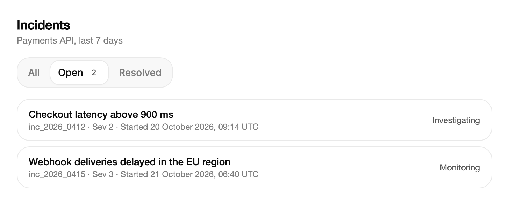

<Demo name="ViewSwitcher" />

## 何时使用

分段控件是一排两到五个简短选项，其中恰好一项处于激活状态，选择某一项会立即切换视图。它位于页面或面板的页头中，位于其所控制的内容上方，并让选择始终可见：使用者总能看到每个选项，以及当前正在显示哪一个。当选项是同一份数据的不同视图、而不是独立的页面时使用它，这样内容会原地切换，控件也保持不动。

- **分析仪表板中的时间范围**：日、周、月和季度会切换营收图表及其合计数。图表会按所选范围重绘，控件在此期间持续显示当前范围。
- **事件或工单列表中的状态筛选**：全部、未解决和已解决会缩小同一列表的范围。附加内容显示未解决项的数量，使用者在选择之前就能看到每个筛选项的规模。
- **数据表格中的布局或密度切换**：紧凑与舒适会改变屏幕上已有网格的行高，这是一项立即生效的设置。
- **共享工作区中的视图模式**：看板、列表和日历以三种排列方式展示同一批任务，当前排列方式以选中的分段保持可见。
- **管理控制台中的环境或账号切换**：生产、预发布与沙盒会改变页面读取的数据。选中的分段说明了页面上每个数字所依据的上下文。

## 何时不用

- **选项需要描述、纵向布局或更长的标签**：用 `RadioGroup`，它为每个选项提供一行，可容纳描述并自动换行。
- **选项需要在卡片上显示价格、元信息或图标**：用 `RadioCards`，它把每个选项排成可选中的卡片。
- **单个开或关的设置**：用 `Switch`。只有两个分段的分段控件会被读作视图之间的选择，而不是一项设置。
- **选项很多，或选项放不进一排短行**：用 `Select`，它能把长列表放在一个字段中。
- **在各自带有标签页的整块内容面板之间切换**：用 `Tabs`，它是为内容区域及其导航设计的，而不是为一排视图模式设计的。

## 用法

每个 `SegmentedOption` 接受一个值和一个标签。控件通过 `SelectedValue` 选中值对应的分段。

```xml
<UserControl xmlns="https://github.com/avaloniaui"
             xmlns:arc="https://github.com/AIDotNet/TKCode.Arc">
    <arc:SegmentedControl AutomationProperties.Name="范围" SelectedValue="week">
        <arc:SegmentedOption Value="day" Label="日" />
        <arc:SegmentedOption Value="week" Label="周" />
        <arc:SegmentedOption Value="month" Label="月" />
    </arc:SegmentedControl>
</UserControl>
```

`SegmentedControl` 派生自 Avalonia 的 `SelectingItemsControl`，因此 `SelectedIndex`、`SelectedItem`、`SelectedValue` 和 `SelectionChanged` 的行为与任何 Avalonia 选择类控件一致。控件在此之上增加了在分段之间滑动的药丸形高亮、方向键导航模型、溢出滚动以及 `ItemIntent` 事件。

### 结构

1. **外框**：1 px 边框，控件圆角，表面弱化色背景。分段在其内部滚动，因此分段溢出时外框形状保持不变。
2. **轨道**：四周各内缩 3 px，分段之间相距 2 px。
3. **选中药丸**：一个圆角图形，表面色背景，带 1 px 边框和静止阴影。它位于标签之下，并移动到选中的分段。
4. **分段**：至少为 Arc 小号控件高度（默认主题中为 36 px），左右各 12 px 内边距，圆角 14 px。分段从不收缩，标签也从不换行。
5. **标签**（`Label`）：小号字号，中等字重。使用弱化文字颜色；分段被悬停、按下或选中时，改为前景色。
6. **附加内容**（`SegmentedOption.Accessory`）：标签之后的可选内容，与标签间隔 6 px。`Accessory` 为空时隐藏。
7. **焦点环**：分段获得焦点时在其内部绘制 2 px 的环。滚动区域会裁剪绘制在外部的轮廓，因此焦点环保持在分段之内。

使用默认参数且无附加内容时，控件高 44 px：36 px 的分段，上下各 3 px 的轨道内缩，以及 1 px 的外框。

### 选择变体

页面上的每次视图切换都使用控件的默认参数，这样所有切换看起来一致。控件没有尺寸属性：其高度由分段与轨道决定，字体跟随 Arc 正文字号。规划分段数量时要参照页头的宽度。两到五个简短分段可以舒适地放进页头；六个或更多标签可能使一排超出页头宽度，此时 `Select` 更适合承载选择。

把控件放在它所控制内容的顶部，与页面起始端对齐。控件默认靠左对齐，只有当它是居中页头中的唯一元素时，才设置 `HorizontalAlignment="Center"`。

### 通过代码设置项

将 `ItemsSource` 绑定到选项列表。控件也接受纯字符串，`SelectedIndex` 可按位置选中分段。

```csharp
var sections = new SegmentedControl
{
    MaxWidth = 300,
    ItemsSource = new[] { "概览", "活动", "部署", "分析", "日志", "设置" },
    SelectedIndex = 0
};
```

纯字符串本身就是它的值，因此 `SelectedValue` 返回字符串本身。当值与标签不同时使用 `SegmentedOption`，例如值是枚举或 ID，而标签是给人阅读的文字。

### 附加内容

`Accessory` 是显示在标签之后的内容，例如数量。它接受任意内容，因此数量可以是放在小徽标中的 `TextBlock`。

<Demo name="AccessoryAndIntent" />

```xml
<arc:SegmentedControl SelectedValue="all">
    <arc:SegmentedOption Value="all" Label="全部" />
    <arc:SegmentedOption Value="unread" Label="未读">
        <arc:SegmentedOption.Accessory>
            <TextBlock Text="3" />
        </arc:SegmentedOption.Accessory>
    </arc:SegmentedOption>
    <arc:SegmentedOption Value="archived" Label="已归档" IsDisabled="True" />
</arc:SegmentedControl>
```

附加内容应只放一个数字或一个简短的状态标记。附加内容位于分段之内，因此过长的标签或过宽的徽标会让分段变宽，并挤压相邻的分段。数据变化时更新附加内容中的数字即可，无需重建分段。

### 绑定到视图模型

使用 CommunityToolkit.Mvvm 时，视图模型保存选项列表和选中值，控件负责显示。`SelectedValue` 是双向的，因此视图模型可以读取指针或键盘所做的选择。

```csharp
public partial class ActivityViewModel : ObservableObject
{
    public ObservableCollection<SegmentedOption> Ranges { get; } = new()
    {
        new SegmentedOption("day", "日"),
        new SegmentedOption("week", "周"),
        new SegmentedOption("month", "月")
    };

    [ObservableProperty]
    private string? _selectedRange = "week";
}
```

```xml
<arc:SegmentedControl ItemsSource="{Binding Ranges}"
                      SelectedValue="{Binding SelectedRange}"
                      AutomationProperties.Name="范围" />
```

- `SelectedValue` 是双向的。将它绑定到保存当前视图的属性，由视图模型根据该值决定视图显示什么。
- `ItemsSource` 接受 `ObservableCollection<SegmentedOption>`，因此页面打开期间选项也可以变化。
- 当变化必须加载数据时使用 `SelectionChanged`，并把加载逻辑放在命令或服务中，而不是控件中。
- `AutomationProperties.Name` 为分组命名。请在 XAML 中设置它，因为控件本身没有标题。

### 意图事件

当指针或焦点到达某个分段时，会在该分段被选中之前引发 `ItemIntent`。用它做预览，例如提示。不要用它来切换视图。

```csharp
segmented.ItemIntent += (_, e) => hint.Text = $"预览：{e.Value}";
segmented.SelectionChanged += (_, _) => ShowView(segmented.SelectedValue);
```

事件携带分段的 `Item` 和 `Value`。鼠标进入分段会引发它，键盘焦点移动也会引发。触摸与触控笔在悬停时不会引发它，但点按时会选中分段，随后引发 `SelectionChanged`。当加载耗时较长时，可在 `ItemIntent` 中预加载分段的内容，使视图在选择之后无需等待即可出现。

### 溢出

当选项比控件更宽时，选项行会在控件内部滚动。滚动条隐藏，每个仍有更多内容的边缘会显示 20 px 的渐隐。选中的分段始终被完整滚动到视野内，其两侧保留 20 px 空间，从而避开渐隐区域。

<Demo name="Overflow" />

溢出让控件在窄面板中仍可使用，但会把部分选项隐藏起来。请选择分段数量，使一排能放进页面所支持的最宽布局。分段在屏幕之外时，使用者可能不知道它的存在，因此更长的选项组请使用 `Select`。

### 示例：事件状态筛选

支付平台事件列表中的状态筛选。三个分段都是简短的名词，“Open”分段带有数量，使用者在选择之前就知道每个选项包含多少条记录。控件下方的列表显示筛选后的行，标题说明列表涵盖的范围。



```xml
<StackPanel Width="680" Spacing="16">
    <StackPanel Spacing="4">
        <TextBlock Text="Incidents"
                   FontSize="18"
                   FontWeight="SemiBold"
                   Foreground="{arc:ArcDesignTokenResource Foreground}" />
        <TextBlock Text="Payments API, last 7 days"
                   FontSize="13"
                   Foreground="{arc:ArcDesignTokenResource TextMuted}" />
    </StackPanel>
    <arc:SegmentedControl AutomationProperties.Name="Incident status" SelectedValue="open">
        <arc:SegmentedOption Value="all" Label="All" />
        <arc:SegmentedOption Value="open" Label="Open">
            <arc:SegmentedOption.Accessory>
                <Border Padding="6,0"
                        CornerRadius="999"
                        VerticalAlignment="Center"
                        Background="{arc:ArcDesignTokenResource Surface}">
                    <TextBlock Text="2"
                               FontSize="11"
                               Foreground="{arc:ArcDesignTokenResource TextSecondary}" />
                </Border>
            </arc:SegmentedOption.Accessory>
        </arc:SegmentedOption>
        <arc:SegmentedOption Value="resolved" Label="Resolved" />
    </arc:SegmentedControl>
    <StackPanel Spacing="8">
        <Border Padding="16,12"
                BorderBrush="{arc:ArcDesignTokenResource Border}"
                BorderThickness="1"
                CornerRadius="{arc:ArcDesignTokenResource RadiusControl}">
            <Grid ColumnDefinitions="*,Auto">
                <StackPanel Spacing="2">
                    <TextBlock Text="Checkout latency above 900 ms"
                               FontWeight="Medium"
                               Foreground="{arc:ArcDesignTokenResource Foreground}" />
                    <TextBlock Text="inc_2026_0412 · Sev 2 · Started 20 October 2026, 09:14 UTC"
                               FontSize="12"
                               Foreground="{arc:ArcDesignTokenResource TextMuted}" />
                </StackPanel>
                <TextBlock Grid.Column="1"
                           Text="Investigating"
                           FontSize="12"
                           VerticalAlignment="Center"
                           Foreground="{arc:ArcDesignTokenResource TextSecondary}" />
            </Grid>
        </Border>
        <Border Padding="16,12"
                BorderBrush="{arc:ArcDesignTokenResource Border}"
                BorderThickness="1"
                CornerRadius="{arc:ArcDesignTokenResource RadiusControl}">
            <Grid ColumnDefinitions="*,Auto">
                <StackPanel Spacing="2">
                    <TextBlock Text="Webhook deliveries delayed in the EU region"
                               FontWeight="Medium"
                               Foreground="{arc:ArcDesignTokenResource Foreground}" />
                    <TextBlock Text="inc_2026_0415 · Sev 3 · Started 21 October 2026, 06:40 UTC"
                               FontSize="12"
                               Foreground="{arc:ArcDesignTokenResource TextMuted}" />
                </StackPanel>
                <TextBlock Grid.Column="1"
                           Text="Monitoring"
                           FontSize="12"
                           VerticalAlignment="Center"
                           Foreground="{arc:ArcDesignTokenResource TextSecondary}" />
            </Grid>
        </Border>
    </StackPanel>
</StackPanel>
```

### 文案规范

- **标签**：一到两个词，说明视图或状态，例如“日”“未解决”“紧凑”。分段从不换行，因此过长的标签会加宽整个控件。使用句首大写。
- **附加内容**：用数字表示的数量，或一个简短标记。不要在附加内容中放一句话。
- **分组名称**：`AutomationProperties.Name` 为辅助技术提供分组名称。请写成名词，例如“范围”“事件状态”“视图”。
- **分段顺序**：把跨度最短或最常用的视图放在最前，并且在使用同一控件的每个页面上保持相同的顺序。

| 不要写 | 改为 |
|---|---|
| 显示最近一天的数据 | 日 |
| 未解决的问题（共 12 个） | Open，附加内容为 12 |
| 点击这里查看已解决的项 | 已解决 |
| 视图模式 | 视图 |

### 最佳实践

**推荐**

- 让每个分段都是同一内容的视图，使切换改变的是数据而不是页面结构。
- 把选中值保存在视图模型中，并据此更新内容，这样重新加载之后控件与内容不会不一致。
- 同一选择在每个页面上使用相同的顺序和标签，让使用者只需学习一次。
- 当页头中没有可见标题说明控件的选择内容时，用 `AutomationProperties.Name` 为分组命名。

**避免**

- 用控件在页面之间导航。页面切换应属于导航，而分段控件只在当前页面内保持选择。
- 在 `ItemIntent` 中执行开销大的工作。它不做节流，因此指针扫过一排时，会为经过的每个分段都引发一次。
- 无理由地把禁用的分段放在一排中间。禁用分段仍然可见，使用者需要知道它为何不能被选择。
- 同一控件中的标签长短不一。长度相同的标签能让药丸宽度保持均匀，也更易于扫读。

### 常见问题

**为什么控件没有填满它的容器？** 它靠左对齐，并根据分段大小确定尺寸。如需固定宽度，请设置 `Width`；如需在页头中居中，请设置 `HorizontalAlignment="Center"`。当分段放不进宽度时，该行会滚动。

**如何在代码中选中分段？** 按值设置 `SelectedValue`，或按位置设置 `SelectedIndex`。分段溢出时，选中的分段会在被选中时滚动到视野内。

**`ItemIntent` 会在鼠标点击之前触发吗？** 会。鼠标进入分段时就会引发 `ItemIntent`，因此预览发生在点击选中分段并引发 `SelectionChanged` 之前。触摸输入在悬停时不会引发它。

**能绑定纯字符串列表吗？** 可以。`ItemsSource` 接受字符串，`SelectedValue` 返回字符串本身。当值必须与文字不同时，例如枚举或 ID，请使用 `SegmentedOption`。

## API 参考

<!-- api: SegmentedControl -->
<!-- api: SegmentedOption -->

## 无障碍

- `AutomationProperties.Name` 为分组命名。对于没有可见标题的控件，请为其设置该属性。
- 每个分段都是一个按钮，会报告其按下状态。滑动的药丸形高亮对辅助技术隐藏。
- Tab 键从选中的分段进入控件；若未选中任何分段，则从第一个分段进入。再按一次 Tab 键即离开。
- 方向键选中并聚焦下一个或上一个分段，并循环切换。Home 和 End 选中第一个和最后一个分段。已禁用的分段会被跳过。
- 键盘焦点会在分段内部绘制 2px 的轮廓线，因此滚动区域不会裁剪它。指针焦点不会绘制。

### 键盘

| 按键 | 操作 |
|---|---|
| `Tab` | 从选中的分段进入控件；若未选中任何分段，则从第一个分段进入；再按一次 `Tab` 即离开 |
| `Right` / `Down` | 选中并聚焦下一个分段，从最后一个循环到第一个 |
| `Left` / `Up` | 选中并聚焦上一个分段，从第一个循环到最后一个 |
| `Home` / `End` | 选中并聚焦第一个或最后一个分段 |
| `Space` / `Enter` | 选中已聚焦的分段 |

焦点每到达一个分段都会引发 `ItemIntent`。方向键随后选中该分段，因此预览与切换都来自同一次移动。

## 动效

- 一个药丸形高亮以形变弹簧滑动到选中的分段之下。高亮位于标签之下，并随标签一同滚动。
- 分段本身不会缩放或改变字重，只有高亮移动，标签颜色快速变化。
- 分段溢出时，该行会以短促的缓动滚动，以保持选中的分段可见。首次加载控件后的定位是即时的。
- 减弱动效时，高亮立即移动，并取消颜色过渡。关闭动效时效果相同。

| 变化 | 完整 | 减弱 | 关闭 |
|---|---|---|---|
| 选中项移动 | 药丸形高亮以形变弹簧滑动 | 高亮立即移动 | 高亮立即移动 |
| 标签颜色（悬停、按下、选中） | 在快速缓动上交叉淡变 | 立即完成 | 立即完成 |
| 溢出时滚动到选中分段 | 在首次布局之后沿标准缓动平滑滚动 | 直接跳转 | 直接跳转 |
| 边缘渐隐出现或消失 | 跟随滚动位置 | 跟随滚动位置 | 跟随滚动位置 |
| 加载后的首次定位 | 立即 | 立即 | 立即 |

## 相关组件

- `RadioGroup`：适用于需要描述或纵向布局的选项。
- `BillingToggle`：用于按月或按年切换计费周期，并附带节省说明。
- `Switch`：用于立即生效的单个设置。

| 组件 | 适用场景 |
|---|---|
| `RadioGroup` | 每个选项都需要描述，或纵向列表更适合表单 |
| `RadioCards` | 选项需要在卡片上显示价格、元信息或图标 |
| `Tabs` | 每个选项都会打开一整块带有自身导航的内容面板 |
| `Select` | 选项很多，或放不进一排短行 |
| `Switch` | 一项设置立即生效，且没有其他取值 |
| `BillingToggle` | 选择的是按月或按年的计费周期，并附带节省说明 |
