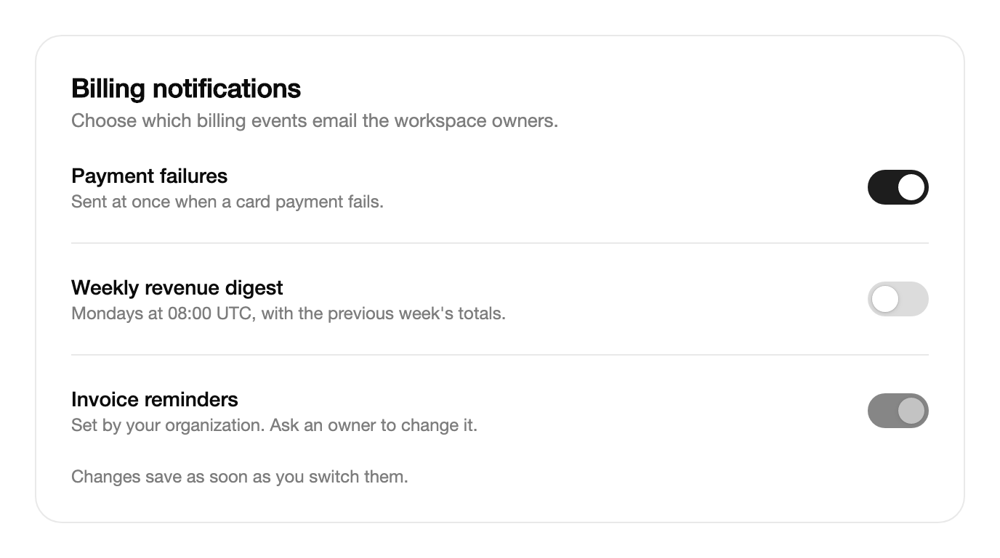

<Demo name="SettingsList" />

## When to use

A switch turns one setting on or off, and the change takes effect as soon as the person makes it. It belongs in a
settings page, a preferences panel or an account area, where each row is a setting that can be changed alone and does
not wait for a save button. The track and thumb show the state at a glance, so the person sees the current setting
without reading a label twice.

- **Notification preferences in an admin console**: "Email me when a payment fails" or "Send a weekly revenue digest".
  Each switch applies its setting on the spot, and the page needs no confirm step.
- **Feature availability in a SaaS workspace**: "Enable beta reports" or "Show archived projects". The switch is the
  only control on its row, so the label states what changes.
- **Privacy and data sharing in an account page**: "Share usage data with the product team". A switch gives the
  person a clear on or off choice with the current state visible.
- **A settings list with one switch per row**: a notifications page where each channel, such as email, SMS or in-app,
  has its own switch and its own description.
- **Operational toggles in a developer tool**: "Pause deployments for this project" or "Mirror logs to the audit
  stream". The effect starts at once, so the switch must not be used where a review step is required.

## When not to use

- **A choice that is confirmed with a submit button**, such as accepting terms or opting in to a plan at checkout:
  use `Checkbox`, whose value is saved only when the form is submitted.
- **A choice among named options**, such as Day, Week or Month: use `SegmentedControl` for short views, or
  `RadioGroup` for options that need a description each.
- **Several options where the person picks more than one**: use one `Checkbox` for each option, so the form reads as a
  list of choices rather than a list of switches with interdependent meanings.
- **An action that runs now**, such as "Restart service" or "Send invoice": use `Button`. A switch names a state,
  and a button names an action.
- **A setting that needs a confirmation or a reason before it applies**, such as disabling single sign-on: show a
  dialog from the action that changes it, instead of a switch that applies the change at once.

## Usage

`Content` is the label of the switch. The whole label is part of the click target.

```xml
<UserControl xmlns="https://github.com/avaloniaui"
             xmlns:arc="https://github.com/AIDotNet/TKCode.Arc">
    <arc:Switch Content="Email notifications" IsChecked="True" />
</UserControl>
```

`Switch` derives from Avalonia's `ToggleButton`, so `IsChecked`, `IsCheckedChanged`, `Content` and the click and
keyboard behavior of a toggle button are all there. The control adds the track and thumb design, the press stretch
of the thumb and the Arc motion. The state is two-valued: `IsChecked` is `true` or `false`, and the switch has no
mixed state.

### Anatomy

1. **Track** (42 by 24 px, fully rounded): the surface the thumb moves on. It is the control track color when off, the
   track color on hover when off, and the accent color (`ControlOn`) when on. It fades to the accent color when the
   state changes.
2. **Thumb** (18 px, fully rounded, with the Arc thumb shadow): sits 3 px inside the track. It travels 18 px from the
   off position to the on position. Its color is the thumb color when off and the on-thumb color when on.
3. **Pressed thumb**: while the pointer or the Space key is held, the thumb widens to 23 px toward the other side, and
   its far edge stays where it is. This is the press feedback, and it shows which way the thumb will go.
4. **Label** (`Content`): 12 px to the right of the track, in the small type size and the foreground color. It is
   hidden when `Content` is empty.
5. **Focus ring**: a 2 px ring for keyboard focus only, with its inner edge 2 px outside the track.

The minimum height of the control is the Arc medium control size. A disabled switch fades to 50% opacity and shows
the not-allowed cursor.

### Settings list

Stack the switches to form a list of settings. Each switch's label names the setting, and the rows are separated by
the spacing of the list rather than by lines.

```xml
<StackPanel Spacing="4">
    <arc:Switch Content="Email notifications" IsChecked="True" />
    <arc:Switch Content="Weekly digest" />
    <arc:Switch Content="Product updates" />
</StackPanel>
```

Keep the labels as the setting's name, not as a sentence about its state. "Weekly digest" is clear in both states,
while "Send me a weekly digest" reads oddly when the switch is off. Put a short description in a text block below the
label when the effect needs explaining, and keep it under the same label in the same column.

### Binding

Bind `IsChecked` to a view model property. Bind `IsEnabled` to lock the switch.

```xml
<arc:Switch Content="Email notifications"
            IsChecked="{Binding EmailEnabled}"
            IsEnabled="{Binding CanEditSettings}" />
```

`IsChecked` is two-way, so a change made by the pointer or the keyboard updates the property at once. Bind
`IsEnabled` to a permission or to a state that blocks the change, such as a setting that is managed by an
organization, and say why nearby.

### Binding to a view model

With CommunityToolkit.Mvvm, the view model holds each setting as a property, and a change saves it. The switch does
not save anything itself; the handler saves the value the person set.

```csharp
public interface ISettingsService
{
    Task SetAsync(string key, bool enabled);
}

public partial class NotificationSettingsViewModel : ObservableObject
{
    private readonly ISettingsService _settings;

    public NotificationSettingsViewModel(ISettingsService settings)
    {
        _settings = settings;
    }

    [ObservableProperty]
    private bool _emailNotifications;

    [ObservableProperty]
    private bool _canEditSettings = true;

    partial void OnEmailNotificationsChanged(bool value)
    {
        _ = _settings.SetAsync("notifications.email", value);
    }
}
```

```xml
<arc:Switch Content="Email notifications"
            IsChecked="{Binding EmailNotifications}"
            IsEnabled="{Binding CanEditSettings}" />
```

- `IsChecked` is the value to bind. Use a plain `bool` property, since the switch never produces a null value.
- The generated `OnEmailNotificationsChanged` method runs whenever the property changes, including when the saved value
  is loaded into it. Load the saved values before the page is shown, or skip the save when the value matches the
  stored one, so loading does not write the setting back.
- Keep the save in the view model, not in the view. Then the same setting saves whether the person changes it by mouse,
  keyboard or code.

### Disabled

A disabled switch keeps its state and cannot be changed.

<Demo name="Disabled" />

Disable a switch when the setting cannot apply at the moment, and say why in a description next to it, such as "Turned
on by your administrator". A disabled switch in a list is still read as part of the list, so keep it in its place
instead of hiding it.

### Changes

`IsCheckedChanged` is raised whenever the state changes, from the pointer, the keyboard or code. Apply the setting
there, so every way of changing it has the same effect.

```csharp
notifications.IsCheckedChanged += (_, _) =>
{
    settings.EmailEnabled = notifications.IsChecked == true;
};
```

The event fires for code changes as well as for the person's input. When a save fails, set `IsChecked` back to the
previous value in the same handler and show the error near the switch, so the switch shows the value that is really
saved.

### Example: notification settings

A notifications page for a billing administrator in a SaaS admin console. Each row names one setting in a short
noun phrase, and a description under it states what the setting sends and when. The rows are separated by a line
and are aligned on one column. The row for invoice reminders is disabled, because the organization sets it, and the
footer says that changes save at once, so the person knows no save step is coming.



```xml
<Border Width="640"
        Padding="24"
        BorderBrush="{arc:ArcDesignTokenResource Border}"
        BorderThickness="1"
        CornerRadius="{arc:ArcDesignTokenResource RadiusControl}">
    <StackPanel Spacing="16">
        <StackPanel Spacing="4">
            <TextBlock Text="Billing notifications"
                       FontSize="18"
                       FontWeight="SemiBold"
                       Foreground="{arc:ArcDesignTokenResource Foreground}" />
            <TextBlock Text="Choose which billing events email the workspace owners."
                       FontSize="13"
                       TextWrapping="Wrap"
                       Foreground="{arc:ArcDesignTokenResource TextMuted}" />
        </StackPanel>
        <Grid ColumnDefinitions="*,Auto" RowDefinitions="Auto,Auto">
            <StackPanel Spacing="2" VerticalAlignment="Center">
                <TextBlock Text="Payment failures"
                           FontWeight="Medium"
                           Foreground="{arc:ArcDesignTokenResource Foreground}" />
                <TextBlock Text="Sent at once when a card payment fails."
                           FontSize="12"
                           Foreground="{arc:ArcDesignTokenResource TextMuted}" />
            </StackPanel>
            <arc:Switch Grid.Column="1"
                        AutomationProperties.Name="Payment failures"
                        IsChecked="True" />
        </Grid>
        <Border Height="1" Background="{arc:ArcDesignTokenResource Border}" />
        <Grid ColumnDefinitions="*,Auto">
            <StackPanel Spacing="2" VerticalAlignment="Center">
                <TextBlock Text="Weekly revenue digest"
                           FontWeight="Medium"
                           Foreground="{arc:ArcDesignTokenResource Foreground}" />
                <TextBlock Text="Mondays at 08:00 UTC, with the previous week's totals."
                           FontSize="12"
                           Foreground="{arc:ArcDesignTokenResource TextMuted}" />
            </StackPanel>
            <arc:Switch Grid.Column="1"
                        AutomationProperties.Name="Weekly revenue digest" />
        </Grid>
        <Border Height="1" Background="{arc:ArcDesignTokenResource Border}" />
        <Grid ColumnDefinitions="*,Auto">
            <StackPanel Spacing="2" VerticalAlignment="Center">
                <TextBlock Text="Invoice reminders"
                           FontWeight="Medium"
                           Foreground="{arc:ArcDesignTokenResource Foreground}" />
                <TextBlock Text="Set by your organization. Ask an owner to change it."
                           FontSize="12"
                           Foreground="{arc:ArcDesignTokenResource TextMuted}" />
            </StackPanel>
            <arc:Switch Grid.Column="1"
                        AutomationProperties.Name="Invoice reminders"
                        IsChecked="True"
                        IsEnabled="False" />
        </Grid>
        <TextBlock Text="Changes save as soon as you switch them."
                   FontSize="12"
                   Foreground="{arc:ArcDesignTokenResource TextMuted}" />
    </StackPanel>
</Border>
```

### Content guidelines

- **Label**: the name of the setting, in sentence case, with no colon and no question. "Email notifications", not
  "Would you like email notifications?".
- **Description**: one sentence on what the setting does and when it applies. Write times and counts as digits.
- **Disabled reason**: name who can change the setting, such as "Set by your organization", and how to ask for a change.
- **Status text**: say that changes save at once when no save button exists. "Changes save as soon as you switch them."

| Instead of | Write |
|---|---|
| Enable | Email notifications |
| Toggle | Turn on to receive a weekly digest. |
| Would you like to get emails? | Email notifications |
| Setting disabled | Set by your organization. Ask an owner to change it. |

### Best practices

**Do**

- Apply the change as soon as the person makes it, and show the result near the switch if the save can fail. A switch
  that shows a state the server has not accepted is worse than one that waits.
- Keep the label the same in every state, so the person reads the setting's name in both positions.
- Group related switches under one heading, and keep the order the same on every visit to the page.
- Give an icon-only switch an `AutomationProperties.Name`, since it has no label to name it.

**Avoid**

- Using a switch for a choice that needs a confirmation or a reason. A dialog or a submit button makes the step visible.
- Changing the state from several code paths without a single save in the view model. The setting then depends on how
  it was changed.
- Hiding a disabled switch to simplify the list. The person then cannot learn that the setting exists or why it is off.
- Writing a state into the label ("On: email notifications"). The switch already shows the state, and a label that
  repeats it reads twice.

### Common questions

**Does the thumb animate when code changes the state?** Yes, with full motion. A change that did not come from a press
plays a short stretch of the thumb, so a code change is visible. A change within 250 ms of a press release does not
stretch, because the press already showed the motion.

**Can a switch have no label?** Yes. With no `Content` the track and thumb show alone, and the switch has no visible
name. Set `AutomationProperties.Name` so assistive technology can read it.

**Does setting `IsChecked` in code save the setting?** No. Setting it changes the state, raises `IsCheckedChanged`
and plays the stretch. The save runs only where your handler or view model calls it.

**Does the switch show a loading state while a save runs?** No. Disable the switch with `IsEnabled` while the save
runs, if the person must not change it again until the result is known.

**Why is the switch a toggle button to a screen reader?** Avalonia has no separate switch control type, so the switch
reports as a toggle button in its checked or unchecked state.

## API reference

<!-- api: Switch -->

## Accessibility

- `Content` is the switch's name. A switch with only an icon needs `AutomationProperties.Name`.
- Space and Enter toggle the switch. The thumb keeps its stretched shape while Space is held.
- Assistive technology reports the switch as a toggle button in the checked or unchecked state. Avalonia has no separate switch control type.
- Keyboard focus draws a 2px outline offset by 2px. Pointer focus does not.
- The thumb is hidden from assistive technology. The on and off state is also shown by the track color and the thumb position.

### Keyboard

| Keys | Action |
|---|---|
| `Tab` / `Shift+Tab` | Moves focus to the switch and on to the next or previous control |
| `Space` | Toggles the switch; the thumb stays stretched while Space is held |
| `Enter` | Toggles the switch |

## Motion

- Pressing the switch widens the thumb toward the other side while the far edge stays in place. Releasing glides the thumb across on a spring with no bounce.
- A change that did not come from a press, such as a key press or code, plays a brief stretch of the thumb.
- The track fill fades in and out, and the thumb color changes with it.
- Reduced motion removes the stretch, moves the thumb at once and turns off the color transitions. Off does the same.

| Change | Full | Reduced | Off |
|---|---|---|---|
| Thumb moves after a press | Glides across on a 0.3 s spring with no bounce | Moves at once | Moves at once |
| Thumb widens while pressed | Springs to 23 px wide; the far edge stays in place | No widening | No widening |
| Change from a key or code | One stretch to 116% and back, about 0.34 s | No stretch | No stretch |
| Track fill and thumb color | Crossfade on the standard tween | Immediate | Immediate |

## Related

- `Checkbox` for a choice that is confirmed with a submit button.
- `SegmentedControl` for switching between a few named views.
- `RadioGroup` for choosing exactly one option from a set.

| Component | Choose it when |
|---|---|
| `Checkbox` | The value is saved with a form or a submit button |
| `SegmentedControl` | The choice is one of a few named views of the same content |
| `RadioGroup` | The choice is one option from a set, with descriptions |
| `Button` | The control runs an action now rather than setting a state |
