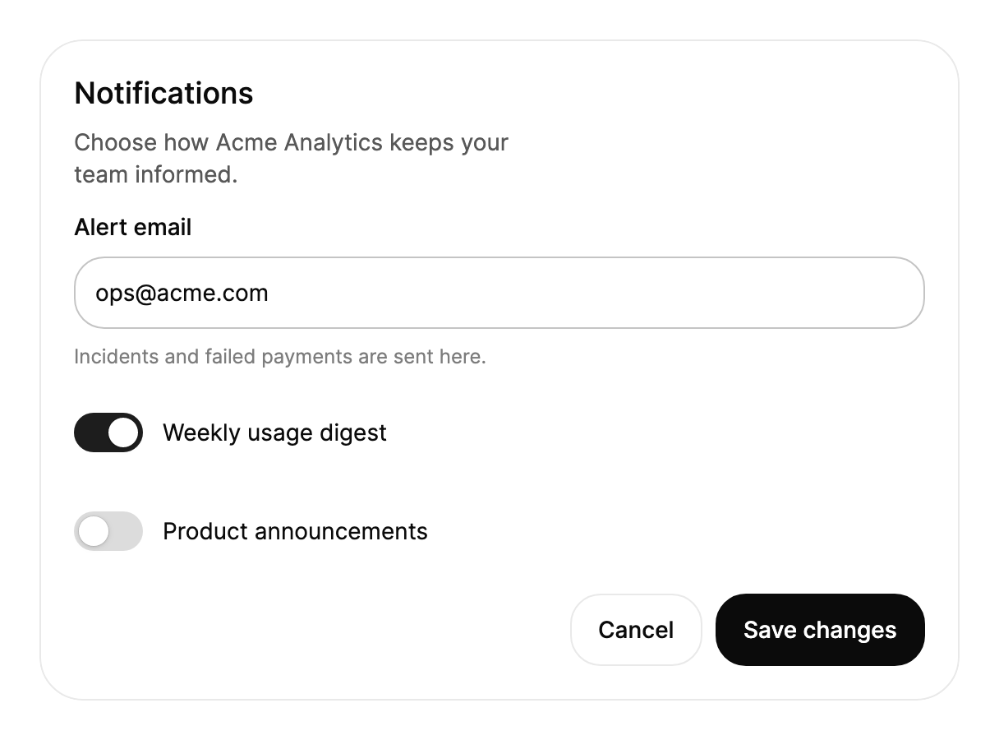

# 安装

本指南介绍如何把 TKCode.Arc 添加到 Avalonia 桌面应用中，从包引用一直到第一个界面。在新项目上大约需要五分钟，并且不会改变你的 Avalonia 代码其余部分的工作方式。

## 环境要求

| 项目 | 版本 | 说明 |
|---|---|---|
| .NET | `net10.0` 或 `net11.0` | 这些包同时面向两个目标框架。 |
| Avalonia | `12.1.5` 或更高的 12.x | 包的依赖为 `[12.1.5, 13.0.0)`：构建时所用的版本或任何更高的 Avalonia 12 版本。 |
| TKCode.Arc.Foundation | 与 Arc 相同 | MIT；主题、令牌、语言与包注册的运行时，随 `TKCode.Arc` 一起引入。 |
| 字体（可选） | `Avalonia.Fonts.Inter` | Arc 的正文使用 Inter；Geist 来自 `TKCode.Arc.Fonts`。 |

Arc 接受 Avalonia 12.1.5 及任何更高的 12.x 版本，因此你可以在 12 版本内升级 Avalonia，无需等待 Arc 发布新版。除 Avalonia 之外，每个 Arc 包只依赖 Arc 自己的 MIT 包。请让应用中的所有 Avalonia 包使用同一个版本；版本混用会导致还原警告，并在运行时出现样式缺失或类型加载错误。

## 从模板开始

新建应用时，`TKCode.Arc.Templates` 包可以创建一个开箱即可构建和运行的项目：包引用、字体、Lucide 图标、`UseArc(...)` 和明暗主题切换都已配置好。

```bash
dotnet new install TKCode.Arc.Templates
dotnet new tkcode-arc -n MyApp --layout sidebar
cd MyApp
dotnet run
```

模板提供四种布局（`blank`、`sidebar`、`header`、`dock`），以及 MVVM、依赖注入、保存偏好设置、本地化、测试和 Arc 标题栏等选项；`tkcode-arc-xplat` 为桌面和浏览器创建同样的应用，项模板则可以添加页面、窗口、对话框和控件。本节的 **模板** 页面列出了全部内容。下面的步骤介绍如何把 Arc 添加到现有项目，也说明了模板配置了哪些内容。


## 1. 添加包

```bash
dotnet add package TKCode.Arc --version 1.1.0-preview.5
dotnet add package TKCode.Arc.Fonts --version 1.1.0-preview.5           # 可选：Geist 与 Geist Mono
dotnet add package TKCode.Arc.Icons.Lucide --version 1.1.0-preview.5    # 可选：完整的 Lucide 图标集
dotnet add package Avalonia.Fonts.Inter --version 12.1.5                 # 可选：正文使用的 Inter
```

`TKCode.Arc` 会引入 `TKCode.Arc.Core`、`TKCode.Arc.Foundation` 和 StreamMark。如果你的解决方案使用集中式包管理，请把版本号一次性添加到 `Directory.Packages.props` 中，并让项目文件不包含版本号：

```xml
<ItemGroup>
    <PackageVersion Include="TKCode.Arc" Version="1.1.0-preview.5" />
    <PackageVersion Include="TKCode.Arc.Fonts" Version="1.1.0-preview.5" />
    <PackageVersion Include="TKCode.Arc.Icons.Lucide" Version="1.1.0-preview.5" />
    <PackageVersion Include="Avalonia.Fonts.Inter" Version="12.1.5" />
</ItemGroup>
```

请让所有 Arc 包保持同一版本。它们一起发布，并遵循语义化版本：破坏性 API 变更只在新的主版本中出现。

## 2. 在应用构建器中注册 Arc

Arc 通过 `AppBuilder` 上的 `UseArc(...)` 注册。一个典型的 `Program.cs` 如下：

```csharp
using Avalonia;
using TKCode.Arc;
using TKCode.Arc.Fonts;

internal static class Program
{
    [STAThread]
    public static void Main(string[] args) => BuildAvaloniaApp().StartWithClassicDesktopLifetime(args);

    public static AppBuilder BuildAvaloniaApp() =>
        AppBuilder.Configure<App>()
                  .UsePlatformDetect()
                  .WithInterFont()      // 正文使用的 Inter（Avalonia.Fonts.Inter）
                  .WithArcFonts()       // 展示文字使用 Geist，代码使用 Geist Mono（TKCode.Arc.Fonts）
                  .UseArc(arc => arc
                      .UseArcControls()
                      .WithTheme(t => t.Appearance(ArcAppearance.System).Accent(ArcAccentPreset.Neutral)));
}
```

各个调用的作用：

| 调用 | 用途 |
|---|---|
| `UseArc(...)` | 在应用初始化后启动 Arc 的主题管理器、设计令牌与语言。回调中列出要启用的包和初始主题。 |
| `UseArcControls()` | 注册 Arc 的控件、主题与令牌。它也会注册 `TKCode.Arc.Core`（`UseArcCore()`），因此你无需自行调用。 |
| `WithTheme(...)` | 可选：绘制第一帧时使用的主题（明暗、强调色、令牌覆盖）。不调用时，Arc 以浅色和 `Neutral` 强调色启动。参见 **主题**。 |
| `WithInterFont()`、`WithArcFonts()` | 注册 Arc 字号体系所设计的字体。若不注册，文字会回退到系统字体。 |

`Application` 类不需要为 Arc 做任何事：不需要特定基类，不需要 `partial` 关键字，`App.axaml` 中也不需要样式。

```csharp
public class App : Application
{
    public override void OnFrameworkInitializationCompleted()
    {
        if (ApplicationLifetime is IClassicDesktopStyleApplicationLifetime desktop)
        {
            desktop.MainWindow = new MainWindow();
        }
        base.OnFrameworkInitializationCompleted();
    }
}
```

Arc 也为其模板用到的 Avalonia 控件提供样式（`ScrollViewer`、`ScrollBar`、`ItemsControl`、`PathIcon`、文本选择手柄和弹出层宿主）。滚动条与 Arc 的 `ScrollArea` 一致：细长，指针悬停在视图上或滚动时显示，静止时隐藏；设置 `ScrollViewer.AllowAutoHide="False"` 可让它们一直显示。如果 `App.axaml` 已包含 `FluentTheme` 或 `SimpleTheme`，Arc 会把这些控件交给该主题。

## 3. 在 XAML 中使用控件

Arc 的 XAML 命名空间是 `https://github.com/AIDotNet/TKCode.Arc`；所有控件、令牌资源与标记扩展都位于其中。



```xml
<UserControl xmlns="https://github.com/avaloniaui"
             xmlns:arc="https://github.com/AIDotNet/TKCode.Arc"
             Width="560">
    <arc:Card Title="Notifications" Description="Choose how Acme Analytics keeps your team informed.">
        <StackPanel Spacing="16" Margin="0,12,0,0">
            <arc:Input Label="Alert email"
                       Text="ops@acme.com"
                       Description="Incidents and failed payments are sent here." />
            <arc:Switch Content="Weekly usage digest" IsChecked="True" />
            <arc:Switch Content="Product announcements" />
            <StackPanel Orientation="Horizontal" Spacing="8" HorizontalAlignment="Right">
                <arc:Button Content="Cancel" Variant="Secondary" />
                <arc:Button Content="Save changes" />
            </StackPanel>
        </StackPanel>
    </arc:Card>
</UserControl>
```

这些控件的行为与它们派生自的 Avalonia 控件一致：将 `Text`、`IsChecked` 和 `Command` 绑定到视图模型，用选择器为它们设置样式，并使用 Avalonia 的数据验证。本图库中的每个组件页面都展示了该控件的绑定、事件与键盘操作模型。

### 与 Avalonia 控件的名称冲突

`Button`、`Calendar`、`Carousel`、`ContextMenu`、`DatePicker`、`Slider`、`SplitButton`、`TabItem`、`TimePicker`、`TreeView` 和 `TreeViewItem` 与 `Avalonia.Controls` 中的类型同名。在 XAML 中，`arc:` 前缀可以把它们区分开。在 C# 中，如果同一个文件同时使用两者，请为其中一个命名空间设置别名：

```csharp
using Avalonia.Controls;
using ArcButton = TKCode.Arc.Button;

var save = new ArcButton { Content = "保存更改" };
```

## 可选包

### 图标

Arc 自有的图标字形（`{x:Static arc:ArcIcons.Check}` 以及另外 186 个）覆盖了组件使用的所有图标。若需要其他 Lucide 图标，请添加 `TKCode.Arc.Icons.Lucide` 并使用它的命名空间：

```xml
<UserControl xmlns="https://github.com/avaloniaui"
             xmlns:lucide="https://github.com/AIDotNet/TKCode.Arc/lucide">
    <lucide:LucideIcon Kind="Sparkles" Size="20" />
</UserControl>
```

只有项目用到的图标会被编译进去：包里的源生成器会在 C#（`LucideIconKind.Bell`）和 XAML（`Kind="Bell"`、`{lucide:LucideGeometry Bell}`）中找到它们。运行时才决定的图标（来自绑定或数据）需要在项目文件中声明：

```xml
<ItemGroup>
    <LucideIcon Include="Bell;ArrowRight" />    <!-- 或设置 <LucideIconsIncludeAll>true</LucideIconsIncludeAll> -->
</ItemGroup>
```

项目还没有声明任何图标时，XAML 中每处绑定 `LucideIcon.Kind` 的位置都会产生构建警告（`ARCL002`）。未编译进来的图标不绘制任何内容，并记录一条警告，指出需要添加的那一行。

### 区块与数据表格

`TKCode.Arc.Blocks`（页面级区块）、`TKCode.Arc.AdvancedCharts`（`DataGrid`）和 `TKCode.Arc.Special`（AI 动画讲解）是独立的包。按需添加，并在 `UseArc(...)` 中注册：

```bash
dotnet add package TKCode.Arc.Blocks --version 1.1.0-preview.5
dotnet add package TKCode.Arc.AdvancedCharts --version 1.1.0-preview.5
dotnet add package TKCode.Arc.Special --version 1.1.0-preview.5
dotnet add package TKCode.Arc.Workflow --version 1.1.0-preview.5
dotnet add package TKCode.Arc.Dock --version 1.1.0-preview.5    # 可选：IDE 式停靠布局（UseArcDock()）
dotnet add package TKCode.Arc.Themes.Pixel --version 1.1.0-preview.5    # 可选：像素风主题（UseArcPixelTheme()）
dotnet add package TKCode.Arc.Themes.Corners --version 1.1.0-preview.5    # 可选：全局圆角风格（UseArcCorners()）
dotnet add package TKCode.Arc.Mobile --version 1.1.0-preview.5    # 可选：移动端控件，尚未在真机上验证（UseArcMobile()）
```

```csharp
.UseArc(arc => arc
    .UseArcControls()
    .UseArcBlocks()            // TKCode.Arc.Blocks
    .UseArcAdvancedCharts()    // TKCode.Arc.AdvancedCharts
    .UseArcSpecial()           // TKCode.Arc.Special
    .UseArcWorkflow()          // TKCode.Arc.Workflow
    .UseArcPixelTheme()        // TKCode.Arc.Themes.Pixel
    .UseArcCorners()           // TKCode.Arc.Themes.Corners
    .UseArcMobile())           // TKCode.Arc.Mobile
```

每个包会注册它所依赖的包（例如 Blocks 会注册控件包），重复注册同一个包不会产生任何效果。

### PDF

`TKCode.Arc.Pdf`（`PdfViewer`）还需要一个渲染器：桌面上是带 PDFium 的 `TKCode.Arc.Pdf.Native`，单平台应用中约 7.5 MB；WebAssembly 中是带 pdf.js 的 `TKCode.Arc.Pdf.Browser`：

```bash
dotnet add package TKCode.Arc.Pdf --version 1.1.0-preview.5
dotnet add package TKCode.Arc.Pdf.Native --version 1.1.0-preview.5     # desktop
dotnet add package TKCode.Arc.Pdf.Browser --version 1.1.0-preview.5    # browser
```

```csharp
.UseArc(arc => arc.UseArcControls().UseArcPdf())    // TKCode.Arc.Pdf

ArcPdfNative.Use();                                 // desktop, before the app starts
await ArcPdfBrowser.UseAsync();                     // browser, before the app starts
```

### 视频

`TKCode.Arc.Video`（`VideoPlayer`、`VideoSurface`）通过平台自带的播放器播放，由后端决定：桌面上是 `TKCode.Arc.Video.Native`（Media Foundation、AVFoundation 或 GStreamer，应用不需要附带编解码器），WebAssembly 中是 `TKCode.Arc.Video.Browser`：

```bash
dotnet add package TKCode.Arc.Video --version 1.1.0-preview.5
dotnet add package TKCode.Arc.Video.Native --version 1.1.0-preview.5     # desktop
dotnet add package TKCode.Arc.Video.Browser --version 1.1.0-preview.5    # browser
```

```csharp
.UseArc(arc => arc.UseArcControls().UseArcVideo())    // TKCode.Arc.Video

ArcVideoNative.Use();                                 // desktop, before the app starts
await ArcVideoBrowser.UseAsync();                     // browser, before the app starts
```

### 语言

应用语言由 Arc 处理（命名空间 `TKCode.Arc.Localization`）。若要提供多种语言，请在 `UseArc(...)` 中声明：第一个参数是启动时的语言，第二个参数是应用提供的语言。本图库以这种方式提供英文、简体中文和繁体中文：

```csharp
.UseArc(arc => arc
    .UseArcControls()
    .UseLanguages(LanguageTags.EnUS, [LanguageTags.EnUS, LanguageTags.ZhCN, LanguageTags.ZhTW]))

// 之后，例如在设置页中：
ArcLanguage.Set(LanguageTags.ZhCN);
```

`ArcLanguage.Current` 是当前语言，`ArcLanguage.Culture` 是格式化数字和日期所用的区域文化，切换语言后会引发 `ArcLanguage.Changed`。自带内置文字的包（`DataGrid`、工作流画布）提供英文、简体中文和繁体中文。如果某个已启用的包没有覆盖声明的某种语言，启动会失败，并列出缺失的文字。

Arc 控件为其内置文字提供英文默认值（例如 "Show password" 或 "Clear search"）。控件将这些文字以属性或标签对象的形式公开，因此你可以在自己的资源中进行翻译。

## 发布

- **NativeAOT 与裁剪。** 这些库兼容裁剪与 AOT，且不使用反射。若要将桌面应用发布为单个自包含文件，请使用 `-p:PublishAot=true`；若不使用 AOT，则使用 `-p:PublishSingleFile=true --self-contained`。
- **.NET 11 SDK 与 NativeAOT。** .NET 11 SDK 的优化 AOT 发布会丢掉所有 Avalonia 12.1 应用编译后的 XAML，应用启动时会抛出 `No precompiled XAML found`。请在应用的项目文件中关闭它：`<UseOptimizedPublish>false</UseOptimizedPublish>`。
- **许可。** Arc、它的 Foundation 包和其他依赖（包括 Avalonia）都采用 MIT 等宽松许可，闭源应用以单文件或 NativeAOT 发布时没有 LGPL 义务。
- **全球化。** 不要启用 `InvariantGlobalization`。输入框、选择器与图表中的数字、货币和日期格式化需要区域文化数据。
- **macOS。** 仓库中的 `tools/macos` 脚本演示了如何将图库打包为已签名并完成公证的 `.app`；同样的流程也适用于你的应用。

## 从源代码构建

构建仓库需要 .NET 11 SDK（见 `global.json`）以及 .NET 10 运行时（测试与图库运行在 `net10.0` 上）：

```bash
dotnet build TKCode.Arc.slnx
dotnet test tests/TKCode.Arc.Core.Tests
dotnet test tests/TKCode.Arc.Foundation.Tests
dotnet test tests/TKCode.Arc.Tests
dotnet run --project gallery/TKCode.Arc.Gallery.Desktop -f net10.0
```

PDF 示例需要 PDFium 和 pdf.js，它们没有提交到仓库。请运行一次 `tools/pdf/sync-native.sh` 和 `tools/pdf/sync-pdfjs.sh`，下载时会校验校验和；没有它们时，桌面 Gallery 显示模拟文档，浏览器构建没有可导入的 pdf.js。

## 故障排查

| 现象 | 原因 | 解决方法 |
|---|---|---|
| Arc 控件没有样式或显示为空 | 没有在 `UseArc(...)` 中调用 `UseArcControls()` | 把它加到 `UseArc(...)` 的回调中。 |
| 启动时抛出 `InvalidOperationException` 并列出缺失的文字 | `UseLanguages` 中的某种语言没有被已启用的包覆盖 | 只声明这些包提供的语言，或补上缺失的翻译。 |
| NativeAOT 构建中出现 `No precompiled XAML found` | .NET 11 SDK 的优化发布 | 设置 `<UseOptimizedPublish>false</UseOptimizedPublish>`。 |
| `ThemeSwitcher` 切换时没有过渡效果 | 窗口没有覆盖层 | 在窗口模板中放一个 `EnableOverlayLayer="True"` 的 `VisualLayerManager`。 |
| 标题与代码使用系统字体 | 没有注册字体 | 在 `AppBuilder` 上调用 `WithInterFont()` 和 `WithArcFonts()`。 |
| 数字或日期格式错误，或格式化时抛出异常 | 启用了 `InvariantGlobalization` | 从项目文件中移除它。 |
| `'Button' is an ambiguous reference` | `TKCode.Arc` 与 `Avalonia.Controls` 同时被导入 | 为其中一个设置别名，如上所示。 |
| 关于 Avalonia 版本的还原警告 | 其他包引入了不同版本的 Avalonia，或引入了 Avalonia 13 | 在应用中显式引用同一个 Avalonia 12 版本（12.1.5 或更高）。 |
| 找不到 Blocks、`DataGrid` 或 Special 类型 | 没有引用该包或没有注册 | 添加 `TKCode.Arc.Blocks`、`TKCode.Arc.AdvancedCharts` 或 `TKCode.Arc.Special`，并在 `UseArc(...)` 中调用 `UseArcBlocks()`、`UseArcAdvancedCharts()` 或 `UseArcSpecial()`。 |

## 下一步

- **主题**：浅色与深色模式、八种强调色以及设计令牌。
- **动效**：动效级别与减弱动效。
- 组件页面：从按钮、输入框和卡片开始，它们是大多数界面的基础。
- **更新日志**：*从 0.3.1 迁移到 0.3.2* 列出了使用基于 AtomUI 的 0.3.1 版本的应用需要做的全部改动。
