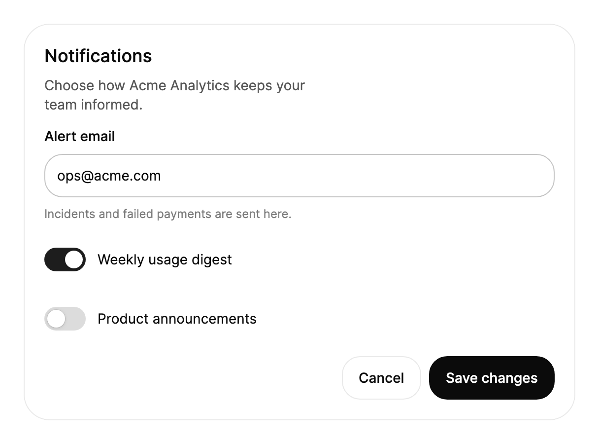

# 安裝

本指南介紹如何把 TKCode.Arc 加入 Avalonia 桌面應用程式中，從套件參照一路到第一個畫面。在新專案上大約需要五分鐘，並且不會改變你的 Avalonia 程式碼其餘部分的運作方式。

## 環境需求

| 項目 | 版本 | 說明 |
|---|---|---|
| .NET | `net10.0` 或 `net11.0` | 這些套件同時以兩個目標框架為對象。 |
| Avalonia | `12.1.5` 或更高的 12.x | 套件的相依為 `[12.1.5, 13.0.0)`：建置時所用的版本或任何更高的 Avalonia 12 版本。 |
| TKCode.Arc.Foundation | 與 Arc 相同 | MIT；佈景主題、權杖、語言與套件註冊的執行階段，隨 `TKCode.Arc` 一起引入。 |
| 字型（選用） | `Avalonia.Fonts.Inter` | Arc 的內文使用 Inter；Geist 來自 `TKCode.Arc.Fonts`。 |

Arc 接受 Avalonia 12.1.5 及任何更高的 12.x 版本，因此你可以在 12 版本內升級 Avalonia，無需等待 Arc 發布新版。除 Avalonia 之外，每個 Arc 套件只依賴 Arc 自己的 MIT 套件。請讓應用程式中的所有 Avalonia 套件使用同一個版本；版本混用會導致還原警告，並在執行時出現樣式遺失或型別載入錯誤。

## 從範本開始

建立新的應用程式時，`TKCode.Arc.Templates` 套件可以建立一個開箱即可建置與執行的專案：套件參照、字型、Lucide 圖示、`UseArc(...)` 與明暗佈景主題切換都已設定好。

```bash
dotnet new install TKCode.Arc.Templates
dotnet new tkcode-arc -n MyApp --layout sidebar
cd MyApp
dotnet run
```

範本提供四種版面配置（`blank`、`sidebar`、`header`、`dock`），以及 MVVM、相依性插入、儲存偏好設定、本地化、測試與 Arc 標題列等選項；`tkcode-arc-xplat` 為桌面與瀏覽器建立同樣的應用程式，項目範本則可以加入頁面、視窗、對話方塊與控制項。本節的 **範本** 頁面列出了全部內容。以下步驟說明如何把 Arc 加入現有專案，也說明範本設定了哪些內容。


## 1. 加入套件

```bash
dotnet add package TKCode.Arc --version 1.1.0-preview.5
dotnet add package TKCode.Arc.Fonts --version 1.1.0-preview.5           # 選用：Geist 與 Geist Mono
dotnet add package TKCode.Arc.Icons.Lucide --version 1.1.0-preview.5    # 選用：完整的 Lucide 圖示集
dotnet add package Avalonia.Fonts.Inter --version 12.1.5                 # 選用：內文使用的 Inter
```

`TKCode.Arc` 會引入 `TKCode.Arc.Core`、`TKCode.Arc.Foundation` 與 StreamMark。如果你的方案使用集中式套件管理，請將版本號一次加入 `Directory.Packages.props`，並讓專案檔不含版本號：

```xml
<ItemGroup>
    <PackageVersion Include="TKCode.Arc" Version="1.1.0-preview.5" />
    <PackageVersion Include="TKCode.Arc.Fonts" Version="1.1.0-preview.5" />
    <PackageVersion Include="TKCode.Arc.Icons.Lucide" Version="1.1.0-preview.5" />
    <PackageVersion Include="Avalonia.Fonts.Inter" Version="12.1.5" />
</ItemGroup>
```

請讓所有 Arc 套件保持同一版本。它們一起發行，並遵循語意化版本：破壞性 API 變更只在新的主版本中出現。

## 2. 在應用程式建構器中註冊 Arc

Arc 透過 `AppBuilder` 上的 `UseArc(...)` 註冊。一個典型的 `Program.cs` 如下：

```csharp
using Avalonia;
using TKCode.Arc;
using TKCode.Arc.Fonts;

internal static class Program
{
    [STAThread]
    public static void Main(string[] args) => BuildAvaloniaApp().StartWithClassicDesktopLifetime(args);

    public static AppBuilder BuildAvaloniaApp() =>
        AppBuilder.Configure<App>()
                  .UsePlatformDetect()
                  .WithInterFont()      // 內文使用的 Inter（Avalonia.Fonts.Inter）
                  .WithArcFonts()       // 展示文字使用 Geist，程式碼使用 Geist Mono（TKCode.Arc.Fonts）
                  .UseArc(arc => arc
                      .UseArcControls()
                      .WithTheme(t => t.Appearance(ArcAppearance.System).Accent(ArcAccentPreset.Neutral)));
}
```

各個呼叫的作用：

| 呼叫 | 用途 |
|---|---|
| `UseArc(...)` | 在應用程式初始化後啟動 Arc 的佈景主題管理員、設計權杖與語言。回呼中列出要啟用的套件與初始佈景主題。 |
| `UseArcControls()` | 註冊 Arc 的控制項、佈景主題與權杖。它也會註冊 `TKCode.Arc.Core`（`UseArcCore()`），因此你不需要自行呼叫。 |
| `WithTheme(...)` | 選用：繪製第一個畫格時使用的佈景主題（明暗、強調色、權杖覆寫）。未呼叫時，Arc 以淺色與 `Neutral` 強調色啟動。請參閱 **佈景主題**。 |
| `WithInterFont()`、`WithArcFonts()` | 註冊 Arc 字級系統所設計的字型。若未註冊，文字會退回系統字型。 |

`Application` 類別不需要為 Arc 做任何事：不需要特定基底類別，不需要 `partial` 關鍵字，`App.axaml` 中也不需要樣式。

```csharp
public class App : Application
{
    public override void OnFrameworkInitializationCompleted()
    {
        if (ApplicationLifetime is IClassicDesktopStyleApplicationLifetime desktop)
        {
            desktop.MainWindow = new MainWindow();
        }
        base.OnFrameworkInitializationCompleted();
    }
}
```

Arc 也為其範本用到的 Avalonia 控制項提供樣式（`ScrollViewer`、`ScrollBar`、`ItemsControl`、`PathIcon`、文字選取控點與快顯視窗宿主）。捲軸與 Arc 的 `ScrollArea` 一致：細長，指標停留在檢視上或捲動時顯示，靜止時隱藏；設定 `ScrollViewer.AllowAutoHide="False"` 可讓它們一直顯示。如果 `App.axaml` 已包含 `FluentTheme` 或 `SimpleTheme`，Arc 會把這些控制項交給該佈景主題。

## 3. 在 XAML 中使用控制項

Arc 的 XAML 命名空間是 `https://github.com/AIDotNet/TKCode.Arc`；所有控制項、權杖資源與標記延伸都位於其中。



```xml
<UserControl xmlns="https://github.com/avaloniaui"
             xmlns:arc="https://github.com/AIDotNet/TKCode.Arc"
             Width="560">
    <arc:Card Title="Notifications" Description="Choose how Acme Analytics keeps your team informed.">
        <StackPanel Spacing="16" Margin="0,12,0,0">
            <arc:Input Label="Alert email"
                       Text="ops@acme.com"
                       Description="Incidents and failed payments are sent here." />
            <arc:Switch Content="Weekly usage digest" IsChecked="True" />
            <arc:Switch Content="Product announcements" />
            <StackPanel Orientation="Horizontal" Spacing="8" HorizontalAlignment="Right">
                <arc:Button Content="Cancel" Variant="Secondary" />
                <arc:Button Content="Save changes" />
            </StackPanel>
        </StackPanel>
    </arc:Card>
</UserControl>
```

這些控制項的行為與它們所衍生的 Avalonia 控制項一致：將 `Text`、`IsChecked` 與 `Command` 繫結到檢視模型，用選取器為它們設定樣式，並使用 Avalonia 的資料驗證。本圖庫中的每個元件頁面都展示了該控制項的繫結、事件與鍵盤操作模型。

### 與 Avalonia 控制項的名稱衝突

`Button`、`Calendar`、`Carousel`、`ContextMenu`、`DatePicker`、`Slider`、`SplitButton`、`TabItem`、`TimePicker`、`TreeView` 與 `TreeViewItem` 和 `Avalonia.Controls` 中的型別同名。在 XAML 中，`arc:` 前綴可以把它們區分開。在 C# 中，若同一個檔案同時使用兩者，請為其中一個命名空間設定別名：

```csharp
using Avalonia.Controls;
using ArcButton = TKCode.Arc.Button;

var save = new ArcButton { Content = "儲存變更" };
```

## 選用套件

### 圖示

Arc 自有的圖示字形（`{x:Static arc:ArcIcons.Check}` 以及另外 186 個）涵蓋了元件使用的所有圖示。若需要其他 Lucide 圖示，請加入 `TKCode.Arc.Icons.Lucide` 並使用它的命名空間：

```xml
<UserControl xmlns="https://github.com/avaloniaui"
             xmlns:lucide="https://github.com/AIDotNet/TKCode.Arc/lucide">
    <lucide:LucideIcon Kind="Sparkles" Size="20" />
</UserControl>
```

只有專案用到的圖示會被編譯進去：套件中的原始碼產生器會在 C#（`LucideIconKind.Bell`）和 XAML（`Kind="Bell"`、`{lucide:LucideGeometry Bell}`）中找到它們。執行時才決定的圖示（來自繫結或資料）需要在專案檔中宣告：

```xml
<ItemGroup>
    <LucideIcon Include="Bell;ArrowRight" />    <!-- 或設定 <LucideIconsIncludeAll>true</LucideIconsIncludeAll> -->
</ItemGroup>
```

專案還沒有宣告任何圖示時，XAML 中每處繫結 `LucideIcon.Kind` 的位置都會產生建置警告（`ARCL002`）。未編譯進來的圖示不繪製任何內容，並記錄一條警告，指出需要加入的那一行。

### 區塊與資料表格

`TKCode.Arc.Blocks`（頁面層級區塊）、`TKCode.Arc.AdvancedCharts`（`DataGrid`）與 `TKCode.Arc.Special`（AI 動畫講解）是獨立的套件。依需要加入，並在 `UseArc(...)` 中註冊：

```bash
dotnet add package TKCode.Arc.Blocks --version 1.1.0-preview.5
dotnet add package TKCode.Arc.AdvancedCharts --version 1.1.0-preview.5
dotnet add package TKCode.Arc.Special --version 1.1.0-preview.5
dotnet add package TKCode.Arc.Workflow --version 1.1.0-preview.5
dotnet add package TKCode.Arc.Dock --version 1.1.0-preview.5    # 選用：IDE 式停靠版面（UseArcDock()）
dotnet add package TKCode.Arc.Themes.Pixel --version 1.1.0-preview.5    # 選用：像素風主題（UseArcPixelTheme()）
dotnet add package TKCode.Arc.Themes.Corners --version 1.1.0-preview.5    # 選用：全域圓角風格（UseArcCorners()）
dotnet add package TKCode.Arc.Mobile --version 1.1.0-preview.5    # 選用：行動端控制項，尚未在真機上驗證（UseArcMobile()）
```

```csharp
.UseArc(arc => arc
    .UseArcControls()
    .UseArcBlocks()            // TKCode.Arc.Blocks
    .UseArcAdvancedCharts()    // TKCode.Arc.AdvancedCharts
    .UseArcSpecial()           // TKCode.Arc.Special
    .UseArcWorkflow()          // TKCode.Arc.Workflow
    .UseArcPixelTheme()        // TKCode.Arc.Themes.Pixel
    .UseArcCorners()           // TKCode.Arc.Themes.Corners
    .UseArcMobile())           // TKCode.Arc.Mobile
```

每個套件會註冊它所依賴的套件（例如 Blocks 會註冊控制項套件），重複註冊同一個套件不會有任何作用。

### PDF

`TKCode.Arc.Pdf`（`PdfViewer`）還需要一個繪製器：桌面上是帶 PDFium 的 `TKCode.Arc.Pdf.Native`，單一平台應用程式中約 7.5 MB；WebAssembly 中是帶 pdf.js 的 `TKCode.Arc.Pdf.Browser`：

```bash
dotnet add package TKCode.Arc.Pdf --version 1.1.0-preview.5
dotnet add package TKCode.Arc.Pdf.Native --version 1.1.0-preview.5     # desktop
dotnet add package TKCode.Arc.Pdf.Browser --version 1.1.0-preview.5    # browser
```

```csharp
.UseArc(arc => arc.UseArcControls().UseArcPdf())    // TKCode.Arc.Pdf

ArcPdfNative.Use();                                 // desktop, before the app starts
await ArcPdfBrowser.UseAsync();                     // browser, before the app starts
```

### 影片

`TKCode.Arc.Video`（`VideoPlayer`、`VideoSurface`）透過平台內建的播放器播放，由後端決定：桌面上是 `TKCode.Arc.Video.Native`（Media Foundation、AVFoundation 或 GStreamer，應用程式不需要附帶編解碼器），WebAssembly 中是 `TKCode.Arc.Video.Browser`：

```bash
dotnet add package TKCode.Arc.Video --version 1.1.0-preview.5
dotnet add package TKCode.Arc.Video.Native --version 1.1.0-preview.5     # desktop
dotnet add package TKCode.Arc.Video.Browser --version 1.1.0-preview.5    # browser
```

```csharp
.UseArc(arc => arc.UseArcControls().UseArcVideo())    // TKCode.Arc.Video

ArcVideoNative.Use();                                 // desktop, before the app starts
await ArcVideoBrowser.UseAsync();                     // browser, before the app starts
```

### 語言

應用程式語言由 Arc 處理（命名空間 `TKCode.Arc.Localization`）。若要提供多種語言，請在 `UseArc(...)` 中宣告：第一個參數是啟動時的語言，第二個參數是應用程式提供的語言。本圖庫以這種方式提供英文、簡體中文與繁體中文：

```csharp
.UseArc(arc => arc
    .UseArcControls()
    .UseLanguages(LanguageTags.EnUS, [LanguageTags.EnUS, LanguageTags.ZhCN, LanguageTags.ZhTW]))

// 之後，例如在設定頁中：
ArcLanguage.Set(LanguageTags.ZhCN);
```

`ArcLanguage.Current` 是目前的語言，`ArcLanguage.Culture` 是格式化數字與日期所用的地區文化，切換語言後會引發 `ArcLanguage.Changed`。自帶內建文字的套件（`DataGrid`、工作流程畫布）提供英文、簡體中文與繁體中文。如果某個已啟用的套件沒有涵蓋宣告的某種語言，啟動會失敗，並列出缺少的文字。

Arc 控制項為其內建文字提供英文預設值（例如 "Show password" 或 "Clear search"）。控制項以屬性或標籤物件的形式公開這些文字，因此你可以在自己的資源中加以翻譯。

## 發佈

- **NativeAOT 與裁剪。** 這些函式庫相容於裁剪與 AOT，且不使用反射。若要把桌面應用程式發佈為單一的自含檔案，請使用 `-p:PublishAot=true`；若不使用 AOT，則使用 `-p:PublishSingleFile=true --self-contained`。
- **.NET 11 SDK 與 NativeAOT。** .NET 11 SDK 的最佳化 AOT 發佈會遺漏所有 Avalonia 12.1 應用程式編譯後的 XAML，應用程式啟動時會擲出 `No precompiled XAML found`。請在應用程式的專案檔中關閉它：`<UseOptimizedPublish>false</UseOptimizedPublish>`。
- **授權。** Arc、它的 Foundation 套件與其他相依項目（包括 Avalonia）都採用 MIT 等寬鬆授權，閉源應用程式以單一檔案或 NativeAOT 發佈時沒有 LGPL 義務。
- **全球化。** 不要啟用 `InvariantGlobalization`。輸入框、選取器與圖表中的數字、貨幣與日期格式化需要地區文化資料。
- **macOS。** 儲存庫中的 `tools/macos` 指令碼示範了如何把圖庫包裝為已簽署並完成公證的 `.app`；同樣的流程也適用於你的應用程式。

## 從原始碼建置

建置儲存庫需要 .NET 11 SDK（見 `global.json`）以及 .NET 10 執行階段（測試與圖庫在 `net10.0` 上執行）：

```bash
dotnet build TKCode.Arc.slnx
dotnet test tests/TKCode.Arc.Core.Tests
dotnet test tests/TKCode.Arc.Foundation.Tests
dotnet test tests/TKCode.Arc.Tests
dotnet run --project gallery/TKCode.Arc.Gallery.Desktop -f net10.0
```

PDF 範例需要 PDFium 和 pdf.js，它們沒有提交到存放庫。請執行一次 `tools/pdf/sync-native.sh` 和 `tools/pdf/sync-pdfjs.sh`，下載時會驗證總和檢查碼；沒有它們時，桌面 Gallery 顯示模擬文件，瀏覽器建置沒有可匯入的 pdf.js。

## 疑難排解

| 症狀 | 原因 | 解決方法 |
|---|---|---|
| Arc 控制項沒有樣式或顯示為空白 | 未在 `UseArc(...)` 中呼叫 `UseArcControls()` | 將它加到 `UseArc(...)` 的回呼中。 |
| 啟動時擲出 `InvalidOperationException` 並列出缺少的文字 | `UseLanguages` 中的某種語言沒有被已啟用的套件涵蓋 | 只宣告這些套件提供的語言，或補上缺少的翻譯。 |
| NativeAOT 建置中出現 `No precompiled XAML found` | .NET 11 SDK 的最佳化發佈 | 設定 `<UseOptimizedPublish>false</UseOptimizedPublish>`。 |
| `ThemeSwitcher` 切換時沒有轉場效果 | 視窗沒有覆疊層 | 在視窗範本中放一個 `EnableOverlayLayer="True"` 的 `VisualLayerManager`。 |
| 標題與程式碼使用系統字型 | 未註冊字型 | 在 `AppBuilder` 上呼叫 `WithInterFont()` 與 `WithArcFonts()`。 |
| 數字或日期格式錯誤，或格式化時擲出例外 | 啟用了 `InvariantGlobalization` | 從專案檔中移除它。 |
| `'Button' is an ambiguous reference` | `TKCode.Arc` 與 `Avalonia.Controls` 同時被匯入 | 為其中一個設定別名，如上所示。 |
| 關於 Avalonia 版本的還原警告 | 其他套件引入了不同版本的 Avalonia，或引入了 Avalonia 13 | 在應用程式中明確參照同一個 Avalonia 12 版本（12.1.5 或更高）。 |
| 找不到 Blocks、`DataGrid` 或 Special 型別 | 未參照該套件或未註冊 | 加入 `TKCode.Arc.Blocks`、`TKCode.Arc.AdvancedCharts` 或 `TKCode.Arc.Special`，並在 `UseArc(...)` 中呼叫 `UseArcBlocks()`、`UseArcAdvancedCharts()` 或 `UseArcSpecial()`。 |

## 下一步

- **主題**：淺色與深色模式、八種強調色以及設計權杖。
- **動態效果**：動態效果等級與減少動態效果。
- 元件頁面：從按鈕、輸入框與卡片開始，它們是大多數畫面的基礎。
- **更新日誌**：*從 0.3.1 遷移到 0.3.2* 列出了使用以 AtomUI 為基礎的 0.3.1 版本的應用程式需要做的全部變更。
