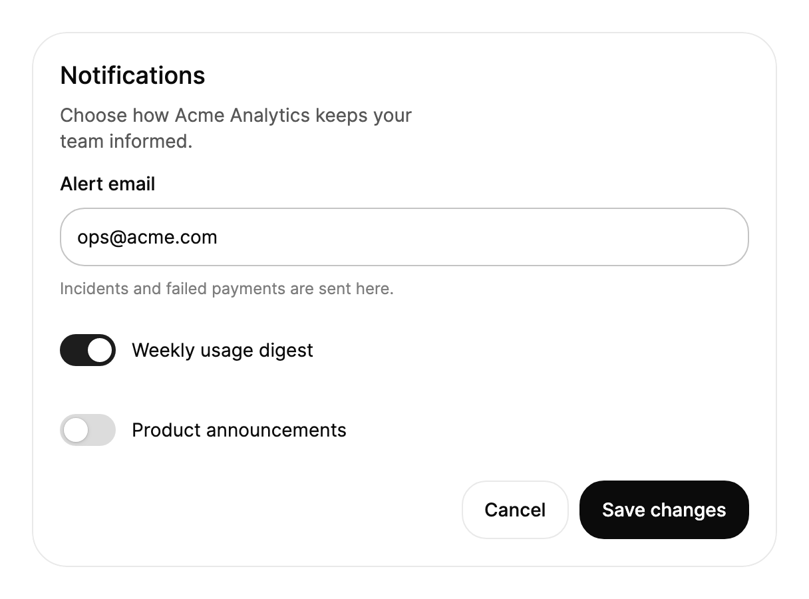

# 安裝

本指南介紹如何把 TKCode.Arc 加入 Avalonia 桌面應用程式中，從套件參照一路到第一個畫面。在新專案上大約需要五分鐘，並且不會改變你的 Avalonia 程式碼其餘部分的運作方式。

## 環境需求

| 項目 | 版本 | 說明 |
|---|---|---|
| .NET | `net10.0` 或 `net11.0` | 這些套件同時以兩個目標框架為對象。 |
| Avalonia | `12.1.4` | 固定為函式庫建置時所用的確切版本。 |
| AtomUI | `6.2.8` | `AtomUI.Desktop.Controls`；Arc 的佈景主題與權杖系統建立在 AtomUI 之上。 |
| 字型（選用） | `Avalonia.Fonts.Inter` | Arc 的內文使用 Inter；Geist 來自 `TKCode.Arc.Fonts`。 |

TKCode.Arc 目前處於預覽階段，AtomUI 與 Avalonia 都固定為確切版本。請在你的應用程式中使用相同的 Avalonia 版本；版本混用會導致還原警告，並在執行時出現樣式遺失或型別載入錯誤。

## 1. 加入套件

```bash
dotnet add package TKCode.Arc --version 0.3.1-preview.5
dotnet add package TKCode.Arc.Fonts --version 0.3.1-preview.5           # 選用：Geist 與 Geist Mono
dotnet add package TKCode.Arc.Icons.Lucide --version 0.3.1-preview.5    # 選用：完整的 Lucide 圖示集
dotnet add package Avalonia.Fonts.Inter --version 12.1.4                 # 選用：內文使用的 Inter
```

`TKCode.Arc` 會引入 `TKCode.Arc.Core`、AtomUI 與 StreamMark。如果你的方案使用集中式套件管理，請將版本號一次加入 `Directory.Packages.props`，並讓專案檔不含版本號：

```xml
<ItemGroup>
    <PackageVersion Include="TKCode.Arc" Version="0.3.1-preview.5" />
    <PackageVersion Include="TKCode.Arc.Fonts" Version="0.3.1-preview.5" />
    <PackageVersion Include="TKCode.Arc.Icons.Lucide" Version="0.3.1-preview.5" />
    <PackageVersion Include="Avalonia.Fonts.Inter" Version="12.1.4" />
</ItemGroup>
```

請固定確切的預覽版本。像 `0.1.*` 這樣的浮動版本可能會在下一次還原時拉到帶有破壞性變更的預覽版。

## 2. 在應用程式建構器中註冊 Arc

Arc 在 AtomUI 的建構器中註冊，與 AtomUI 的桌面控制項並列。一個典型的 `Program.cs` 如下：

```csharp
using AtomUI;
using AtomUI.Desktop.Controls;
using Avalonia;
using TKCode.Arc;
using TKCode.Arc.Fonts;

internal static class Program
{
    [STAThread]
    public static void Main(string[] args) => BuildAvaloniaApp().StartWithClassicDesktopLifetime(args);

    public static AppBuilder BuildAvaloniaApp() =>
        AppBuilder.Configure<App>()
                  .UsePlatformDetect()
                  .WithInterFont()      // 內文使用的 Inter（Avalonia.Fonts.Inter）
                  .WithArcFonts()       // 展示文字使用 Geist，程式碼使用 Geist Mono（TKCode.Arc.Fonts）
                  .UseAtomUI(builder =>
                  {
                      builder.UseDesktopControls();
                      builder.UseArc();
                  });
}
```

各個呼叫的作用：

| 呼叫 | 用途 |
|---|---|
| `UseAtomUI(...)` | 為應用程式啟動 AtomUI 的佈景主題管理員、設計權杖與在地化。 |
| `UseDesktopControls()` | AtomUI 的桌面控制項套件，Arc 建立於其上。 |
| `UseArc()` | 註冊 Arc 的控制項、佈景主題與權杖。它也會註冊 `TKCode.Arc.Core`（`UseArcCore()`），因此你不需要自行呼叫。 |
| `WithInterFont()`、`WithArcFonts()` | 註冊 Arc 字級系統所設計的字型。若未註冊，文字會退回系統字型。 |

將 `Application` 類別宣告為 `partial`。AtomUI 的原始碼產生器會為它加入啟動程式碼；若該類別不是 partial，建置會以 `ATOMUILOC008` 停止：

```csharp
public partial class App : Application
{
    public override void OnFrameworkInitializationCompleted()
    {
        if (ApplicationLifetime is IClassicDesktopStyleApplicationLifetime desktop)
        {
            desktop.MainWindow = new MainWindow();
        }
        base.OnFrameworkInitializationCompleted();
    }
}
```

## 3. 在 XAML 中使用控制項

Arc 的 XAML 命名空間是 `https://github.com/AIDotNet/TKCode.Arc`；所有控制項、權杖資源與標記延伸都位於其中。



```xml
<UserControl xmlns="https://github.com/avaloniaui"
             xmlns:arc="https://github.com/AIDotNet/TKCode.Arc"
             Width="560">
    <arc:Card Title="Notifications" Description="Choose how Acme Analytics keeps your team informed.">
        <StackPanel Spacing="16" Margin="0,12,0,0">
            <arc:Input Label="Alert email"
                       Text="ops@acme.com"
                       Description="Incidents and failed payments are sent here." />
            <arc:Switch Content="Weekly usage digest" IsChecked="True" />
            <arc:Switch Content="Product announcements" />
            <StackPanel Orientation="Horizontal" Spacing="8" HorizontalAlignment="Right">
                <arc:Button Content="Cancel" Variant="Secondary" />
                <arc:Button Content="Save changes" />
            </StackPanel>
        </StackPanel>
    </arc:Card>
</UserControl>
```

這些控制項的行為與它們所衍生的 Avalonia 控制項一致：將 `Text`、`IsChecked` 與 `Command` 繫結到檢視模型，用選取器為它們設定樣式，並使用 Avalonia 的資料驗證。本圖庫中的每個元件頁面都展示了該控制項的繫結、事件與鍵盤操作模型。

### 與 Avalonia 控制項的名稱衝突

`Button`、`Calendar`、`Carousel`、`ContextMenu`、`DatePicker`、`Slider`、`SplitButton`、`TabItem`、`TimePicker`、`TreeView` 與 `TreeViewItem` 和 `Avalonia.Controls` 中的型別同名。在 XAML 中，`arc:` 前綴可以把它們區分開。在 C# 中，若同一個檔案同時使用兩者，請為其中一個命名空間設定別名：

```csharp
using Avalonia.Controls;
using ArcButton = TKCode.Arc.Button;

var save = new ArcButton { Content = "儲存變更" };
```

## 選用套件

### 圖示

Arc 自有的圖示字形（`{x:Static arc:ArcIcons.Check}` 以及另外 186 個）涵蓋了元件使用的所有圖示。若需要其他 Lucide 圖示，請加入 `TKCode.Arc.Icons.Lucide` 並使用它的命名空間：

```xml
<UserControl xmlns="https://github.com/avaloniaui"
             xmlns:lucide="https://github.com/AIDotNet/TKCode.Arc/lucide">
    <lucide:LucideIcon Kind="Sparkles" Size="20" />
</UserControl>
```

### 區塊與資料表格

`TKCode.Arc.Blocks`（頁面層級區塊）、`TKCode.Arc.AdvancedCharts`（`DataGrid`）與 `TKCode.Arc.Special`（AI 動畫講解）是獨立的套件。依需要加入，並將它們註冊在 `UseArc()` 旁邊：

```bash
dotnet add package TKCode.Arc.Blocks --version 0.3.1-preview.5
dotnet add package TKCode.Arc.AdvancedCharts --version 0.3.1-preview.5
dotnet add package TKCode.Arc.Special --version 0.3.1-preview.5
dotnet add package TKCode.Arc.Workflow --version 0.3.1-preview.5
dotnet add package TKCode.Arc.Themes.Pixel --version 0.3.1-preview.5    # 選用：像素風主題（UseArcPixelTheme()）
dotnet add package TKCode.Arc.Themes.Corners --version 0.3.1-preview.5    # optional: global corner style (WithArcCorners())
dotnet add package TKCode.Arc.Mobile --version 0.3.1-preview.5    # 選用：行動端控制項，尚未在真機上驗證（UseArcMobile()）
```

```csharp
builder.UseDesktopControls();
builder.UseArc();
builder.UseArcBlocks();          // TKCode.Arc.Blocks
builder.UseArcAdvancedCharts();  // TKCode.Arc.AdvancedCharts
builder.UseArcSpecial();         // TKCode.Arc.Special
```

### 語言

應用程式語言由 AtomUI 處理。若要提供多種語言，請在建構器中宣告它們；本圖庫以這種方式提供英文、簡體中文與繁體中文：

```csharp
builder.UseLanguages(LanguageTags.EnUS, [LanguageTags.EnUS, LanguageTags.ZhCN, LanguageTags.ZhTW]);
```

Arc 控制項為其內建文字提供英文預設值（例如 "Show password" 或 "Clear search"）。控制項以屬性或標籤物件的形式公開這些文字，因此你可以在自己的資源中加以翻譯。

## 發佈

- **NativeAOT 與裁剪。** 這些函式庫相容於裁剪與 AOT，且不使用反射。若要把桌面應用程式發佈為單一的自含檔案，請使用 `-p:PublishAot=true`；若不使用 AOT，則使用 `-p:PublishSingleFile=true --self-contained`。
- **全球化。** 不要啟用 `InvariantGlobalization`。輸入框、選取器與圖表中的數字、貨幣與日期格式化需要地區文化資料。
- **macOS。** 儲存庫中的 `tools/macos` 指令碼示範了如何把圖庫包裝為已簽署並完成公證的 `.app`；同樣的流程也適用於你的應用程式。

## 從原始碼建置

建置儲存庫需要 .NET 11 SDK（見 `global.json`）以及 .NET 10 執行階段，AtomUI 的建置工作即在其上執行：

```bash
dotnet build TKCode.Arc.slnx
dotnet test tests/TKCode.Arc.Core.Tests
dotnet test tests/TKCode.Arc.Tests
dotnet run --project gallery/TKCode.Arc.Gallery.Desktop -f net10.0
```

## 疑難排解

| 症狀 | 原因 | 解決方法 |
|---|---|---|
| Arc 控制項沒有樣式或顯示為空白 | 未在 `UseAtomUI(...)` 中呼叫 `UseArc()` | 將它註冊在 `UseDesktopControls()` 之後。 |
| 建置錯誤 `ATOMUILOC008` | `Application` 類別不是 `partial` | 將其宣告為 `public partial class App : Application`。 |
| 標題與程式碼使用系統字型 | 未註冊字型 | 在 `AppBuilder` 上呼叫 `WithInterFont()` 與 `WithArcFonts()`。 |
| 數字或日期格式錯誤，或格式化時擲出例外 | 啟用了 `InvariantGlobalization` | 從專案檔中移除它。 |
| `'Button' is an ambiguous reference` | `TKCode.Arc` 與 `Avalonia.Controls` 同時被匯入 | 為其中一個設定別名，如上所示。 |
| 關於 Avalonia 版本的還原警告 | 其他套件引入了不同版本的 Avalonia | 在應用程式中明確參照 Avalonia `12.1.4`。 |
| 找不到 Blocks、`DataGrid` 或 Special 型別 | 未參照該套件或未註冊 | 加入 `TKCode.Arc.Blocks`、`TKCode.Arc.AdvancedCharts` 或 `TKCode.Arc.Special`，並呼叫 `UseArcBlocks()`、`UseArcAdvancedCharts()` 或 `UseArcSpecial()`。 |

## 下一步

- **主題**：淺色與深色模式、八種強調色以及設計權杖。
- **動態效果**：動態效果等級與減少動態效果。
- 元件頁面：從按鈕、輸入框與卡片開始，它們是大多數畫面的基礎。
