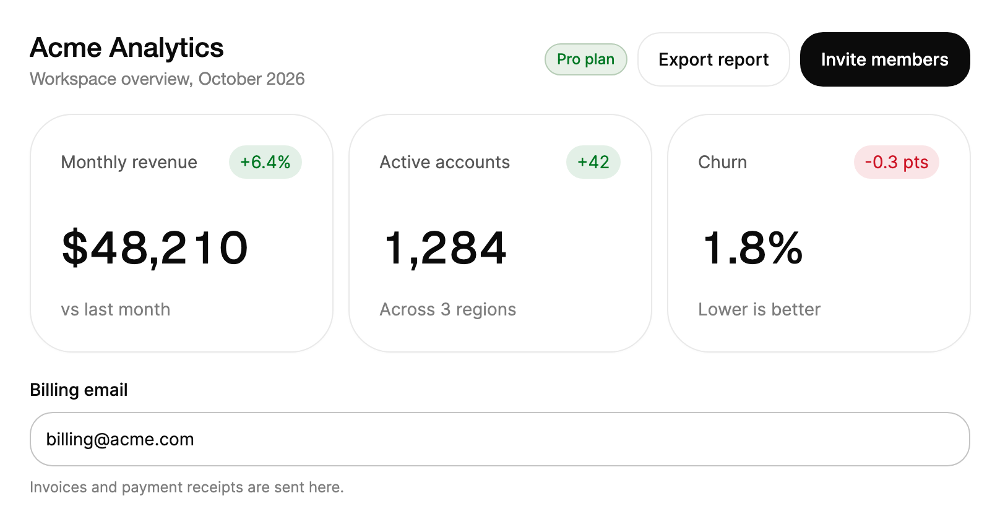

# 介紹

TKCode.Arc 將 [Arc](https://uiarc.dev) 帶到 Avalonia：相同的元件分組、相同的視覺語言與相同的彈簧動態效果，以原生 Avalonia 控制項的形式建構在 [AtomUI](https://github.com/AtomUI/AtomUI) 之上。它移植了免費的 Arc 元件（22 個分組中的 110 個元件），並新增頁面層級的區塊、試算表風格的資料表格，以及串流式 Markdown 渲染器，使桌面產品可以由一套一致的工具組組裝而成，而不是拼湊各種樣式。

本圖庫即是該程式庫的文件。每個元件頁面都根據元件原始碼撰寫，展示可互動的即時範例，並列出產生的 API 參考。



```xml
<StackPanel Width="760" Spacing="20">
    <Grid ColumnDefinitions="*,Auto">
        <StackPanel Spacing="4">
            <TextBlock Text="Acme Analytics"
                       FontSize="22"
                       FontWeight="Medium"
                       Foreground="{arc:ArcDesignTokenResource Foreground}" />
            <TextBlock Text="Workspace overview, October 2026"
                       Foreground="{arc:ArcDesignTokenResource TextMuted}" />
        </StackPanel>
        <StackPanel Grid.Column="1" Orientation="Horizontal" Spacing="8" VerticalAlignment="Center">
            <arc:Badge Content="Pro plan" Tone="Success" />
            <arc:Button Content="Export report" Variant="Secondary" />
            <arc:Button Content="Invite members" />
        </StackPanel>
    </Grid>
    <UniformGrid Columns="3">
        <arc:MetricCard Label="Monthly revenue" Prefix="$" Value="48210" Change="+6.4%" Context="vs last month" Margin="0,0,8,0" />
        <arc:MetricCard Label="Active accounts" Value="1284" Change="+42" Context="Across 3 regions" Margin="4,0" />
        <arc:MetricCard Label="Churn" Suffix="%" Value="1.8" Decimals="1" Change="-0.3 pts" Context="Lower is better" Margin="8,0,0,0" />
    </UniformGrid>
    <arc:Input Label="Billing email"
               Text="billing@acme.com"
               Description="Invoices and payment receipts are sent here." />
</StackPanel>
```

## 程式庫包含什麼

| 部分 | 提供的內容 |
|---|---|
| 元件 | Arc 22 個分組中的 110 個控制項：按鈕、手勢、選單、文字欄位、特殊輸入、選取器、切換、滑桿、挑選器、編輯器、導覽、展開、浮層、訊息、進度、頭像、卡片、圖表、表格、活動、媒體與文字效果。 |
| 區塊 | 供應用程式外殼與設定使用的頁面層級組合：Sidebar、PageHeader、CommandPalette、SearchResults、NotificationCenter、EmptyStates、SettingsPage、SettingsCommand、SecuritySettings、BillingOverview、UsageBilling 與 CancelFlow。 |
| AdvancedCharts | `DataGrid`，一個試算表風格的表格，支援排序、篩選、編輯、選取統計、復原與匯出。 |
| 插圖 | 供落地頁與引導頁使用的動畫說明場景（DataFlow、PaymentFlow、MultiRegionFailover、VectorSearch）。 |
| 內容 | 串流式 `Markdown` 控制項與帶語法醒目提示的 `CodeBlock`，用於文件與 AI 聊天回覆。 |
| 圖示與字型 | 核心內建的 187 個 Lucide 字形、作為獨立套件提供的完整 Lucide 集（2155 個圖示），以及 Geist 與 Geist Mono。 |

### 元件分組

| 分組 | 數量 | 典型用途 |
|---|---|---|
| 按鈕 | 10 | 主要與次要操作、分割與成組操作、複製、確認、主題切換 |
| 手勢 | 3 | 長按確認、表情反應、清單列的滑動操作 |
| 選單 | 3 | 內容選單、下拉選單、帳號選單 |
| 文字欄位 | 7 | 單行與多行輸入、密碼、搜尋、原位編輯 |
| 特殊輸入 | 7 | 數字、金額、電話號碼、標籤、提及、拖曳調整與鍵盤快速鍵 |
| 選擇器 | 5 | 從清單中單選與多選、可搜尋的選擇、標籤 |
| 切換 | 6 | 開關、核取方塊、單選群組與單選卡片、分段控制項、計費週期切換 |
| 滑桿 | 2 | 範圍與數值，含彈性變體 |
| 挑選器 | 5 | 日曆、日期、日期範圍、時間、顏色 |
| 編輯器 | 3 | 富文字、檔案拖放區、簽名 |
| 導覽 | 3 | 索引標籤、麵包屑、分頁 |
| 展開 | 5 | 手風琴、可展開卡片與文字、可調整大小的面板、捲動區域 |
| 浮層 | 6 | 對話方塊、抽屜、底部面板、彈出框、懸停卡片、工具提示 |
| 訊息 | 5 | 警示、輕提示與輕提示堆疊、公告列、Cookie 同意 |
| 進度 | 5 | 進度列、骨架畫面、步驟條、倒數計時、用量儀表 |
| 頭像 | 3 | 頭像、頭像群組、徽章 |
| 卡片 | 3 | 內容卡片、指標卡片、空白狀態 |
| 圖表 | 13 | 折線、長條、環形、儀表、迷你圖、矩形樹狀圖、熱度圖等 |
| 表格 | 6 | 可排序表格、篩選工具列、樹狀檢視、可重新排序的清單、JSON 與程式碼檢視器 |
| 活動 | 3 | 聊天串、評論串、時間軸 |
| 媒體 | 3 | 輪播、卡片堆疊、圖片比較 |
| 文字效果 | 4 | 文字顯現、變形、閃爍、可視範圍內的標題 |

## 設計原則

**Arc 忠實度。** 尺寸、圓角、顏色、緩動曲線與彈簧常數都來自 Arc 自己的 ArcDesign 設計權杖，因此用 TKCode.Arc 建構的畫面讀起來就像網頁上的 Arc。在 Avalonia 與瀏覽器不同之處（焦點、鍵盤、浮層、無障礙），行為會對應到原生桌面的做法，而不是照搬網頁。

**原生 Avalonia 控制項。** 每個控制項都衍生自 Avalonia 基底型別：`Input` 是 `TextBox`，`Button` 是 `Button`，`Select` 與 `MultiSelect` 是 `SelectingItemsControl`。資料繫結、命令、樣式、資料驗證與鍵盤操作，都與 Avalonia 開發者的預期一致。

**使用設計權杖，而非硬編碼的值。** 顏色、圓角、陰影、字型與動態效果都來自 ArcDesign 設計權杖。在淺色與深色之間切換，或選擇八種強調色之一，會同時重新繪製每個控制項。參見 **主題**。

**克制的動態效果。** 彈簧與時長遵循 Arc 的動態效果系統，每個動畫都有三個層級（完整、減少與關閉），可以依視窗或依容器設定。參見 **動態效果**。

**預設即具備無障礙。** 欄位由標籤命名，錯誤透過即時區域播報，每個可互動的控制項都有鍵盤操作模型，每個頁面都記錄了輔助技術會讀取的內容。

**為 AOT 做好準備。** 本程式庫不使用反射，相容裁剪與 NativeAOT，因此桌面應用程式可以發佈為體積小、啟動快的單一檔案。

## 套件

| 套件 | 內容 | 來源 |
|---|---|---|
| `TKCode.Arc` | 元件（`UseArc()`）、串流式 `Markdown` 控制項與 `CodeBlock`。引入 `TKCode.Arc.Core`。 | NuGet |
| `TKCode.Arc.Core` | ArcDesign 設計權杖與調色盤、彈簧動態效果引擎、共用基礎元件、187 個內建 Lucide 字形。 | NuGet |
| `TKCode.Arc.Fonts` | Geist 與 Geist Mono（`WithArcFonts()`）。 | NuGet |
| `TKCode.Arc.Icons.Lucide` | 完整的 Lucide 集（2155 個圖示）：`LucideIcon` 控制項與 `LucideGeometry` 標記延伸。 | NuGet |
| `TKCode.Arc.Blocks` | 頁面層級區塊（`UseArcBlocks()`）。 | 從儲存庫建置 |
| `TKCode.Arc.AdvancedCharts` | `DataGrid`（`UseArcAdvancedCharts()`）。 | 從儲存庫建置 |

**安裝**一節說明如何將它們加入應用程式。

## 需求與平台

- **.NET**：這些套件以 `net8.0`、`net10.0` 與 `net11.0` 為目標。
- **Avalonia 與 AtomUI**：Avalonia `12.1.4` 與 AtomUI `6.2.7`，固定為確切版本。請在你的應用程式中使用相同的版本。
- **平台**：Windows、macOS 與 Linux 桌面版。圖庫也可透過其 WebAssembly 主機在瀏覽器中執行。
- **文字與程式碼的渲染**：Markdown 與語法醒目提示使用 StreamMark，由 `TKCode.Arc` 套件引入。

## 使用本圖庫

- **側邊欄。** 文件（本指南）、元件（Arc 的 22 個分組，加上 Charts 中的 DataGrid、Content 與 Illustrations）以及區塊。`Cmd+K` 或 `Ctrl+K` 可在任何位置聚焦搜尋；All、Ready 與規劃中篩選器可縮小清單範圍。
- **元件頁面。** 頁首顯示套件及其安裝指令。頂端的預覽是即時的。每個頁面的各節順序相同：何時使用、何時不用、用法（包含即時範例、業務範例與使用指引）、從 XML 文件產生的 API 參考、無障礙、動態效果與相關元件。
- **範例。** 每個即時範例都有「預覽」與「程式碼」兩個索引標籤，「程式碼」索引標籤會顯示其 `.axaml` 與程式碼後置檔案。較大的業務畫面截圖會顯示產生它的確切 XAML，並隨淺色或深色外觀變化。
- **複製頁面。** 將整個頁面複製為 Markdown，並包含每個範例的原始碼，可直接貼到問題單、設計審查或 AI 助手中。
- **外觀。** 「外觀」面板可在淺色與深色之間切換，選擇八種強調色之一，設定動態效果等級，並切換語言（English、简体中文、繁體中文）。你看到的一切，包括圖片，都會遵循這些設定。

## 狀態與版本

TKCode.Arc 處於預覽階段。版本遵循[語意化版本](https://semver.org/)；只要版本帶有 `-preview` 後綴，API 在各發行版本之間仍可能變動，每個版本都會在 **更新日誌** 中列出破壞性變更。請在專案中固定確切的版本，並在升級前閱讀更新日誌。

## 授權

TKCode.Arc 以 MIT 授權發佈。它移植了 Arc（MIT），並使用 Lucide（ISC）、Geist 字型（OFL）、StreamMark、TextMateSharp、Oniguruma 與 Markdig，且依賴 AtomUI（LGPL-3.0）。儲存庫中的 `THIRD-PARTY-NOTICES.md` 列出了全部內容。

## 下一步

- **安裝**：加入這些套件，並顯示你的第一個 Arc 畫面。
- **主題**：淺色與深色、強調色與設計權杖。
- **動態效果**：動態效果等級，以及為你自己的控制項撰寫動態效果。
- **AI 與 MCP**：在 Arc 程式碼庫中與 AI 助手協作。
