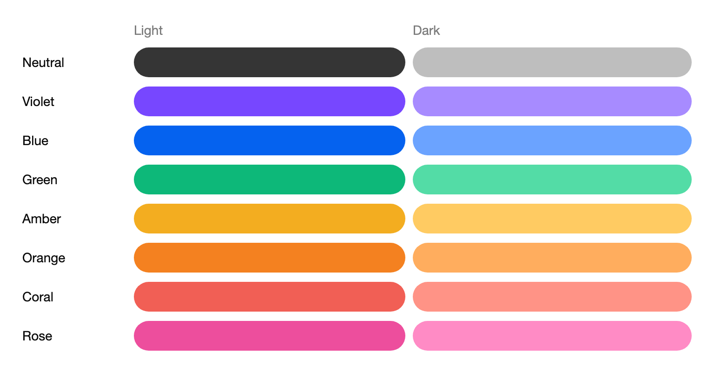
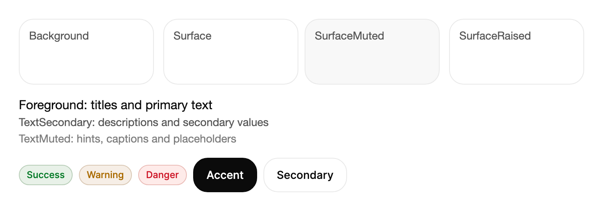

# 主題

TKCode.Arc 中的每一種顏色、圓角、陰影、字型大小和動態效果時長，都來自同一套設計權杖，即 ArcDesign 權杖。元件從不寫死數值，而是讀取權杖。因此，切換外觀（淺色或深色）、強調色或某一個權杖，都會一次重繪整個應用程式，並讓所有控制項維持一致。

本頁說明主題如何建構、如何在執行階段切換、有哪些權杖，以及如何在你自己的檢視與控制項中使用它們。

## 主題的建構方式

TKCode.Arc 建構在 AtomUI 的主題系統之上：

1. **AtomUI 的主題管理器**（`IThemeManager`）持有目前的主題，並將其套用到應用程式。主題是由 `ThemeConfigBuilder` 建立的 `ThemeConfig`。
2. **演算法**決定外觀：`ThemeAlgorithm.Default` 用於淺色，`ThemeAlgorithm.Dark` 用於深色。
3. **ArcDesign 識別**持有 Arc 自己的權杖。建構器上的 `WithArc(...)` 為該識別設定強調色、覆寫權杖並設定動態效果模式。
4. **控制項權杖**持有個別控制項的幾何參數（內距、寬度、位移），以及不依賴強調色的顏色。

套用主題時，每個權杖都會依外觀和強調色重新計算，讀取權杖的每個控制項都會就地更新：不需要重新載入頁面，也不需要重新啟動。

## 淺色與深色

建立主題設定，並透過主題管理器套用：

```csharp
using AtomUI;
using AtomUI.Theme;
using AtomUI.Theme.Algorithms;
using AtomUI.Theme.Configuration;
using TKCode.Arc;

public static async Task ApplyAppearanceAsync(bool dark, ArcAccentPreset accent)
{
    var builder = new ThemeConfigBuilder();
    builder = dark
        ? builder.WithAlgorithms(ThemeAlgorithm.Default, ThemeAlgorithm.Dark)
        : builder.WithAlgorithms(ThemeAlgorithm.Default);
    builder = builder.WithArc(arc => arc.Accent(accent));

    var manager = Application.Current!.GetThemeManager()!;
    await manager.ApplyThemeAsync(new ThemeRequest(IThemeManager.DEFAULT_THEME_ID, builder.Build(),
                                                   ThemeTransitionReason.UserRequest));
}
```

將使用者的選擇（淺色、深色或跟隨系統）保存在設定儲存區中，並在啟動時、主視窗顯示之前套用，使第一個畫面就具有正確的外觀。圖庫的外觀面板正是這樣運作的。

### ThemeSwitcher 控制項

對於頁首或工具列，`ThemeSwitcher` 是現成的淺色/深色切換開關，帶有 Arc 的頁面轉場效果（透過 `Variant` 設定 `Reveal`、`Eclipse`、`Split` 和 `Rise`）。按下時會觸發 `ThemeChangeRequested`。如果沒有處理常式將事件標示為已處理，切換器會自行切換 `ThemeAlgorithm.Dark`，並保留目前主題的其餘部分。當應用程式自行掌管外觀時（例如要儲存使用者的選擇），請處理該事件：

```csharp
themeSwitcher.ThemeChangeRequested += async (_, e) =>
{
    e.Handled = true;
    await settings.SaveAppearanceAsync(e.Next);
    await ApplyAppearanceAsync(e.Next == ThemeSwitcherAppearance.Dark, settings.Accent);
};
```

## 強調色

Arc 提供八種強調色預設。強調色驅動按鈕、選取狀態、焦點環、開關、滑桿、圖表數列和連結；其他部分維持中性，因此更換強調色只會改變品牌色，不會改變版面配置或文字的對比度。



```xml
<StackPanel Width="720" Spacing="10">
    <Grid ColumnDefinitions="120,*,*">
        <TextBlock Grid.Column="1" Text="Light" Foreground="{arc:ArcDesignTokenResource TextMuted}" />
        <TextBlock Grid.Column="2" Text="Dark" Foreground="{arc:ArcDesignTokenResource TextMuted}" />
    </Grid>
    <Grid ColumnDefinitions="120,*,*">
        <TextBlock Text="Neutral" VerticalAlignment="Center" Foreground="{arc:ArcDesignTokenResource Foreground}" />
        <Border Grid.Column="1" Height="32" CornerRadius="16" Margin="0,0,8,0" Background="#353535" />
        <Border Grid.Column="2" Height="32" CornerRadius="16" Background="#BEBEBE" />
    </Grid>
    <Grid ColumnDefinitions="120,*,*">
        <TextBlock Text="Violet" VerticalAlignment="Center" Foreground="{arc:ArcDesignTokenResource Foreground}" />
        <Border Grid.Column="1" Height="32" CornerRadius="16" Margin="0,0,8,0" Background="#7747FF" />
        <Border Grid.Column="2" Height="32" CornerRadius="16" Background="#A78BFF" />
    </Grid>
    <Grid ColumnDefinitions="120,*,*">
        <TextBlock Text="Blue" VerticalAlignment="Center" Foreground="{arc:ArcDesignTokenResource Foreground}" />
        <Border Grid.Column="1" Height="32" CornerRadius="16" Margin="0,0,8,0" Background="#0562EF" />
        <Border Grid.Column="2" Height="32" CornerRadius="16" Background="#6BA3FF" />
    </Grid>
    <Grid ColumnDefinitions="120,*,*">
        <TextBlock Text="Green" VerticalAlignment="Center" Foreground="{arc:ArcDesignTokenResource Foreground}" />
        <Border Grid.Column="1" Height="32" CornerRadius="16" Margin="0,0,8,0" Background="#0DB879" />
        <Border Grid.Column="2" Height="32" CornerRadius="16" Background="#53DCA6" />
    </Grid>
    <Grid ColumnDefinitions="120,*,*">
        <TextBlock Text="Amber" VerticalAlignment="Center" Foreground="{arc:ArcDesignTokenResource Foreground}" />
        <Border Grid.Column="1" Height="32" CornerRadius="16" Margin="0,0,8,0" Background="#F3AD20" />
        <Border Grid.Column="2" Height="32" CornerRadius="16" Background="#FFCB62" />
    </Grid>
    <Grid ColumnDefinitions="120,*,*">
        <TextBlock Text="Orange" VerticalAlignment="Center" Foreground="{arc:ArcDesignTokenResource Foreground}" />
        <Border Grid.Column="1" Height="32" CornerRadius="16" Margin="0,0,8,0" Background="#F48120" />
        <Border Grid.Column="2" Height="32" CornerRadius="16" Background="#FFAD5E" />
    </Grid>
    <Grid ColumnDefinitions="120,*,*">
        <TextBlock Text="Coral" VerticalAlignment="Center" Foreground="{arc:ArcDesignTokenResource Foreground}" />
        <Border Grid.Column="1" Height="32" CornerRadius="16" Margin="0,0,8,0" Background="#F15F55" />
        <Border Grid.Column="2" Height="32" CornerRadius="16" Background="#FF9386" />
    </Grid>
    <Grid ColumnDefinitions="120,*,*">
        <TextBlock Text="Rose" VerticalAlignment="Center" Foreground="{arc:ArcDesignTokenResource Foreground}" />
        <Border Grid.Column="1" Height="32" CornerRadius="16" Margin="0,0,8,0" Background="#ED4E9D" />
        <Border Grid.Column="2" Height="32" CornerRadius="16" Background="#FF8BC5" />
    </Grid>
</StackPanel>
```

| 預設 | 種子色 | 強調色，淺色 | 強調色，深色 | 較深強調色，淺色 |
|---|---|---|---|---|
| `Neutral`（預設） | `#353535` | `#353535` | `#BEBEBE` | `#1F1F1F` |
| `Violet` | `#7747FF` | `#7747FF` | `#A78BFF` | `#5528CE` |
| `Blue` | `#0562EF` | `#0562EF` | `#6BA3FF` | `#074DB7` |
| `Green` | `#0DB879` | `#0DB879` | `#53DCA6` | `#087C54` |
| `Amber` | `#F3AD20` | `#F3AD20` | `#FFCB62` | `#9C6300` |
| `Orange` | `#F48120` | `#F48120` | `#FFAD5E` | `#AA4700` |
| `Coral` | `#F15F55` | `#F15F55` | `#FF9386` | `#B92C27` |
| `Rose` | `#ED4E9D` | `#ED4E9D` | `#FF8BC5` | `#AE2570` |

每個預設都為兩種外觀提供了手工調校的值：強調色、用於文字和按下狀態的較深色階、用於選取背景的淡色調、強調色上的文字顏色，以及開關和核取方塊的顏色。

### 品牌色

當所有預設都不符合品牌時，直接傳入品牌色本身。Arc 會在 OKLCH 色彩空間中由它推導出淺色與深色的強調色系，使各個色階在視覺上保持均勻：

```csharp
builder = builder.WithArc(arc => arc.Accent(Color.Parse("#0E7C86")));
```

請在兩種外觀下檢查結果。非常淺的種子色（黃色、萊姆綠）在白色背景上作為文字顏色效果很差；這類情況請優先使用預設，或使用品牌色的較深色調。

## 設計權杖

權杖依其描述的內容分組。下列名稱是 `ArcDesignTokenKind` 的成員，XAML 中也以相同名稱參照。



```xml
<StackPanel Width="720" Spacing="16">
    <UniformGrid Columns="4">
        <Border Height="84" Margin="0,0,8,0" Padding="12" CornerRadius="{arc:ArcDesignTokenResource RadiusControl}"
                Background="{arc:ArcDesignTokenResource Background}"
                BorderBrush="{arc:ArcDesignTokenResource Border}" BorderThickness="1">
            <TextBlock Text="Background" Foreground="{arc:ArcDesignTokenResource TextSecondary}" />
        </Border>
        <Border Height="84" Margin="4,0" Padding="12" CornerRadius="{arc:ArcDesignTokenResource RadiusControl}"
                Background="{arc:ArcDesignTokenResource Surface}"
                BorderBrush="{arc:ArcDesignTokenResource Border}" BorderThickness="1">
            <TextBlock Text="Surface" Foreground="{arc:ArcDesignTokenResource TextSecondary}" />
        </Border>
        <Border Height="84" Margin="4,0" Padding="12" CornerRadius="{arc:ArcDesignTokenResource RadiusControl}"
                Background="{arc:ArcDesignTokenResource SurfaceMuted}"
                BorderBrush="{arc:ArcDesignTokenResource Border}" BorderThickness="1">
            <TextBlock Text="SurfaceMuted" Foreground="{arc:ArcDesignTokenResource TextSecondary}" />
        </Border>
        <Border Height="84" Margin="8,0,0,0" Padding="12" CornerRadius="{arc:ArcDesignTokenResource RadiusControl}"
                Background="{arc:ArcDesignTokenResource SurfaceRaised}"
                BorderBrush="{arc:ArcDesignTokenResource Border}" BorderThickness="1">
            <TextBlock Text="SurfaceRaised" Foreground="{arc:ArcDesignTokenResource TextSecondary}" />
        </Border>
    </UniformGrid>
    <StackPanel Spacing="4">
        <TextBlock Text="Foreground: titles and primary text" Foreground="{arc:ArcDesignTokenResource Foreground}" FontSize="16" />
        <TextBlock Text="TextSecondary: descriptions and secondary values" Foreground="{arc:ArcDesignTokenResource TextSecondary}" />
        <TextBlock Text="TextMuted: hints, captions and placeholders" Foreground="{arc:ArcDesignTokenResource TextMuted}" />
    </StackPanel>
    <StackPanel Orientation="Horizontal" Spacing="8">
        <arc:Badge Content="Success" Tone="Success" />
        <arc:Badge Content="Warning" Tone="Warning" />
        <arc:Badge Content="Danger" Tone="Danger" />
        <arc:Button Content="Accent" />
        <arc:Button Content="Secondary" Variant="Secondary" />
    </StackPanel>
</StackPanel>
```

| 分組 | 權杖 | 取值與用途 |
|---|---|---|
| 表面 | `Background`、`Surface`、`SurfaceMuted`、`SurfaceRaised`、`Scrim` | 頁面、卡片與欄位、弱化的底色區域、抬起的選單與彈出層，以及對話方塊背後的遮罩層。 |
| 文字 | `Foreground`、`TextSecondary`、`TextMuted` | 三級強調。`TextMuted` 只用於提示和說明文字，切勿用於讀者必須看到的資訊。 |
| 邊框 | `Border`、`BorderStrong`、`BorderSubtle` | 卡片外框、欄位框線與分隔線。 |
| 強調 | `Accent`、`AccentStrong`、`AccentSubtle`、`AccentForeground` | 品牌色、用於文字的較深色階、用於選取背景的淡色調，以及強調色上的文字。 |
| 控制項 | `ControlOn`、`ControlOnSubtle`、`ControlThumb`、`ControlThumbOn`、`ControlTrack`、`ControlTrackHover`、`ControlGlyph`、`ControlFill`、`ControlThumbShadow` | 開關、核取方塊、選項按鈕和滑桿。 |
| 狀態 | `Success`、`Warning`、`Danger` 及其 `…Subtle` 淡色調 | 結果、警告和錯誤；淡色調用於徽章與警示的背景。 |
| 資料 | `Series1` 至 `Series4`、`Neutral0` 至 `Neutral11` | 跟隨強調色的圖表數列，以及用於圖表與插圖的中性色階。 |
| 焦點 | `FocusRing`、`FocusRingWidth`（2）、`FocusRingOffset`（2） | 鍵盤焦點環。 |
| 形狀 | `RadiusControl`（18）、`RadiusPanel`（26）、`RadiusSurface`（34）、`RadiusPill` | 欄位與按鈕、卡片與面板、大型表面，以及膠囊形和徽章。 |
| 尺寸 | `ControlSizeSM`（36）、`ControlSizeMD`（44）、`ControlSizeLG`（50）；`GlyphSizeSM`（16）、`GlyphSizeMD`（20）、`GlyphSizeLG`（24）；`IconStrokeWidth` | `Small`、`Medium` 與 `Large` 三種尺寸對應的控制項高度，以及圖示尺寸。 |
| 間距 | `Space1`（4）至 `Space24`（96） | 以 4 px 為基準的間距刻度：4、8、12、16、20、24、32、40、48、64、80、96。 |
| 字級 | `TypeXS`（12）、`TypeSM`（14）、`TypeBase`（16）、`TypeLG`（18）、`TypeXL`（22）、`Type2XL`（28）、`Type3XL`（36）、`Type4XL`（52）、`Type5XL`（72） | 字級刻度。 |
| 字型樣式 | `BodyFontFamily`、`DisplayFontFamily`、`MonoFontFamily`、`WeightRegular`、`WeightMedium`、`LeadingBody`（1.4）、`LeadingDisplay`（1.1）、`TrackingBody`、`TrackingDisplay` | 內文與展示文字的字型家族、字重、行高和字距。 |
| 層級 | `ShadowResting`、`ShadowRaised`、`ShadowFloating` | 靜止的卡片、抬起的卡片與選單、浮動的對話方塊與彈出框。深色模式使用較深的陰影。 |
| 效果 | `BlurSubtle`、`BlurSoft`、`BlurText`、`BackdropBlurDialog`、`BackdropBlurDrawer`、`ReduceTransparency` | 動態模糊的步進，以及對話方塊和抽屜的毛玻璃背景。 |
| 動態 | `Duration…`、`Ease…`、`Spring…`、`Stagger…`、`MotionMode` | 時長、曲線、彈簧預設與動態效果級別。參見 **動態效果**。 |

## 在檢視中使用權杖

### 在 XAML 中

`ArcDesignTokenResource` 讀取權杖，並跟隨主題變化：

```xml
<Border Padding="16"
        Background="{arc:ArcDesignTokenResource Surface}"
        BorderBrush="{arc:ArcDesignTokenResource BorderSubtle}"
        BorderThickness="1"
        CornerRadius="{arc:ArcDesignTokenResource RadiusPanel}">
    <StackPanel Spacing="4">
        <TextBlock Text="本月用量"
                   FontSize="{arc:ArcDesignTokenResource TypeLG}"
                   Foreground="{arc:ArcDesignTokenResource Foreground}" />
        <TextBlock Text="已用 182 / 250 GB"
                   Foreground="{arc:ArcDesignTokenResource TextSecondary}" />
    </StackPanel>
</Border>
```

### 在程式碼中

`ArcTokens.Bind` 將屬性繫結到權杖，使其隨主題更新；`ArcTokens.Get` 和 `ArcTokens.GetColor` 讀取目前的值一次，例如在自訂的 `Render` 中繪製時使用：

```csharp
ArcTokens.Bind(card, Border.BackgroundProperty, ArcDesignTokenKind.Surface);
ArcTokens.Bind(title, TextBlock.ForegroundProperty, ArcDesignTokenKind.Foreground);

var accent = ArcTokens.GetColor(chart, ArcDesignTokenKind.Accent);
```

對於會持續顯示在螢幕上的內容，優先使用 `Bind` 而不是 `Get`：讀取一次的值不會在使用者切換到深色模式時改變。

### 控制項權杖

每個 Arc 控制項都有自己的權杖類別，用於讀取其幾何參數，在 XAML 中寫作 `{arc:<Control>TokenResource Name}`。例如，所有文字欄位都共用 `{arc:FieldTextBoxTokenResource SelectionFill}` 作為選取顏色。控制項權杖保存的值不依賴強調色，因此很少需要修改；撰寫一個應當與 Arc 欄位外觀一致的控制項時，請讀取這些權杖，而不是複製數值。

## 更改權杖

`WithArc` 可以覆寫任何 ArcDesign 權杖的最終值，並為整個主題設定動態效果模式：

```csharp
builder = builder.WithArc(arc => arc
    .Accent(ArcAccentPreset.Blue)
    .Token(nameof(ArcDesignTokenKind.Danger), "#D92D20")
    .MotionMode(ArcMotionLevel.Reduced));
```

請盡量少改。權杖的修改會套用到所有地方：覆寫 `Danger` 會改變應用程式中每一則錯誤訊息、每一個破壞性按鈕和每一個失敗狀態。顏色的覆寫值應在兩種外觀下檢查，因為深色模式不會重新計算該覆寫值。

## 圓角風格

Arc 的圓角偏大：控制項 18、面板 26、表面 34。如果產品想要更方的外觀，請改用圓角風格，而不是只覆寫四個 `Radius*`
權杖。這四個只是最上層：範本內部使用的圓角階梯、約 300 個控制項屬性各自的圓角權杖（核取方塊的方框、Combobox 的選項、
懸停選單列後面的高亮），以及某些控制項在動畫中自己計算的圓角，都是另外的值。只改那四個，彈層、懸停背景和核取方塊仍然是圓的。

`TKCode.Arc.Themes.Corners` 套件用一次呼叫改掉全部，並且只改圓角：顏色、描邊、陰影和動效保持不變。

```csharp
using TKCode.Arc.Themes.Corners;

builder = builder.WithArc(arc => arc
    .Accent(ArcAccentPreset.Blue)
    .Corners(ArcCornerStyle.Square, ArcCornerScope.All));
```

| 風格 | 結果 |
|---|---|
| `ArcCornerStyle.Default` | 保持 Arc 原樣，不寫入任何值。 |
| `ArcCornerStyle.Scale(0.5)` | 每個圓角乘以係數。`Scale(0)` 等於 `Square`，`Scale(1)` 等於 `Default`，大於 1 則更圓。 |
| `ArcCornerStyle.Square` | 所有圓角變為直角。 |

- **藥丸與圓形。** 半徑達到 999 及以上的（藥丸按鈕、圓形頭像、圓點）在 `Scale` 下保持形狀，只有 `Square` 會把它們變平，
  所以直角風格會把圓形頭像變成方形。想保留圓形，請用 `Scale`。
- **範圍。** `ArcCornerScope` 指明應用程式註冊了哪些控制項套件：`Controls`、`Blocks`、`Special`、`AdvancedCharts`、`Workflow`，
  或 `All`。點名了應用程式沒有註冊的套件，整次主題切換會失敗，所以只列實際使用的。
- **一次呼叫。** 後一次 `WithArc` 會取代前一次寫入的內容，所以像上面這樣把強調色和圓角風格放在同一次呼叫裡。
  只設定圓角時，可以用 `builder.WithArcCorners(style, scope)` 簡寫。
- **捲軸。** AtomUI 捲軸的滑塊出現在每個 Arc 彈層和捲動區域裡，所以圓角風格也會改變整個應用程式的捲軸滑塊，
  包括不屬於 Arc 的 AtomUI 控制項。
- **Pixel。** Pixel 風格建立在同一個套件上，始終是直角。

## 單一控制項的樣式

如需局部調整，請使用 Avalonia 的一般工具，而不是權杖：

- **屬性**：`Width`、`Margin`、`HorizontalAlignment` 以及各控制項有文件的屬性。
- **樣式**：使用如 `arc|Button.toolbar` 之類選取器的 `Style`，可以更改某個範圍內帶有該類別的每一個按鈕。
- **控制項主題**：以 Arc 主題為 `BasedOn` 的 `ControlTheme`，可以取代應用程式中某一類控制項的範本，同時保留 Arc 的狀態。

這些樣式中的顏色應繼續以權杖為基礎（`{arc:ArcDesignTokenResource ...}`），以便它們仍然跟隨外觀變化。

## 指導原則

**建議**

- 所有顏色都從權杖讀取。檢視中單獨一個十六進位值就是深色模式下的缺陷。
- 只為畫面上最重要的那一個操作或狀態使用強調色，其餘保持中性。
- 將狀態顏色與文字或圖示搭配使用。僅靠紅色框線無法說明錯誤，而且有些讀者分辨不出紅色與綠色的差別。
- 發佈前，請在淺色與深色下、至少使用兩種強調色測試每個畫面。

**避免**

- 將 `TextMuted` 用於讀者必須閱讀的資訊：它的對比度在三級文字中最低，僅適用於簡短提示和說明文字。
- 覆寫大量權杖，將函式庫改造成另一套設計系統：控制項的間距、圓角和動態效果是一起調校的。
- 在強調色背景上的文字寫死 `#FFFFFF`；應使用 `AccentForeground`，它在 Amber 這類淺色強調色上為深色。
